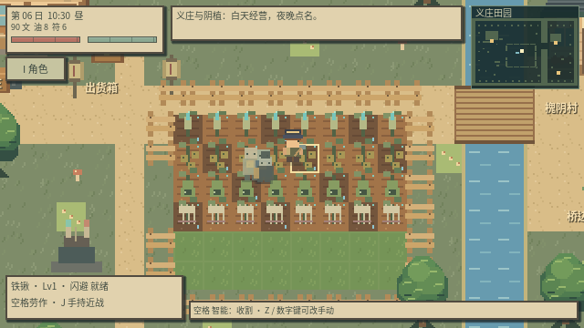
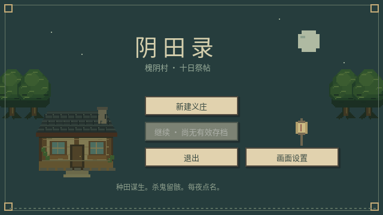
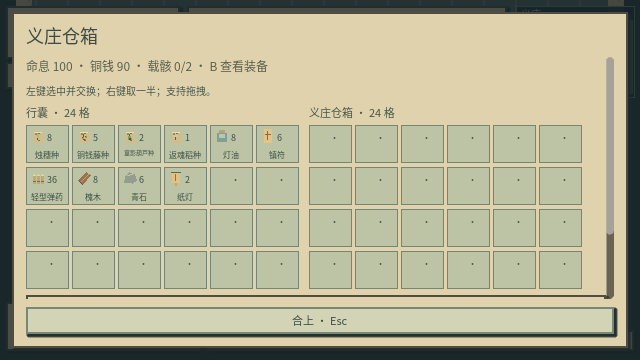
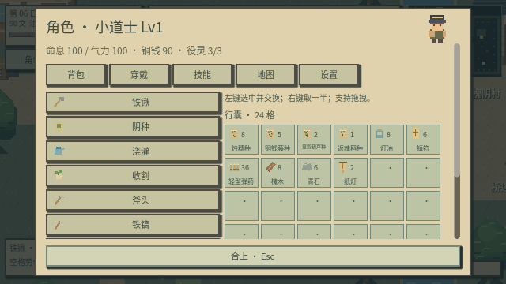
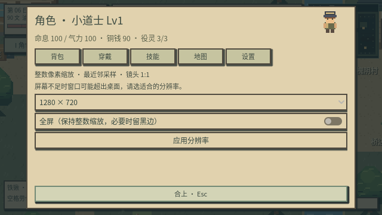
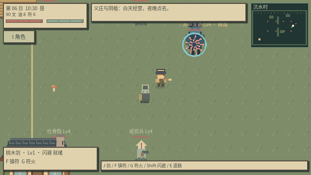
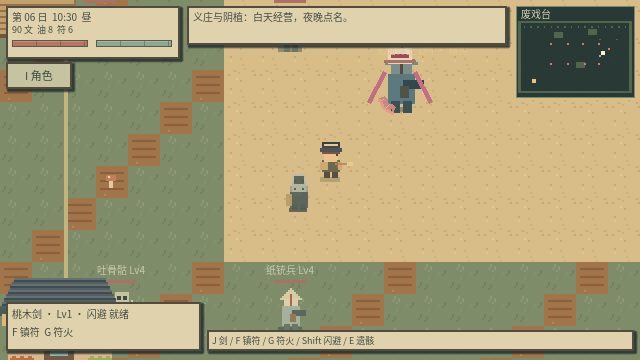
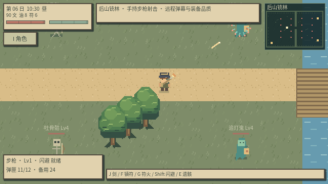
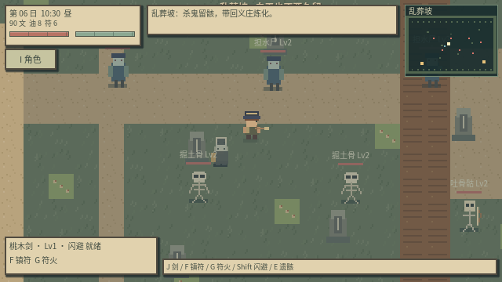
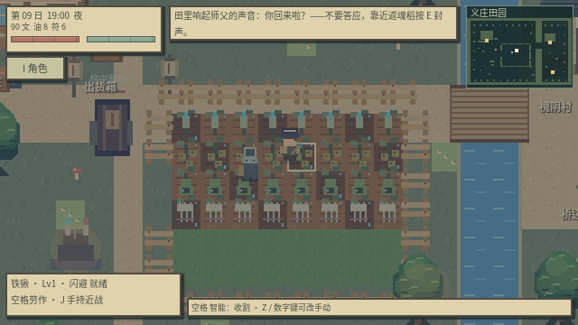

# 阴田录 v0.7 · 第一章：十日祭帖

**Godot 4.6 / 俯视角像素 2D / 中式诡异种田 / 道士养成 / 即时战斗 / 役灵经营**

一名刚出师的小道士，来到槐阴村接管义庄和阴田。师父留下三句话：田里长出人声，不要答应；驱使的东西，每夜都要点名；祠堂里的神，不是祖宗。



截图展示成熟作物和役灵；新游戏从空田、遗书与少量物资开始。

本版按用户指定的 [JevonLee/Stardew](https://github.com/JevonLee/Stardew) 的程序结构重构：角色状态机、物品资源、格子背包、仓箱、分层地图、场景管理、时钟、战斗、对话和存档组件。完整模块对应见 [docs/STARDEW_REFERENCE.md](docs/STARDEW_REFERENCE.md)。





## v0.7：清晰像素、角色界面与地图分支

取消午夜自动回家：24:00 后继续原地探索，次日 06:00 结算田地与供养，不传送、不恢复生命或气力；只有主动睡觉才恢复。每夜点名与灯油供养规则保留。

画面统一最近邻采样与整数缩放，镜头使用 1:1，移除小数倍物品缩放。标题的「画面设置」或角色「设置」页可选择 **1280×720 / 1920×1080 / 2560×1440** 与全屏，设置独立保存。无法整数铺满时保留黑边。

HUD 大幅缩小，右上小地图显示障碍、出口、敌人、役灵和自己。删除原 1–6 工具栏及按键绑定；**I / B** 打开统一角色界面，可查看状态、背包、工具、穿戴、统御技能、地图和画面设置。工具有名称和图标，点击后直接手持。**Tab** 打开地图页。

后山东北进入 **沉水村**，东南进入 **废戏台**，两张地图均为 1280×960。新增 **井中龙婆**（十八方向交错速度水弹）和 **无面伶王**（扇形弹幕与瞄准连射），保证装备掉落；击败后不会次日复活，也不影响主线棺中客的完成状态。

站到普通怪物遗骸上按 **V 顷刻炼化**，无需装车或返回义庄，消耗 2 灯油、要求完整度至少 60；首领遗骸用于拆解、埋田或超度。随从基础容量为 2，扩建义庄为 3，**Lv4 / 7 / 10 / 13 / 16 / 19** 各被动增加 1 位，最高 9 位。随从主动追击攻击，使用碰撞与网格寻路绕障；**C 驻守**时围绕接到命令的位置巡逻。






## v0.6：枪械、弹幕与装备

新增手枪、冲锋枪、步枪，独立弹匣、轻弹 / 步枪弹、装填、连射、后坐、枪口闪光与弹丸轨迹。新增吐骨骷、追灯鬼、纸铳兵、山魈，合计七类敌人；远程蓄力后使用扇形、环形或连续瞄准弹幕，精英和半血首领进一步强化。

击杀会留下遗骸、弹药与带品质的装备。武器与护甲独立穿戴，支持装备阶数、品质加成、护甲减伤和备用装备拆解；数值用统一公式计算。后山铳林地图为 1920×1280，是原探索地图面积的四倍，包含十六个敌人和两名精英。乱葬坡右下纸灯按 E 进入。

智能种田默认开启：面对田块按空格自动翻土、播种、浇水或收获，Z 切换，在角色背包中选择工具会关闭自动模式。角色背包显示名称、图标及数量，角色显示手持物品；斧头等农具可用于近战。

完整操作、数值公式与参考说明见 [战斗与掉落说明](docs/COMBAT_AND_LOOT.md)。



## v0.5 界面与战斗重构

统一纸色与墨绿的方角像素界面；重排命息、气力、时辰、资源、快捷工具与战斗提示。工具和行囊改用原创像素图标，补充树冠、瓦片与室内案台、卧榻细节，启用整数缩放与像素对齐。

桃木剑在起手 0.06 秒后的接触帧命中，剑弧与前方扇区使用同一范围，每次挥剑只结算一次。鼠标攻击朝点击方向瞄准。镇符、符火和敌方攻击受墙体阻挡；新增伤害数字、符术轨迹、受击闪烁、轻微受伤镜头反馈与闪避残影。角色与敌人有身体碰撞，闪避可穿过敌人，但不能穿墙。闪避方向优先采用当前移动方向。

已通过键鼠驱动的开局经营、乱葬坡战斗、载骸回家及案台炼化流程，并修复门口纸灯阻路。验证范围与结果见 [试玩记录](docs/PLAYTEST.md)。

## 下载与运行

1. 下载仓库根目录 **`yintian-godot.zip`**，解压。
2. 用 **Godot 4.6 标准版**导入 `yintian/godot/project.godot`。
3. 等待导入完成，按 **F5** 进入标题，选择 **新建义庄** 或 **继续**。

这是包含全部美术、中文字体与声音的源码工程，运行需要 Godot；不是独立 EXE。无需网络、.NET、插件或服务端。下载 Godot：[官方页面](https://godotengine.org/download/)。

## 第一版可玩的内容

- 48 块灵田，四种作物：**烛穗、铜钱藤、童影葫芦、返魂稻**。
- 可进入与扩建的义庄、杂货铺室内；制符、炼灯油、修阵、交易与手札。
- 24 格行囊与 24 格仓箱，堆叠、拆分、交换、拖拽、整理和跨容器存取。
- 斧头伐木、铁镐采石、掉落拾取；制作与放置纸灯和阵桩。
- **担水尸、掘土骨、葫芦童**三类役灵；葫芦童有食秽、提灯、伏影三个成长分支。
- 乱葬坡独立地图，行尸和骨怪的近身追击、攻击预兆。
- 桃木剑、镇符压制、符火、闪避；役灵跟随、驻守、集火。
- 击杀留下可保存的遗骸；查看完整度、残念、凶性、阴性，可原地顷刻炼化，也可装车带回。
- 遗骸可炼为役灵、拆材料、埋入空灵田、超度；用途互斥。
- 一次可预览收益和代价的虚构祭祀，以及可不祭祀的路线。
- 夜袭首领“棺中客”、十日线索、封镇 / 共处两种章末选择。
- 白昼和靛蓝夜色、原创环境音、供养失踪、禁种封声与农场外观变化。

目前是完整核心流程的垂直切片。义庄与杂货铺已有独立室内场景，经营菜单在案台 / 柜台使用。角色成长包含等级伤害、装备品质、被动统御和随从契合，尚无复杂主动技能树。后山铳林、沉水村和废戏台已可探索；封山古观，以及缝衣婆、纸兵、棺将独立收役种类尚未实现。十日内容已接入，但“1–2 小时”的时长尚未经过玩家测试。





## 操作

| 操作 | 按键 |
| --- | --- |
| 移动 | WASD / 方向键 |
| 面对田块劳作 | 空格；也可点击近处田块 |
| 铁锹 / 阴种 / 浇灌 / 收割 / 斧头 / 铁镐 | I → 背包中点击工具，也可滚轮切换 |
| 切换作物种子 | Q |
| 手持武器攻击 | J / 左键；枪械可按住连射，鼠标瞄准 |
| 剑 / 手枪 / 冲锋枪 / 步枪 | 7 / 8 / 9 / 0；需已拥有装备 |
| 装填 | U / 右键；空弹匣尝试射击也会装填 |
| 装备与拆解 | B → 穿戴；装备独立 20 位，材料行囊 24 格 |
| 智能劳作开关 | Z；角色背包或滚轮选择工具后进入手动模式 |
| 镇符压制 | F，消耗一张符；定身 3 秒，保留完整度 |
| 符火 | G，消耗一张符；30 伤害，完整度 -35 |
| 闪避 | Shift，短暂无敌，冷却 1.2 秒 |
| 互动 / 查看遗骸 / 寄灵作物 | 靠近并按 E |
| 每夜点名 | R，也可在义庄菜单选择 |
| 跟随 / 驻守 / 集火 | C 循环 |
| 等到 18:00 | 在农场按 T，界面确认 |
| 角色 / 地图 / 手札 / 暂停 | I / Tab / L / Esc |
| 原地顷刻炼化 | 站到遗骸上按 V；2 灯油、完整度 ≥60 |
| 环境音开关 | M |

农田入口在左侧栅栏缺口。村庄隔着河，走木桥过去；右下角纸灯标记通往乱葬坡。乱葬坡左下角纸灯可返回义庄。货箱在义庄右侧，祭坛在田地左下方。进入义庄后，案台用于经营，左侧仓箱存取，右侧卧榻休息；靠近出口按 E 返回院落。

## 建议的第一次游玩

1. 翻几块田，种烛穗并浇灌；烛穗 2 日成熟，可卖钱或炼成灯油。
2. 去乱葬坡，按 **7** 选择桃木剑、**F** 压制近敌，再用 **J** 击杀，保留完整遗骸。
3. 靠近遗骸按 **E** 查看并装车。车只能带 2 具，载骸时移速下降，装满还会引来追踪者。
4. 站到遗骸上按 **V**，用 2 灯油顷刻炼为役灵；也可按 E 选择装车、拆解或超度。
5. 把担水尸安排浇灌、掘土骨安排开荒；**每天睡前点名并准备灯油**。
6. 童影葫芦成熟后面对它按 **E**，选择陪伴方向和破壳；也可收割为材料。
7. 第六日后可查看祭祀预览；也可完全跳过祭祀，种田、超度和制符发展。
8. 祭祀后的夜晚或最迟第九夜，会发生义庄夜袭。击败棺中客后，第十日找桥边阿婆作出章末选择。

## 明确的风险规则

- 每位役灵每日需要 **1 灯油**；漏点名怨气 +20，缺供养 +25，错误工作 +8。
- 怨气达到 **60** 时失踪，农场污染 +15；重复点名不能无限降低怨气。
- 匹配工作提升契合；担水尸自动浇灌，掘土骨翻 3 块田，食秽童净化污染。提灯童更适合守夜，伏影童有更高战斗伤害。
- 返魂稻生长到第 2 阶段后，未封声时每天污染 +4，且成熟后不能直接收割。面对它按 E 用一张符封声，能停止异常并安全收获。
- 完整度低于 **60** 的遗骸不能炼为完整役灵；符火容易造成这种结果。
- 镇守可降低义庄内受到的伤害；污染会提高夜袭首领的生命。
- 被击倒时护命符将你送回义庄，损失 15 文；载骸掉在原区域的昏倒位置，可以再去取回。
- 首领在场时不能靠睡觉跳过夜袭。章末选择会改变镇守 / 役灵状态与院落阵纹，且本章不能反复更改。

祭祀在界面内以虚构资源与效果结算。

## 十日流程、范围与架构

详见 [docs/FIRST_CHAPTER.md](docs/FIRST_CHAPTER.md)。程序结构与参考对应见 [docs/STARDEW_REFERENCE.md](docs/STARDEW_REFERENCE.md)。模板沿用与许可记录见 [docs/TEMPLATE_RESEARCH.md](docs/TEMPLATE_RESEARCH.md)。

```text
godot/
  scenes/ui/           标题入口
  scenes/maps/         院落、义庄室内、杂货铺、乱葬坡
  scenes/actors/       道士与鬼物预制场景
  resources/items/     不同物品的 .tres 定义
  resources/weapons/   桃木剑、镇符、符火参数
  resources/crops/     四种阴植
  scripts/core/        场景、时钟、声音服务
  scripts/player_states/  动作状态机
  scripts/components/  分层地图、战斗、受击、存档、采集、拾取、放置
  scripts/inventory/   物品目录与容器模型
  scripts/ui/          标题、格子界面与逐句对话
  scripts/main.gd      游戏编排与经营菜单
  scripts/farm_state.gd   阴植、遗骸、役灵、祭祀与十日规则
```

## 存档与验证

存档格式为版本 5，自动迁移本作版本 3–4 的进度，兼容 v0.6 存档。新作存档为 **`user://yintian-save.json`**，不覆盖之前《青苔牧场》的存档。保存角色位置、区域、作物、役灵、遗骸、运输车、敌人状态、手札和章末选择。操作后、每 15 秒及正常关窗时保存。损坏存档会提示新建游戏，不导致崩溃。

```sh
# Linux 云环境
sh scripts/godot.sh --editor
sh scripts/godot.sh
# 隔离存档测试，不影响游戏进度
python scripts/test_game.py
# 制作新作压缩包
python scripts/package_game.py
```

`MOSSFIELD_RUNTIME_DIR` 是保留的启动脚本覆盖选项；默认存档和缓存位于仓库父目录 `.runtime/`。Windows / macOS 直接通过 Godot 导入即可。

美术和环境音由本项目生成；生成源在 `scripts/generate_art.py`、`generate_audio.py`。字体为重命名的 Noto CJK 字符子集，许可与模板 MIT 署名保留在 `godot/licenses/`。美术重生成需 Pillow，字体重生成需 fonttools；游戏运行均不需要它们。无声 / 无窗口验证不启用音频播放。

仓库仍保留早期网页原型与 `mossfield-godot.zip`，本版的下载文件是 **`yintian-godot.zip`**。

## 仓箱、采集与放置

- 在行囊 / 仓箱界面左键选中后点击目标格交换或堆叠，右键选中半份再点击目标格；也可以直接拖拽。
- 行囊和仓箱每格最多 99；关闭界面不会丢失选中的物品。材料入仓后需取回行囊才能用于制作和供养。
- 5 选择斧头，面对树按空格；6 选择铁镐，面对石头按空格。三次工具动作后产生掉落，靠近拾取。
- 案台制作纸灯需 2 槐木与 1 灯油，制作阵桩需 1 骨料与 1 青石。
- 在行囊选中纸灯 / 阵桩，点击放置按钮。绿色为可放区域，红色为阻挡；左键确认，Esc 取消。灵田内禁止占地，取消不消耗物品。
- 新建游戏会先确认并备份旧存档，暂停菜单可存档并返回标题。
