# 阴诡世界 v0.24 · 帧耗时优化与尸体重构

**Godot 4.6 / 俯视角像素 2D / 连续大地图 / 四方势力 / 装备探索 / 实时战斗 / 村民自卫与随从指挥**

旅人来到诡异缝合的异境，以义庄为营地，穿过界河与桥梁，探索装备、结识村民，介入四方势力的纷争。种田玩法已移除。

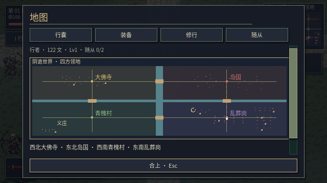

## v0.24：帧耗时优化与尸体重构

减少远处怪物关节更新，按视野分块绘制环境，使用邻近单位索引和更紧凑的寻路网格；共享树木材质，并将 225 张怪物部件贴图无损合入同一图集。目标 60 FPS，持续超预算时自动减少景深、光晕、草密度和衣物细分，战斗逻辑保持 60 Hz，远处实体战争继续运行。F3 显示帧率与当前画质档。

尸体使用原怪物的部件与死亡姿态，保留缺肢状态，加入倒地与地面投影；落地后停止逐帧更新，后续死亡不重建已有尸体。战争阵亡者同样留下遗体。支持旧档、读档和 E/V 就地处理，合并连续攻击的存档写入。

云端软件渲染实测：营地中位帧耗时约 **137→16 ms**，雨天战斗约 **153→20 ms**。该环境的雨战仍未稳达 60 FPS，不能据此承诺任意设备最低 60 帧。

[实测数据、尸体实机画面与验证](docs/PERFORMANCE_CORPSES_V024.md)

## v0.23：无缝领地与实体战争

6400×4800 的连续世界包含西北大佛寺、东北岛国、西南青槐村、东南乱葬岗；义庄、后山、沉水村与废戏台分布于相应领地。中央河网形成实体边界，四座桥梁连接各方，跨境保留同一场景与战斗对象。

军队在本方主城集结，实际行军、寻路过桥并与敌军交锋。玩家远离战场时仍运行同一套实体战斗；取消离屏扣血及入夜强制判胜。青槐村村民具备近战或远程自卫，驻守随从留在村内保护居民。

新游戏直接持武器；移除地块、农具、播种浇水、种子交易与种田日结。旧档保留装备、任务、随从等进度，种子和作物按每件 2 文折算，迁移仅执行一次。更名后的存档会读取旧《阴田录》目录，原文件保留。

[本版实机画面、规则与验证](docs/SEAMLESS_WORLD_V023.md) · [开源与素材来源](docs/ARPG_RESEARCH_V022.md) · [下载 Godot 源码工程](yintian-godot.zip)

解压后使用 Godot 4.6 打开 `godot/project.godot`。WASD 移动，左键轻击，右键近战重击，Shift 闪避，E 交互，滚轮切武器，B 装备，Tab 地图，P 势力，O 委托，H 随从。

以下章节为历史版本记录，其中种田与分图传送属于旧玩法。

## v0.22：像素美术与战斗表现重构

统一主角、NPC、23 类怪物、武器、植被与建筑图集。参考《八方旅人》的像素比例、分层遮挡、光照和地域配色，采用现有 2D 引擎实现立体布景；重整攻击蓄力、出手、收招时序和鼠标瞄准，装备页加入可切换的武器槽。

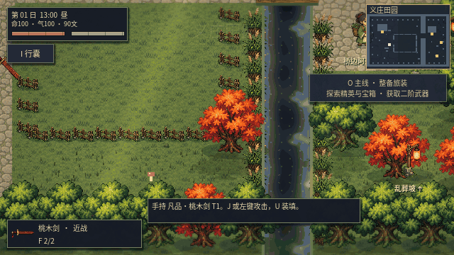

[本版画面与验证记录](docs/RESET_V022.md) · [开源研究、素材来源与许可](docs/ARPG_RESEARCH_V022.md)

## v0.21：初次守夜与换装体验

开局围绕“进入乱葬坡 → 击败两只异怪 → 返回义庄领取银剑 → 对比换装”形成短程闭环。任务栏、小地图与近处路点给出具体方向，完成状态随存档保存。乱葬坡第一天提供三类敌人，强化近身轮廓和蓄力提示。

装备页突出图标、伤害、距离与间隔，新奖励置顶并显示同类武器伤害差异；无随从时改为获取引导。旧地图与系统保留，本轮集中打磨开局。

[实机画面、试玩流程与验证记录](docs/FIRST_JOURNEY_V021.md)

## v0.20：怪物实体与地图交互重建

重绘23类怪物、大天狗四向动作、场景物件和地面。怪物改为独立关节节点，体型决定胶囊碰撞、避让、击退与寻路宽度；步相跟随实际位移，蓄力、发力、收招和受击停顿联动断肢位置。采用2D分层关节动画，大天狗另有四向源姿态。

十张地图统一出口、落点与地图标记，阻止隔墙交互，修正箱子抢占地标操作。后山营地可整备、枯井可解除异常、山门可疗养役灵，连接探索委托。

[实机画面、交互规则与验证记录](docs/MODELS_MAP_V020.md)

## v0.19：重击、武器素材与随从指挥

右键近战重击加入独立前摇、发力、命中停顿与击退；行走补充脚步着地、重心和握点联动。重制怪物图集与12种武器素材，更新命中、技能特效和战斗音效。草叶修正朝向并降低密度、高度和地面纹理对比度。

随从出战不再受点数限制，`H` 支持全员随行、智能驻村和休整，也可指定随从守护村民。驻村随从在玩家离开后仍参与守卫。势力冲突增加离屏伤亡、选边支援、存活战报及贡献奖励。

[实机动图、操作说明与验证记录](docs/ACTION_COMMAND_V019.md)

## v0.18：移动、攻击衔接与探索主线

攻击中可以走位，闪避可取消攻击和装填，近战伤害与挥击时机同步；重做武器轨迹、命中停顿、位移驱动的行走，以及怪物关节和阴影动态。滚轮换武器显示当前状态条，点击物品直接查看简介，大地图标注出口与地点，水面增加深浅变化、流波、岸沫和雨圈。

尸体运输已移除，旧运输遗骸迁回义庄院落。种田转为可选休闲内容；`O` 查看装备获取、异境探索和四方制衡阶段目标，`P` 查看战况、援助弱方。

[具体调整与玩家视角实测](docs/PLAYER_POLISH_V018.md)

## v0.17：日系 RPG 角色、外观定制与活草地

采用偏《八方旅人》的紧凑像素比例，重新设计两套主角、23 类怪物与六位村民，统一建筑、树木、石路和地面材质。主角四向八帧行走、六帧攻击，部分方向镜像复用；外观界面支持姓名、基础造型和七组配色，旧存档自动迁移。怪物按透明部位层驱动关节动画，断肢与当前动作共用位置、翻转、角度和缩放。

草叶随风摆动，经过时压弯、随后回弹；采用分块实例化和视野剔除，避开道路、水面、耕地和室内。地图、雨水、阴影和原有玩法继续联动。

[实机动图、外观界面、全怪物预览和验证说明](docs/JRPG_V017.md)

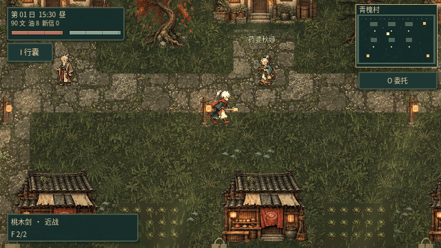

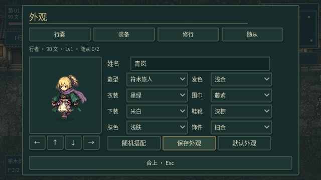

## v0.16：参考角色、动作与断肢接入

按本轮参考图换入白发蓝衣主角与鸦翼大天狗：主角四向 24 姿态，大天狗四向 16 姿态；23 类敌人统一为更细腻的志怪像素外观。新动作与装备、受击、闪避、断肢和役灵外观接通，保留断腿减速及断头慌乱、无法攻击的行为。其他敌人目前使用新立绘与程序化分段动画。

[实机截图、全敌人预览与实现说明](docs/ACTORS_V016.md)

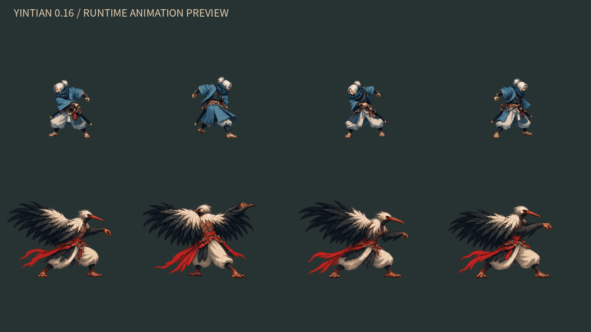

## v0.15：HD-2D 方向的光照与风雨细节

继续参考《八方旅人》的像素与光影层次：光照加入墙体遮挡、暖窗冷雨与浅层投影；路面加入积水、实际精灵倒影、水花和脚步涟漪；树冠、芦苇和落叶随风运动，砍树后同步移除阴影与倒影。室内保持干燥，暂停时环境动态冻结。

主角改为 32×48 源帧，补充衣袍与轮廓明暗；树冠、树皮、瓦沟、苔痕和墙面继续细化。玩法、存档和原有交互继续兼容。

[实机动图、前后对比和详细说明](docs/WEATHER_V015.md)

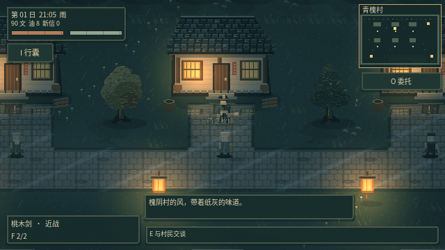

## v0.14：16-bit 志怪美术重构

首轮实机美化已接入：28 张新素材图集、分区域地形、连接式石路、灰瓦木屋、暖色纸灯、人物与 23 类敌人统一图集，以及墨青旧金 UI。夜间窗光与纸灯参与局部照明，区域薄雾保留战斗视野；耕作、战斗与旧存档继续兼容。

青槐村样板、义庄前后对比和各区域实机截图见 [美术重构说明](docs/ART_V014.md)。

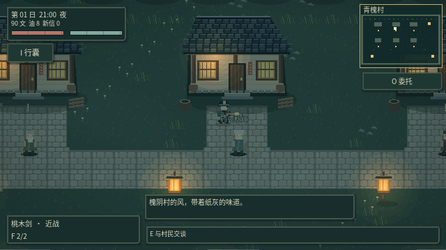

## v0.13：大佛寺与文殊般若剑

青槐村北山道新增 **1600×1280 大佛寺**，含施食庭、塔林、梦障院、修罗道场、护法殿，两处探索宝箱。大佛寺加入第四势力，按 P 查看四方局势。

- **饿鬼**吞骸回血、近身夺气；**幽魂**虚化抗刀枪，镇符显形；**罗刹**幻身绕侧并持毒刃；**鸠槃茶**以梦压飞珠减速夺气。
- **阿修罗**交替使用六臂剑阵与战火，半血加速；击败后解封**夜叉**，应对护障、疾刺和三叉投锋。
- **文殊般若剑**是可装备的近战神器，随角色修为成长，每次命中同时触发燃烧、冰冻、闪电，神器三相共存；独立金色剑光与三色轨迹。
- 五段委托 **北山梵影 → 四障异闻 → 止息修罗 → 守藏之问 → 般若开锋**，由砚青、秋婶、柳伯和阿祁衔接。先找砚青接取，最终向阿祁领取神器。
- 旧存档自动迁移，保留原有三方势力、装备和任务进度，加入佛寺档案与第四势力。

详见 [大佛寺版本说明](docs/TEMPLE_V013.md)。

## v0.12：三方势力战争

岛国、乱葬岗、青槐村各有兵力与物资，强势力更容易侵袭弱势力，出兵规模和战败掠夺随实力差距增大。三方均能相互出兵；正午交战，入夜结算，玩家可前往守方地图参战。每日恢复、有限远征和最低兵力使弱方有恢复机会。

按 **P** 查看实时局势和最近战报，也可从暂停菜单、村民对话进入；每日可花 30 文支援青槐村。队伍以势力色环和地图色点区分，村民兵优先攻击敌军。战事、双方生命与物资损耗均存档，兼容旧版本。

规则与验证见 [势力系统说明](docs/FACTIONS_V012.md)。

## v0.11：诡异缝合世界 · 岛国异闻

裂海把不同地域的传说与地貌缝在同一片世界。青槐村与义庄仍是归处，村东渡船通向岛国的苇岸、荒冢、风山、双面社。异闻线与原十日主线并存。

- **岛国地图**：2240×1600，渡船往返、河桥、苇岸水塘、荒冢和鸟居祭场；三处首领依次解封，击败记录跨天保留。
- **五种小怪**：河童依水恢复且头皿可封；提灯妖怪长舌惊扰、纸躯易燃；一本踏鞴独足跳进重锤；络新妇蛛网减速；丛原火是耐火的无躯妖火。
- **三位首领**：以津真天的金羽毒鸣随未葬遗骸增强；大天狗以羽扇山岚推击、蓄势风障减伤；两面宿傩采用双面四臂武人形象，双向剑斩与弓阵交替。
- **伊佩塔姆**：阿伊努嗜血自走之刃意象转化的唯一近战神器。独立血色与青色三重刀弧；按实际造成伤害吸血；仅自身剑击击杀成长，每 5 杀升一级，最高 10 级，提高伤害与吸血。不可拆解。
- **六环委托**：砚青的渡海与五妖调查 → 秋婶的亡骸哀鸣 → 砚青的风山修验 → 柳伯的双面试炼 → 阿祁见证神器契约。前置需复命，奖励只领一次，装备位满时保留奖励。

[岛国世界观、怪物机制与神器规则](docs/ISLAND_V011.md)

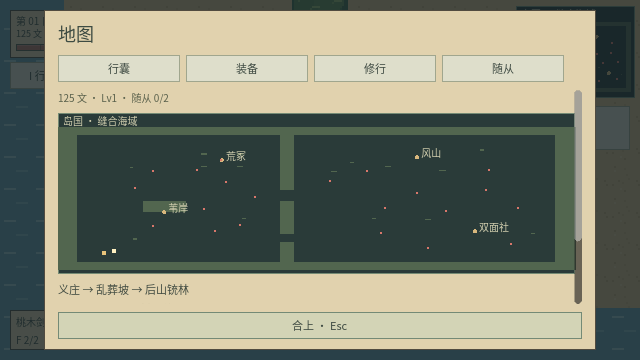
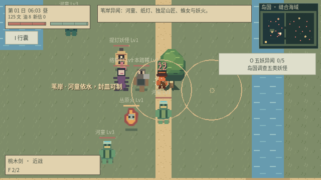
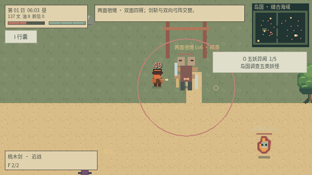
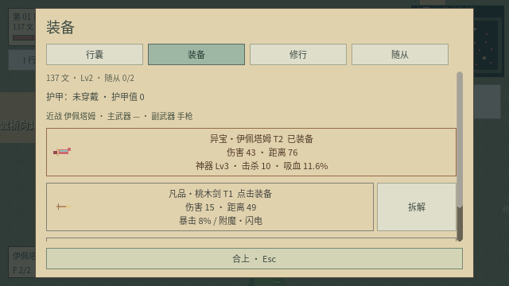

## v0.10：元素武器、探索宝箱与离线 NPC（历史记录，以 v0.15 为准）

- **六种新武器**：鞭子的长距扇扫、银剑的重斩、六发左轮、起转后持续射击的加特林、耗气力的魔法书与咒术娃娃。铁匠、掉落、宝箱和委托均可获得。
- **随机元素附魔**：武器获取时随机带燃烧 / 冰冻 / 闪电，命中时触发；与既有暴击 / 重伤并存。火冰相互消解，闪电仅跳向可见敌人，不穿墙。
- **地图逻辑**：主路串联出口、河桥与分支，营地—枯井—山门形成支路环线；七处地图宝箱有附近守卫检查，领取后存档，不重复刷新。
- **离线 NPC**：身份、话题记忆、伤势、袭击状态和委托进度驱动交谈；支持自由输入关键词与话题按钮。完全离线的规则系统，无接口和密钥，不是本地大语言模型。
- **委托与任务栏**：清怪、交付物资、调查遗迹四项委托；O 查看，HUD 追踪一条。向正确 NPC 复命，背包满时保留报酬，奖励不能重复领。
- **断头行为**：生命降至 15% 后的实体攻击可断头；立即取消攻击、连射和冲锋，随机乱窜，无法再攻击。断腿减速与断肢存档保留。

详细规则与武器表见 [v0.10 说明](docs/ADVENTURE_V010.md)。参考方向与网页访问限制见 [设计记录](docs/research/EXPLORATION_AND_ARSENAL.md)。

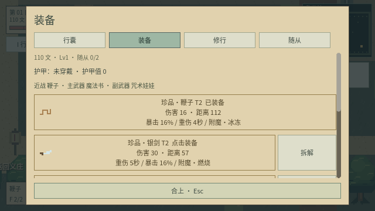
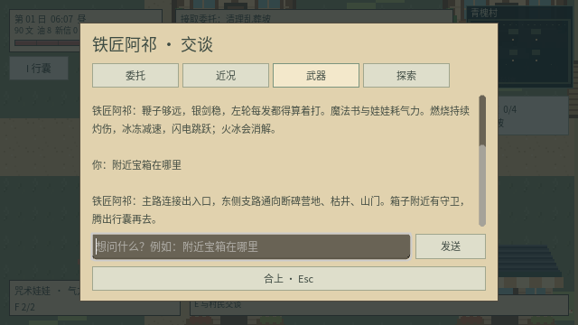
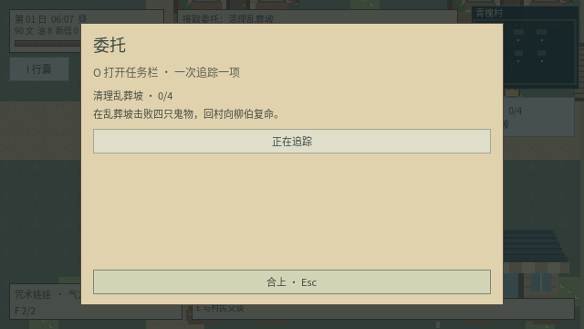
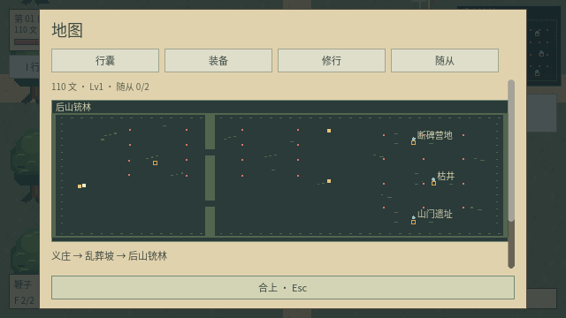

## v0.9：精简交互、天生词条与断肢（历史记录，以 v0.10 为准）

- **四个主入口**：行囊、装备、修行、随从。导航固定在滚动区外；农具按需打开，物品放置 / 丢弃只在选中适用物品时出现。地图 Tab、书信 K 和设置移到暂停页，操作帮助单独查看。
- **装备词条自带**：凡品与灵纹武器自带一个词条，珍品与异宝自带两个不同词条。掉落、购买、奖励共用生成规则；移除铭刻界面、材料与货币消耗。旧存档无词条武器加载时自动补齐，已有词条保留。
- **免费炼化**：普通怪物与 Boss 均不消耗灯油或其他材料。完整度至少 60、随从容量限制仍保留，失败不吞遗骸。供养、训练和疗养仍使用各自资源。
- **命中反馈与断肢**：近战 / 枪击带来命中闪白、方向性击退、短暂停顿、火花与血条残影。实体攻击使敌人生命降至 60% / 30% 时分别断臂 / 断腿；断臂攻击伤害降低 25%，断腿移动速度降低 38%。碎肢使用怪物自身像素素材抛落后渐隐；状态随存档保存，不降低遗骸完整度。
- **后山扩展**：2880×1920，比 v0.8 面积增加 125%；新增断碑营地、枯井和山门遗址、第二座河桥及连接道路。共 28 个敌人、4 个精英；旧存档当日也能立即进入新增遭遇。

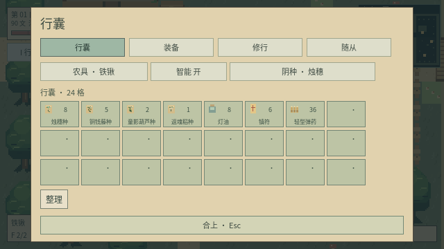
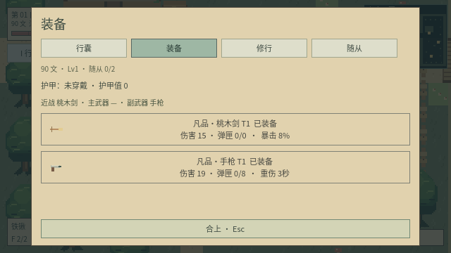
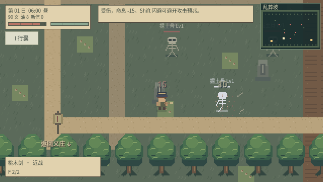
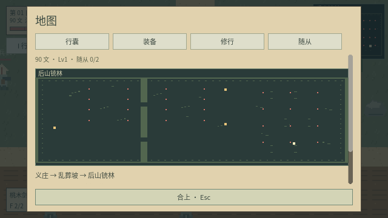

运行 `python3 scripts/test_game.py` 验证完整游戏流程；新增 `godot/tests/test_redesign.gd` 覆盖简化界面、零耗材炼化、断肢、地图路径和旧存档迁移。

## v0.8：技能树、随从成长与村庄救援（历史记录，以 v0.9 为准）

- **滚轮切换近战 / 主武器 / 副武器**；桃木剑、冲锋枪或步枪、手枪分别占对应栏位。角色「穿戴」页点击装备分配栏位，换枪取消装填并保留每把枪的弹匣；滚轮不再切换农具。
- **技能树**：镇符起始一阶，二级花技能点学习符火；还有调息与统御，每项最多三阶。F 镇符消耗 12 体力，G 符火消耗 22；各有 2 次充能，基础 12 / 18 秒恢复一次。两者不耗符箓，农田封声也使用镇符充能。体力缓慢恢复，暂停时停止充能。
- **随从管理 H**：独立生命条、受击与倒下、升级经验、训练、疗养、出战 / 召回、确认解散。小怪与三位 Boss 全部可以炼化，继承各自一个主动和被动技能；炼化后使用削弱过的随从数值，不保留敌方 Boss 的巨量生命与攻击。出战上限 **3 点**，普通随从 1 点、Boss 2 点；安置容量仍随等级和统御成长。
- **敌人强化**：每类敌人都有主动与被动，首领增加生命、伤害、抗控制与阶段强化；遇到障碍会寻路追击，不站在墙后无效射击。
- **青槐村**：义庄东侧纸灯按 E 前往，六位有姓名、有生命的村民，铁匠交易和救治互动。每 3 日收到求救信，K 阅读；当日 18:00 夜袭，次日 06:00 前清敌救援。成功获得 30 文和声望，失败会使村庄受损、村民受伤。
- **更少装备、更多补给**：普通敌人装备概率 12%，精英 35%，Boss 65%；装备中枪械合计仅 10%。弹药必掉，常见材料概率 75%。武器可掉落暴击 / 重伤词条，也可在穿戴页「铭刻词条」消耗 20 文与 2 零件添加，最多两个不同词条。

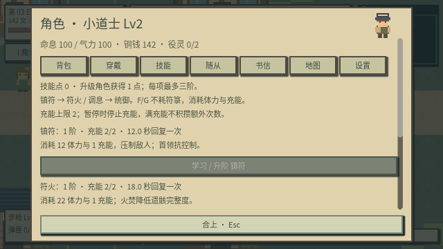

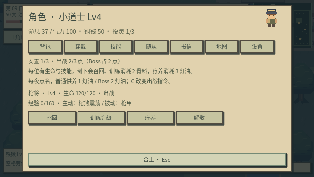
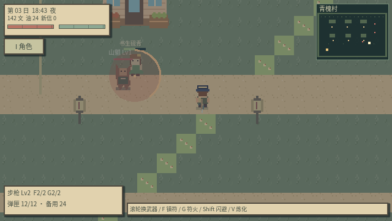
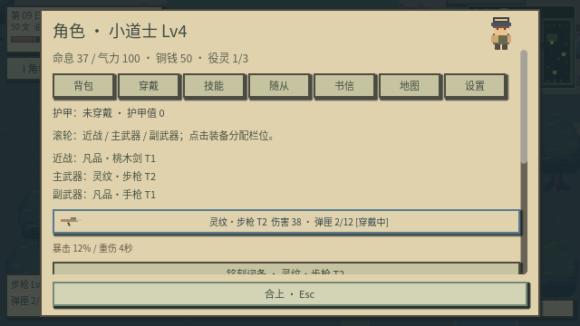

本版已完成实际键鼠驱动的玩家试玩：进村交易、学习技能、换武器、救援、炼化与训练、解散、击败满生命强化首领、炼化首领、随从受击倒下与复出、铭刻与真实暴击 / 重伤、存档恢复。试玩使用第 3 日二级角色和第 9 日四级角色两组准备场景，具体记录见 [PLAYTEST](docs/PLAYTEST.md)。

## v0.7：清晰像素、角色界面与地图分支（历史记录，当前规则以 v0.8 为准）

取消午夜自动回家：24:00 后继续原地探索，次日 06:00 结算田地与供养，不传送、不恢复生命或气力；只有主动睡觉才恢复。每夜点名与灯油供养规则保留。

画面统一最近邻采样与整数缩放，镜头使用 1:1，移除小数倍物品缩放。标题的「画面设置」或角色「设置」页可选择 **1280×720 / 1920×1080 / 2560×1440** 与全屏，设置独立保存。无法整数铺满时保留黑边。

**Godot 编辑器嵌入运行时，外部窗口大小由编辑器控制。** 在角色「设置」中选择分辨率后，点击「独立窗口运行」：保存当前进度、打开独立游戏窗口并结束旧的嵌入运行。独立窗口可以应用所选尺寸；全屏使用桌面分辨率，退出全屏后恢复所选窗口尺寸。应用按钮会显示实际结果。

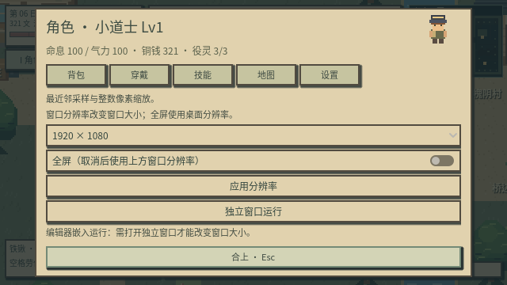

HUD 大幅缩小，右上小地图显示障碍、出口、敌人、役灵和自己。删除原 1–6 工具栏及按键绑定；**I / B** 打开统一角色界面，可查看状态、背包、工具、穿戴、统御技能、地图和画面设置。工具有名称和图标，点击后直接手持。**Tab** 打开地图页。

后山东北进入 **沉水村**，东南进入 **废戏台**，两张地图均为 1280×960。新增 **井中龙婆**（十八方向交错速度水弹）和 **无面伶王**（扇形弹幕与瞄准连射），保证装备掉落；击败后不会次日复活，也不影响主线棺中客的完成状态。

站到普通怪物遗骸上按 **V 顷刻炼化**，无需装车或返回义庄，消耗 2 灯油、要求完整度至少 60；首领遗骸用于拆解、埋田或超度。随从基础容量为 2，扩建义庄为 3，**Lv4 / 7 / 10 / 13 / 16 / 19** 各被动增加 1 位，最高 9 位。随从主动追击攻击，使用碰撞与网格寻路绕障；**C 驻守**时围绕接到命令的位置巡逻。


## v0.6：枪械、弹幕与装备（历史记录）

新增手枪、冲锋枪、步枪，独立弹匣、轻弹 / 步枪弹、装填、连射、后坐、枪口闪光与弹丸轨迹。新增吐骨骷、追灯鬼、纸铳兵、山魈，合计七类敌人；远程蓄力后使用扇形、环形或连续瞄准弹幕，精英和半血首领进一步强化。

击杀会留下遗骸、弹药与带品质的装备。武器与护甲独立穿戴，支持装备阶数、品质加成、护甲减伤和备用装备拆解；数值用统一公式计算。后山铳林地图为 1920×1280，是原探索地图面积的四倍，包含十六个敌人和两名精英。乱葬坡右下纸灯按 E 进入。

智能种田默认开启：面对田块按空格自动翻土、播种、浇水或收获，Z 切换，在角色背包中选择工具会关闭自动模式。角色背包显示名称、图标及数量，角色显示手持物品；斧头等农具可用于近战。

完整操作、数值公式与参考说明见 [战斗与掉落说明](docs/COMBAT_AND_LOOT.md)。


## v0.5 界面与战斗重构

统一纸色与墨绿的方角像素界面；重排命息、气力、时辰、资源、快捷工具与战斗提示。工具和行囊改用原创像素图标，补充树冠、瓦片与室内案台、卧榻细节，启用整数缩放与像素对齐。

桃木剑在起手 0.06 秒后的接触帧命中，剑弧与前方扇区使用同一范围，每次挥剑只结算一次。鼠标攻击朝点击方向瞄准。镇符、符火和敌方攻击受墙体阻挡；新增伤害数字、符术轨迹、受击闪烁、轻微受伤镜头反馈与闪避残影。角色与敌人有身体碰撞，闪避可穿过敌人，但不能穿墙。闪避方向优先采用当前移动方向。

已通过键鼠驱动的开局经营、乱葬坡战斗、载骸回家及案台炼化流程，并修复门口纸灯阻路。验证范围与结果见 [试玩记录](docs/PLAYTEST.md)。

## 下载与运行

1. 下载仓库根目录 **`yintian-godot.zip`**，解压。
2. 用 **Godot 4.6 标准版**导入 `yintian/godot/project.godot`。
3. 等待导入完成，按 **F5** 进入标题，选择 **新建义庄** 或 **继续**。

这是包含全部美术、中文字体与声音的源码工程，运行需要 Godot；不是独立 EXE。无需网络、.NET、插件或服务端。下载 Godot：[官方页面](https://godotengine.org/download/)。

## 第一版可玩的内容

- 48 块灵田，四种作物：**烛穗、铜钱藤、童影葫芦、返魂稻**。
- 可进入与扩建的义庄、杂货铺室内；制符、炼灯油、修阵、交易与手札。
- 24 格行囊与 24 格仓箱，堆叠、拆分、交换、拖拽、整理和跨容器存取。
- 斧头伐木、铁镐采石、掉落拾取；制作与放置纸灯和阵桩。
- **担水尸、掘土骨、葫芦童**三类役灵；葫芦童有食秽、提灯、伏影三个成长分支。
- 乱葬坡独立地图，行尸和骨怪的近身追击、攻击预兆。
- 桃木剑、镇符压制、符火、闪避；役灵跟随、驻守、集火。
- 击杀留下可保存的遗骸；查看完整度、残念、凶性、阴性，可原地顷刻炼化，也可装车带回。
- 遗骸可炼为役灵、拆材料、埋入空灵田、超度；用途互斥。
- 一次可预览收益和代价的虚构祭祀，以及可不祭祀的路线。
- 夜袭首领“棺中客”、十日线索、封镇 / 共处两种章末选择。
- 白昼和靛蓝夜色、原创环境音、供养失踪、禁种封声与农场外观变化。

目前是完整核心流程的垂直切片。义庄与杂货铺已有独立室内场景，经营菜单在案台 / 柜台使用。角色成长包含等级伤害、装备品质、被动统御和随从契合，当前提供四节点技能树。后山铳林、沉水村和废戏台已可探索；封山古观，缝衣婆等独立敌人种类尚未实现；纸铳兵与棺中客已可收役。十日内容已接入，但“1–2 小时”的时长尚未经过玩家测试。


## 操作

| 操作 | 按键 |
| --- | --- |
| 移动 | WASD / 方向键 |
| 面对田块劳作 | 空格；也可点击近处田块 |
| 铁锹 / 阴种 / 浇灌 / 收割 / 斧头 / 铁镐 | I → 背包中点击工具，滚轮只切换武器 |
| 切换作物种子 | Q |
| 手持武器攻击 | J / 左键；枪械可按住连射，鼠标瞄准 |
| 剑 / 手枪 / 冲锋枪 / 步枪 | 7 / 8 / 9 / 0；需已拥有装备 |
| 装填 | U / 右键；空弹匣尝试射击也会装填 |
| 装备与拆解 | B → 穿戴；装备独立 20 位，材料行囊 24 格 |
| 智能劳作开关 | Z；角色背包选择工具后进入手动模式 |
| 镇符技能 | F，12 体力与 1 充能；普通敌人压制 3 秒，Boss 0.65 秒 |
| 符火技能 | 技能树学习后 G，22 体力与 1 充能；基础 30 伤害，完整度 -35 |
| 闪避 | Shift，短暂无敌，冷却 1.2 秒 |
| 互动 / 查看遗骸 / 寄灵作物 | 靠近并按 E |
| 每夜点名 | R，也可在义庄菜单选择 |
| 跟随 / 驻守 / 集火 | C 循环 |
| 随从管理 / 村庄书信 | H / K |
| 三栏武器切换 | 鼠标滚轮；主武器需先在穿戴页装备 |
| 等到 18:00 | 在农场按 T，界面确认 |
| 角色 / 地图 / 手札 / 暂停 | I / Tab / L / Esc |
| 任务栏 / 宝箱 | O 查看委托 / 靠近宝箱 E 开启 |
| 原地顷刻炼化 | 站到遗骸上按 V；无需耗材、完整度 ≥60 |
| 环境音开关 | M |

农田入口在左侧栅栏缺口。村庄隔着河，走木桥过去；右下角纸灯标记通往乱葬坡。乱葬坡左下角纸灯可返回义庄。货箱在义庄右侧，祭坛在田地左下方。进入义庄后，案台用于经营，左侧仓箱存取，右侧卧榻休息；靠近出口按 E 返回院落。

## 建议的第一次游玩

1. 翻几块田，种烛穗并浇灌；烛穗 2 日成熟，可卖钱或炼成灯油。
2. 去乱葬坡，按 **7** 选择桃木剑、**F** 压制近敌，再用 **J** 击杀，保留完整遗骸。
3. 靠近遗骸按 **E** 查看并装车。车只能带 2 具，载骸时移速下降，装满还会引来追踪者。
4. 站到遗骸上按 **V**，用 2 灯油顷刻炼为役灵；也可按 E 选择装车、拆解或超度。
5. 把担水尸安排浇灌、掘土骨安排开荒；**每天睡前点名并准备灯油**。
6. 童影葫芦成熟后面对它按 **E**，选择陪伴方向和破壳；也可收割为材料。
7. 第六日后可查看祭祀预览；也可完全跳过祭祀，种田、超度和制符发展。
8. 祭祀后的夜晚或最迟第九夜，会发生义庄夜袭。击败棺中客后，第十日找桥边阿婆作出章末选择。

## 明确的风险规则

- 每位役灵每日需要 **1 灯油**；漏点名怨气 +20，缺供养 +25，错误工作 +8。
- 怨气达到 **60** 时失踪，农场污染 +15；重复点名不能无限降低怨气。
- 匹配工作提升契合；担水尸自动浇灌，掘土骨翻 3 块田，食秽童净化污染。提灯童更适合守夜，伏影童有更高战斗伤害。
- 返魂稻生长到第 2 阶段后，未封声时每天污染 +4，且成熟后不能直接收割。面对它按 E 用一张符封声，能停止异常并安全收获。
- 完整度低于 **60** 的遗骸不能炼为完整役灵；符火容易造成这种结果。
- 镇守可降低义庄内受到的伤害；污染会提高夜袭首领的生命。
- 被击倒时护命符将你送回义庄，损失 15 文；载骸掉在原区域的昏倒位置，可以再去取回。
- 首领在场时不能靠睡觉跳过夜袭。章末选择会改变镇守 / 役灵状态与院落阵纹，且本章不能反复更改。

祭祀在界面内以虚构资源与效果结算。

## 十日流程、范围与架构

详见 [docs/FIRST_CHAPTER.md](docs/FIRST_CHAPTER.md)。程序结构与参考对应见 [docs/STARDEW_REFERENCE.md](docs/STARDEW_REFERENCE.md)。模板沿用与许可记录见 [docs/TEMPLATE_RESEARCH.md](docs/TEMPLATE_RESEARCH.md)。

```text
godot/
  scenes/ui/           标题入口
  scenes/maps/         院落、义庄室内、杂货铺、乱葬坡
  scenes/actors/       道士与鬼物预制场景
  resources/items/     不同物品的 .tres 定义
  resources/weapons/   桃木剑、镇符、符火参数
  resources/crops/     四种阴植
  scripts/core/        场景、时钟、声音服务
  scripts/player_states/  动作状态机
  scripts/components/  分层地图、战斗、受击、存档、采集、拾取、放置
  scripts/inventory/   物品目录与容器模型
  scripts/ui/          标题、格子界面与逐句对话
  scripts/main.gd      游戏编排与经营菜单
  scripts/farm_state.gd   阴植、遗骸、役灵、祭祀与十日规则
```

## 存档与验证

存档格式为版本 8，自动迁移本作版本 3–7 的进度。旧随从迁移时补充生命、技能来源与经验，暂留义庄，可在 H 管理页出战。新作存档为 **`user://yintian-save.json`**，不覆盖之前《青苔牧场》的存档。保存角色位置、区域、作物、役灵、遗骸、运输车、敌人状态、手札和章末选择。操作后、每 15 秒及正常关窗时保存。损坏存档会提示新建游戏，不导致崩溃。

```sh
# Linux 云环境
sh scripts/godot.sh --editor
sh scripts/godot.sh
# 隔离存档测试，不影响游戏进度
python scripts/test_game.py
# 制作新作压缩包
python scripts/package_game.py
```

`MOSSFIELD_RUNTIME_DIR` 是保留的启动脚本覆盖选项；默认存档和缓存位于仓库父目录 `.runtime/`。Windows / macOS 直接通过 Godot 导入即可。

美术和环境音由本项目生成；生成源在 `scripts/generate_art.py`、`generate_audio.py`。字体为重命名的 Noto CJK 字符子集，许可与模板 MIT 署名保留在 `godot/licenses/`。美术重生成需 Pillow，字体重生成需 fonttools；游戏运行均不需要它们。无声 / 无窗口验证不启用音频播放。

仓库仍保留早期网页原型与 `mossfield-godot.zip`，本版的下载文件是 **`yintian-godot.zip`**。

## 仓箱、采集与放置

- 在行囊 / 仓箱界面左键选中后点击目标格交换或堆叠，右键选中半份再点击目标格；也可以直接拖拽。
- 行囊和仓箱每格最多 99；关闭界面不会丢失选中的物品。材料入仓后需取回行囊才能用于制作和供养。
- 5 选择斧头，面对树按空格；6 选择铁镐，面对石头按空格。三次工具动作后产生掉落，靠近拾取。
- 案台制作纸灯需 2 槐木与 1 灯油，制作阵桩需 1 骨料与 1 青石。
- 在行囊选中纸灯 / 阵桩，点击放置按钮。绿色为可放区域，红色为阻挡；左键确认，Esc 取消。灵田内禁止占地，取消不消耗物品。
- 新建游戏会先确认并备份旧存档，暂停菜单可存档并返回标题。
