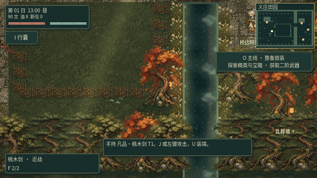
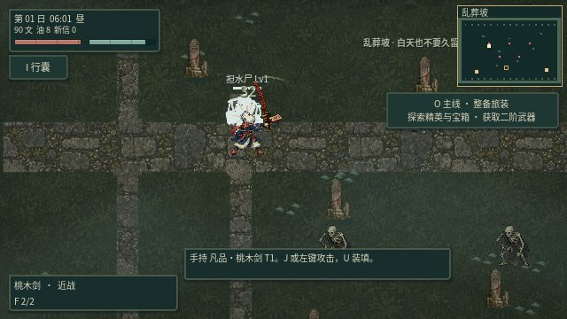
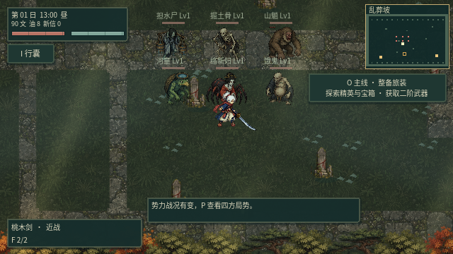
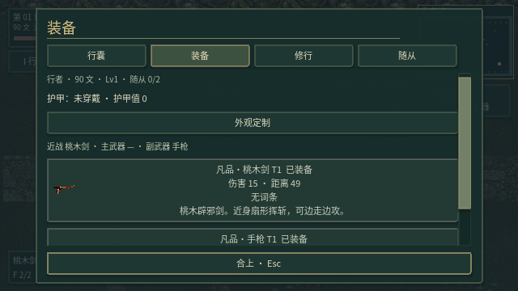
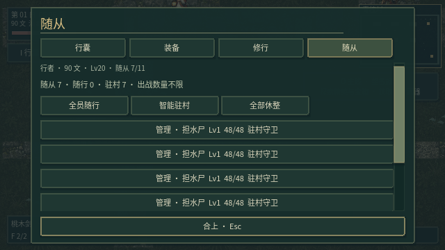
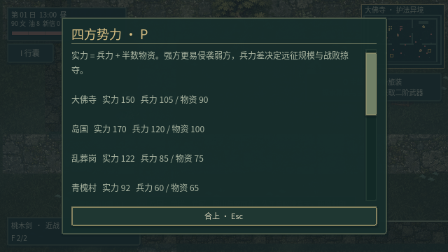

# v0.19 · 动作、重击与随从守卫

角色动作按预备、发力、接触和收势组织，以像素ARPG的可读性和操作衔接为目标。

## 玩家与武器

两套空手行走图集各有四向八帧姿态，以实际位移推进，配合连续脚部着地和抬起、躯干起伏、手臂反向摆动。停步使用站稳姿态，攻击保留六帧基础姿态与连续的重心、武器轨迹。跟随镜头响应更快。攻击时身体前倾和重心位移、逐帧手部锚点、武器角度、拖尾及命中时间共享动作进度。角色与装备分层绘制，朝上时有身体遮挡，外观改色不会影响武器材质。

重制并接入12种武器素材：桃木剑、银剑、伊佩塔姆、文殊般若剑、鞭子、手枪、冲锋枪、步枪、左轮、加特林、魔法书和咒术娃娃。装备界面的图标固定尺寸，手持武器保留独立握点。长鞭的鞭身继续使用动态曲线。

- 左键或 `J`：轻击；近战右键：重击。
- 重击消耗14气力，前摇更长，约在动作中段接触，伤害为轻击的2.15倍，附带更强硬直、击退、75毫秒命中停顿和短促震屏。首领受到的控制较短。
- `Shift` 可取消前摇，取消后不留下延迟伤害；已经消耗的气力不返还。气力不足时拒绝发动。
- 枪械右键仍装填，`U` 也可装填。法器不使用近战重击。

命中特效加入短促亮芯、方向火花、碎屑与重击冲击环；镇符、符火、闪电、诅咒、随从术法各有对应色彩和动画。补充轻重命中、挥动和施术的合成音效，最多6个同时发声，`M` 同时静音环境音与战斗音。音频数据检查验证了轻重差异及振幅限制；自动化运行使用静音或Dummy设备，未将此描述为人工听音评审。

## 怪物与草地

怪物图集重绘为更紧凑、轮廓清楚的日系像素比例，并重新生成透明部位层。大天狗保留已有四向动作图集；其他怪物以新素材和关节驱动动画，未宣称所有怪物已有逐帧手绘动作。断肢与当前关节姿态仍共用位置、旋转、缩放数据。

草叶显式从根部向上构建，避免四边形UV方向导致倒长；高度、密度、风摆幅度和亮度均下调，地面草纹对比度也降低。碰触压弯与回弹保留。独立渲染检查确认草叶像素都在根部上方。

## 随从与势力

取消出战点数限制，拥有的健康随从可以全部出战，既有安置位成长继续保留。普通随从基础生命由42调整为48，基础伤害由4调整为5；首领随从也略作增强。旧存档按生命比例迁移，倒下的随从保持倒下。

`H` 管理提供全员随行、智能驻村、全部休整。智能驻村综合村民伤势和已有守卫数分配，避免全部挤在一人身边。也可在村民交互中指定随从保护该村民。驻村随从留在青槐村，玩家前往异境后不会跟走；离屏时继续参与夜袭与势力入侵结算。管理界面显示当前任务、训练与疗养消耗，并禁用当前不可执行的操作。

四方军队在离屏时按时间交换伤害和产生伤亡，进入战场后由实际角色交战。`P` 可承诺支援攻方或守方，被支援方成为友军，本场不能反复换边。战报显示存活兵力、你的击杀、支援方及结果；击杀或驻村守卫计入贡献奖励。离屏结算受时间间隔限制，不因高频调用而重复造成伤害。

## 验证与实机记录

运行 `python3 scripts/test_game.py`，包含21组回归及主场景启动。新增场景用实际鼠标右键发动重击、点击随从指令，检查前摇、接触、取消、七人同时出战、驻村留守、离屏战、阵营选择、存档迁移、音效数据和装备页尺寸。图形测试另检查草叶朝向并保存实机画面。

验证结果：21组回归共886项检查通过，主场景正常启动；带画面的实际输入与渲染检查46项通过。39组怪物姿态的透明部位层无重叠重建源像素。

清晨切日测试曾在物理帧批量执行时提前读取了日历；现等待实际时钟更新后，再验证不强制传送、不免费恢复生命。测试的行为断言保留。

```sh
DISPLAY=:1 YINTIAN_CAPTURE_DIR=/tmp/action-captures \
  MOSSFIELD_RUNTIME_DIR=/tmp/action-profile \
  sh scripts/godot.sh --audio-driver Dummy --rendering-method gl_compatibility \
  --fixed-fps 30 --script res://tests/test_action_command.gd
python3 scripts/verify_actor_parts.py
```

以下均为Godot运行画面。动图以固定30帧游戏时间录制，避免PNG读取耗时改变动作播放速度。长线掉落节奏和多人随从的极端规模表现仍需持续调校。







