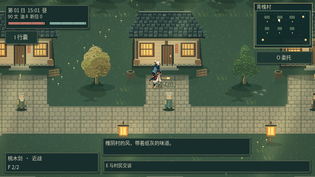
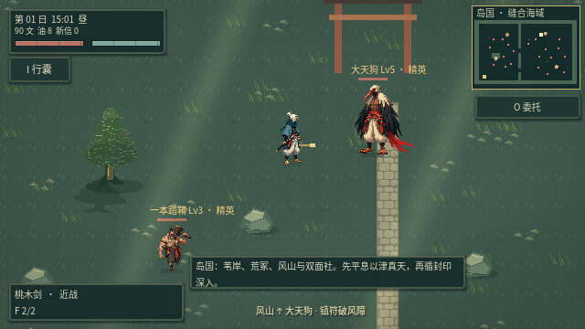
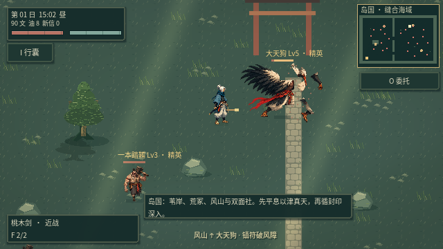
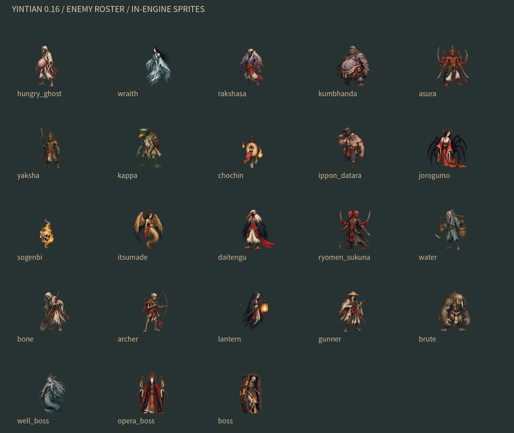

# v0.16 · 白发行者与鸦翼妖

按本轮提供的两张参考图确定角色方向：白发、蓝色围巾、蓝衣与浅色宽裤的主角；白羽鸟首、黑翼、红带与浅色裤装的大天狗。参考图通过当前图像工具补成透明动作图集，已接入 Godot；并非 Midjourney 出图。

## 游戏内表现

主角有四个朝向，每向六张姿态：待机、左右迈步、攻击准备、攻击释放和受击，共 24 张。运行时以待机／左右迈步组成四拍步态，攻击计时驱动准备与释放，受击优先。手持物由现有装备系统绘制，换武器继续生效；闪避保留倾身与新人物残影。脚底按源图中鞋／爪的位置校准，飘带不参与脚底定位。

大天狗有四向共 16 张姿态，包含收翼、两种迈步与展翼攻击。攻击蓄力、释放后的短暂保持、击退和受击闪白共同参与表现。其余 22 类敌人使用同一方向的新像素立绘，加上程序化分段步态、浮动或攻击摆动；尚非每类敌人都有独立绘制的四向完整动作组。

动图是 Godot 使用游戏中的动作选择器和图集渲染的四向动作展示，非战斗录像。下列游戏场景截图才是实际地图中的表现。

## 断肢与行为

从当前姿态的源区域取出断肢，使用与身体相同的缩放与翻转，断口从身体绘制中扣除。碎片抛出、旋转、落地后逐渐消失，暂停时停住。

- 断臂沿用攻击削弱。
- 断腿沿用减速，并放慢分段步态。
- 断头立即取消蓄力、连射和冲锋，保留无攻击的慌乱移动。
- 丛原火与幽魂没有肢体；提灯妖只有整体头部；一本踏鞴的唯一腿按整体下肢处理。

目前采用图集分区切割，局部断口仍可继续精修为独立伤口和残体图层。不同朝向的鼻、翼和飘带做了分区校准，避免直接沿用旧素材的裁切坐标。

## 全敌人统一美术

23 类敌人的名称、能力、地图分布与委托保持联动。役灵中对应的怪物也使用新外观。

[主角 24 姿态](images/actors-hero-poses.png) · [大天狗动作与断肢预览](images/actors-tengu-poses.png)

## 素材与验证

源图保存在 `godot/assets/actors16/`。`scripts/index_actor_atlas.py` 只读取透明边界、格子与脚底位置并重建 `atlas.json`，不重画 PNG；旧地形生成器不会覆盖本轮源图。图集由图像工具依据用户提供的参考制作，未复制其他商业游戏素材。

运行 `python3 scripts/test_game.py` 检查导入、17 组游戏回归和主场景启动。新增 `test_reference_art.gd` 检查四向动作、全部敌人的源区域与无重叠分区、实际断肢、断头禁止攻击、冻结与暂停以及存档往返。图形模式还导出实机场景、图集预览和 24 帧动作演示；测试使用隔离存档。
