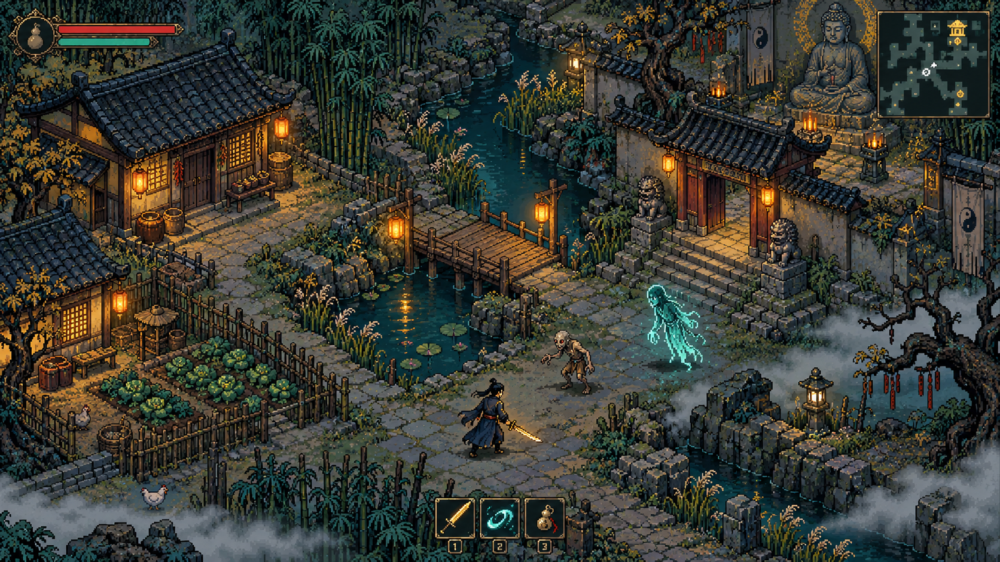
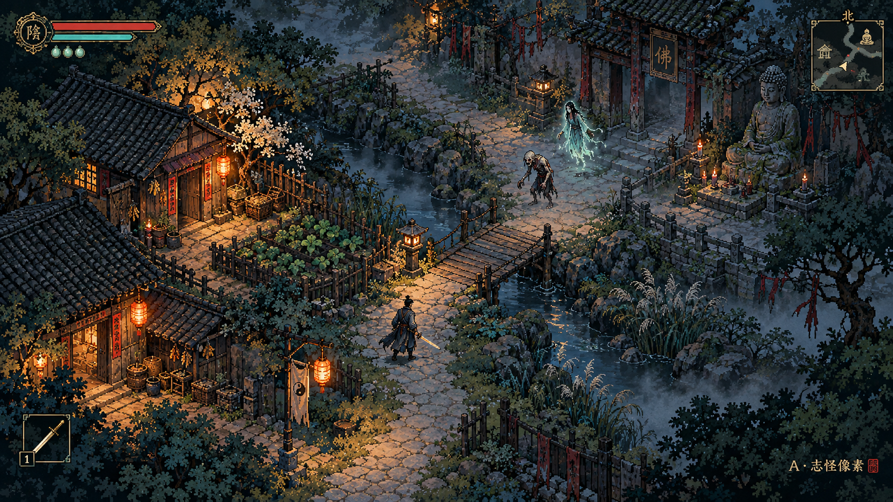
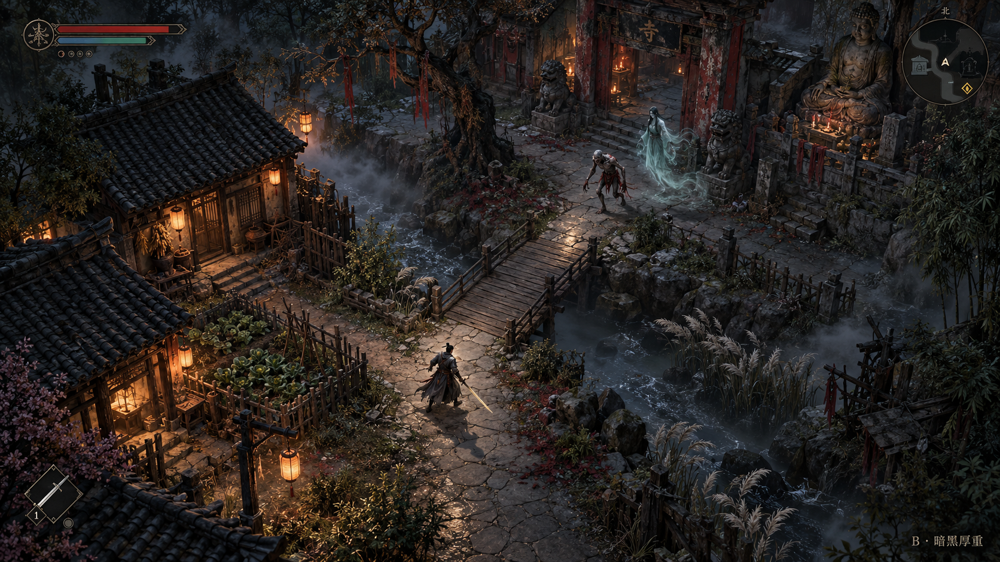
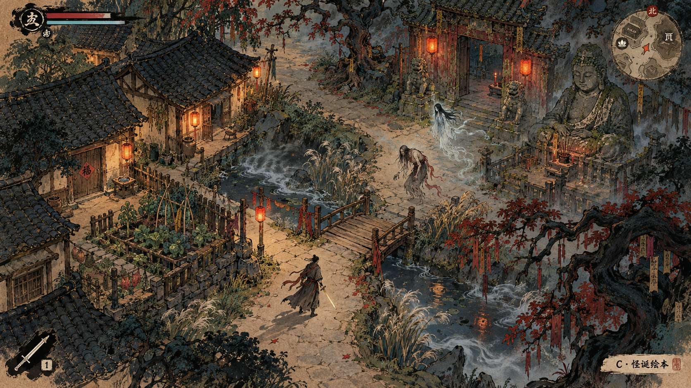

# 美术方向对比

左侧为 v0.13 实际运行截图；右侧为选型用的 16-bit 像素风概念预览，尚未应用到游戏。概念图由本环境可用的图像生成工具制作，并非 Midjourney 输出。两幅图不是同一地图布局或同一镜头的替换前后截图。

| 当前游戏实机 | 16-bit 像素方向概念 |
| --- | --- |
|  |  |

[单独打开当前游戏图片](images/art-current-v013.png) · [单独打开16-bit预览原图](images/art-16bit-concept.png)

| 项目 | 当前实机 | 16-bit 方向目标 |
| --- | --- | --- |
| 地面 | 大片平铺草地、沙路，边界较直 | 草、石、泥、岸线有过渡，疏密形成路线层次 |
| 建筑 | 简单方块结构、较少材质变化 | 灰瓦、木梁、屋檐、窗光及少量生活道具 |
| 人物与敌人 | 小型占位感精灵，轮廓细节较少 | 统一比例与像素密度，以服装、武器、姿态和轮廓区分 |
| 光影与气氛 | 平面环境色与昼夜遮罩 | 冷色环境、暖色灯火、水面倒影与克制的雾气 |
| UI | 大块浅色面板、信息占据较多画面 | 墨青底、旧金细边，常驻信息收紧，保留阅读对比度 |
| 战斗 | 已有预警、受击、断肢与神器特效 | 保留玩法反馈，统一色彩和动画，控制装饰遮挡 |

方向建议：采用 16-bit 像素美术，以志怪氛围为主；保留绘本方向的符纸、木刻纹样与妖怪设计。先做青槐村和相邻战场的可运行样板，再统一推广至乱葬岗、岛国与大佛寺。概念细节需转化成可拼接地块、可排序建筑和可动画精灵，不以一张背景画替代可玩的地图。

## 原先三种方向

| A：志怪像素概念 | B：暗黑厚重概念 | C：怪诞绘本概念 |
| --- | --- | --- |
|  |  |  |

A 偏古村烟火与冷暖对比；B 偏写实材质与压迫感；C 偏水墨线条和旧纸质感。原 A 图像素密度较细，新的 16-bit 预览更明确地强调像素风。以上均为方向图，不代表游戏已经完成对应美术。
