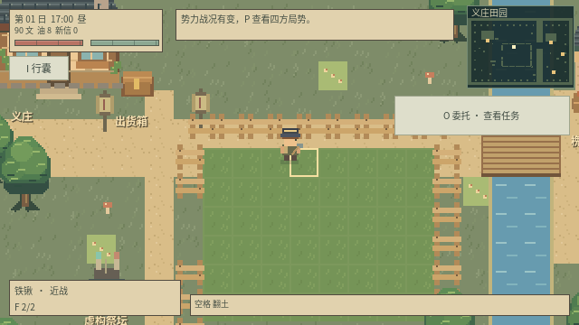
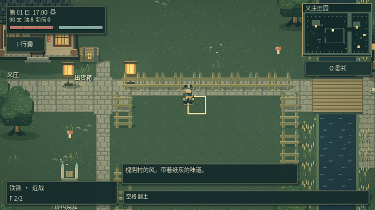
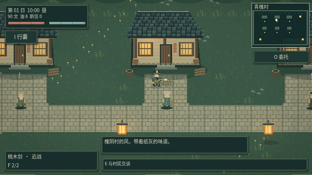
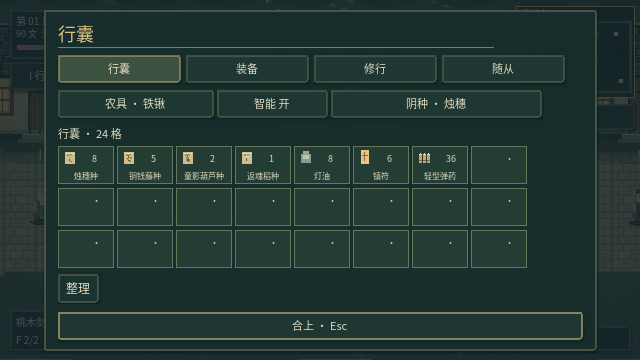
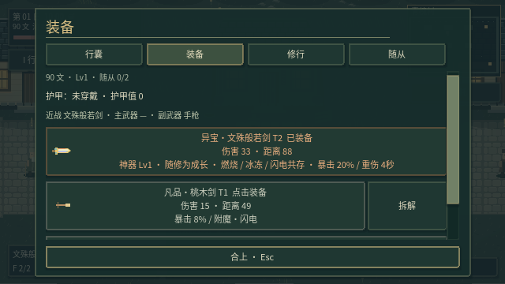
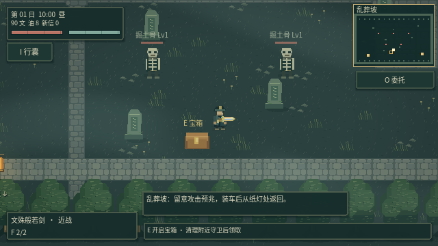
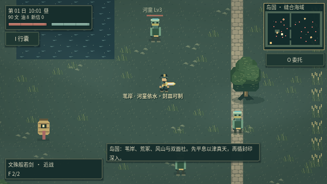
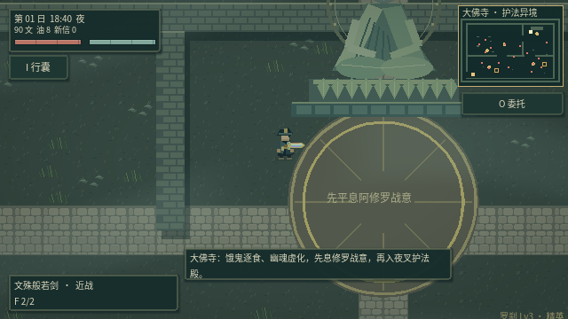
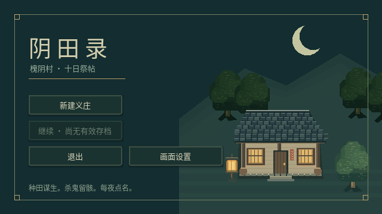

# v0.14：16-bit 志怪美术首轮实机重构

这一版把选定的墨青、苔绿、旧金与暖灯方向转成实际游戏素材和渲染代码。下图均由 Godot 运行项目截图，不是概念背景图。首轮重点是青槐村样板，以及各区域共享的地形、人物、光影和界面；场景密度与细节仍可继续打磨。

## 实机对比

| 美化前 v0.13 | 美化后 v0.14 |
| --- | --- |
|  |  |

两张义庄图使用相同角色位置和同一时段，便于比较素材、地块与 HUD。新图保持可游玩的原场景布局。

## 本轮变化

- **28 张原创素材图集**：分区域地面、连接式石路边缘、灰瓦木屋、木梁窗光、纸灯、树冠、石块、墓碑、箱子、旧木围栏、义庄家具、佛像与石塔。
- **人物与敌人**：主角四方向步行动画，六位村民分别有长者、药婆、铁匠、灯匠、农人、书生外观；23 类敌人统一到 32×48 源像素图集，保留各自轮廓与武器特征。断肢与炼化后的役灵同步使用对应图集。
- **地图层次**：区域色调区分；道路按相邻地块组合边缘；清理无意义的土色条纹与密集纹理。青槐村增加庭前铺地、菜圃和生活道具。装饰没有额外挡路碰撞；建筑、树木、田地及交互点维持原有坐标。
- **真实局部照明**：夜色随游戏时钟变化，纸灯与房屋窗光参与屏幕光照，冷色环境中保留暖灯层次；墓地、佛寺、沉水村等区域有克制的薄雾。薄雾在角色附近降低强度，保留战斗辨识度。HUD 与菜单在照明层之上，不被夜色压暗。
- **界面**：墨青面板、旧金边线、明确悬停和焦点反馈；行囊、装备、对话、设置与标题统一配色。无追踪委托时只留紧凑入口，短时通知移至下方。仍保留四个主要角色页签。
- **标签**：普通敌人靠近、受伤时显示信息，精英与首领持续保留辨识；健康村民名字主要在靠近时显示，受伤时保留提示。攻击预警、受击闪白、元素状态和神器剑光继续工作。
- **修正旧绘制问题**：青槐村不再误画义庄专属桥梁和田地叠层；砍伐树木后同步移除其接触阴影。

本轮保留 640×360 逻辑画布、最近邻采样与整数窗口缩放。更高密度素材使用源像素尺寸绘制，不以滤镜放大旧素材；生成的概念图没有被铺成静态地图背景。旧版玩法、存档版本和碰撞规格继续兼容。

## 开发与验证

```sh
python3 scripts/generate_art16.py
python3 scripts/generate_font.py /usr/share/fonts/opentype/noto/NotoSansCJK-Regular.ttc
python3 scripts/test_game.py
python3 scripts/package_game.py
```

`generate_art16.py` 使用固定随机种子，可重建全部新素材。开发时依赖 Pillow，游戏运行无需 Python。敌人图集顺序来自 `YinBalance.MONSTERS`，新增敌人后应重新生成。

本次完整回归：15 套游戏测试共 698 项检查及主场景启动全部通过；图形专项 22 项通过，包含 9 张截图校验。28 张素材也已验证可逐字节重复生成。专项检查地块与田地坐标、建筑素材比例、真实灯光参数、昼夜变化、菜单溢出、断肢裁切和存档往返，并在图形环境保存实机截图。

## 实机图集















