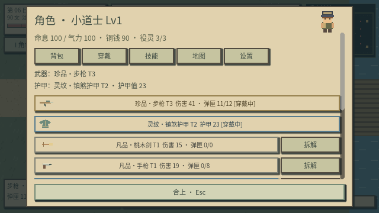

# v0.7：铳林、装备与智能劳作

## 参考与实现方式

程序参考阅读了 Godot 官方 `godot-demo-projects` 的 **Bullet Shower** 和 **Dodge the Creeps**，固定于提交 `b761b4cd5718a7118f2c95eb55f181d0a5f004f1`：

- [集中管理弹丸的官方示例](https://github.com/godotengine/godot-demo-projects/tree/b761b4cd5718a7118f2c95eb55f181d0a5f004f1/2d/bullet_shower)：参考统一更新、统一绘制和避免弹丸相互检测的思路。
- [俯视角移动与碰撞的官方示例](https://github.com/godotengine/godot-demo-projects/tree/b761b4cd5718a7118f2c95eb55f181d0a5f004f1/2d/dodge_the_creeps)：参考方向归一化与碰撞职责划分。

设计上借鉴《暗黑破坏神》系列的品质颜色、装备成长、精英强度与可读的落地奖励。枪械、怪物、美术、数值和代码为《阴田录》独立实现。官方示例使用低层 Servers 展示数百个对象；本项目使用一个管理节点中的弹丸数组、每帧线段扫掠和统一绘制，最多保留 256 发弹丸。高速弹丸从上一位置检测到下一位置，避免跨过薄墙；切换场景清除飞行中的弹丸。

## 三种枪械

| 武器 | 基础伤害 | 射击间隔 | 弹匣 | 装填时间 | 弹种 | 射程 | 特点 |
| --- | ---: | ---: | ---: | ---: | --- | ---: | --- |
| 手枪 | 19 | 0.28 秒 | 8 | 1.0 秒 | 轻型弹药 | 650 | 初始拥有，精度较高 |
| 冲锋枪 | 9 | 0.09 秒 | 24 | 1.4 秒 | 轻型弹药 | 560 | 持续连射，散布较大 |
| 步枪 | 31 | 0.20 秒 | 12 | 1.6 秒 | 步枪弹药 | 1000 | 单发更强，精度与射程较高 |

连射冷却在固定物理帧中计时，并保留时间余量，减少渲染帧率对射速的影响。鼠标移动控制枪械瞄准，按住左键或 J 射击。7 / 8 / 9 / 0 分别选择剑、手枪、冲锋枪、步枪；未拥有的武器会提示获取方式。U 或右键装填；尝试射击空弹匣时也会启动装填。

装填完成时才把行囊中的备用弹药移入对应装备实例的弹匣。暂停冻结装填与飞行中的弹丸；换枪取消尚未完成的装填。射击只扣弹匣，每发成功生成的子弹扣一发；弹丸已满时不扣弹。弹匣内容随装备保存，换枪不复制弹药。拆解备用枪械会回收未用弹药。

角色显示当前手持的枪、剑或农具。开枪有后坐与枪口闪光，弹丸带短轨迹，命中产生像素碎屑与伤害数字。铁锹、镰刀、斧头和铁镐也可作为手持近战工具；阴种与水壶用于经营，攻击时不会偷偷替换成剑。

## 数值公式

全部核心数值集中于 `godot/scripts/combat/balance.gd`。

```text
玩家等级 L = min(20, 1 + floor(修为 / 80))
攻击倍率 = [1 + 0.07 × (装备阶数 T - 1) + 0.02 × (L - 1)]
          × [1 + 0.08 × 品质 Q]
攻击值 = round(基础伤害 × 攻击倍率)
实际伤害 = max(1, round(攻击值 × 100 / (100 + 护甲 A)))
```

零伤害保留为零。镇符与符火沿用固定法术伤害，并忽略敌方护甲。玩家在农场受到的伤害先减去 `floor(镇守 / 30)`，再计算穿戴护甲的减伤。

```text
敌人生命 = round(基础生命 × [1 + 0.18 × (敌人等级 - 1)] × 精英生命倍率)
敌人伤害 = round(基础伤害 × [1 + 0.10 × (敌人等级 - 1)] × 精英伤害倍率)
敌人护甲 = 基础护甲 + 2 × (敌人等级 - 1)
精英生命倍率 = 1.65；精英伤害倍率 = 1.20
```

敌人等级随每四个游戏日提升，最高 20。后山以等级 2–3 起步。原章节首领保留 `220 + 污染` 的生命规则，以维持旧剧情路线；它会释放八方向弹幕，半血后追加更快的瞄准扇形弹幕。

护甲装备提供 `12 + 3 × (T - 1) + 8 × Q` 护甲，采用收益递减的减伤公式。品质不增加射速，枪械节奏与弹药成本保持可辨认。

## 怪物与难度

| 怪物 | 行为 |
| --- | --- |
| 担水尸 | 近身追击与地面攻击预兆 |
| 掘土骨 | 较低生命的近战敌人 |
| 吐骨骷 | 蓄力后射出三方向扇形弹幕；精英为五方向 |
| 追灯鬼 | 靠太近会后退，释放十二方向环形弹幕；精英为十六方向 |
| 纸铳兵 | 蓄力后连续瞄准射击三发；精英五发 |
| 山魈 | 更高生命、护甲与移动速度，较大近战范围 |
| 井中龙婆 | 沉水村首领，十八方向 100 / 180 速度交错环形水弹 |
| 无面伶王 | 废戏台首领，七方向扇形弹幕后瞄准连射，半血加倍连射 |
| 棺中客 | 原章节夜袭首领，加环形弹幕与半血强化 |

远程怪物约有 0.85 秒蓄力，带方向线和进度圈。普通子弹不打断其蓄力；镇符可中断并压制，近战可以中断，因此远程射击需要配合走位。静态墙体拦截敌我弹丸，闪避提供短暂无敌。弹幕避免采用没有预兆的瞬间命中。

## 装备与经济

品质为 **凡品 / 灵纹 / 珍品 / 异宝**，使用白、蓝、黄、橙标识，对应额外伤害 0% / 8% / 16% / 24%。阶数按敌人等级生成。

每次击杀留下遗骸，并掉落对应弹药 `3 + 敌人等级`。普通敌人有 35% 装备掉落机会；精英与首领保证掉落装备，至少为灵纹品质。品质抽取分布为凡品 60%、灵纹 28%、珍品 10%、异宝 2%，精英与首领把凡品结果提升到灵纹。落地装备带颜色标记与武器图标，靠近拾取，B 查看和穿戴。

材料行囊仍为 24 格，仓箱为 24 格；装备单独有 20 个位置。装备位满时物品保留在场景，清出位置后可以再拾取。备用装备可拆解为 `1 + Q` 个零件，已穿戴装备不可直接拆解。地面装备上限为 200 件。

- 初始拥有桃木剑、手枪与 36 发备用轻弹，枪械弹匣初始为空。
- 杂货铺出售冲锋枪 80 文、步枪 140 文、护甲 50 文。
- 轻弹 24 发 / 12 文；步枪弹 12 发 / 18 文。
- 案台用 1 零件 + 1 骨料，制作 12 轻弹或 6 步枪弹。

普通怪物遗骸可在原地按 V 收役，2 灯油、完整度至少 60；担水尸仍为担水役灵，追灯鬼转为伏影童，其他普通怪物转为掘土役灵。三位首领不可收役，可拆解、埋田或超度。

## 地图与智能种田

从乱葬坡右下纸灯按 E 进入 **后山铳林**，从后山左下纸灯返回。新地图为 **1920×1280**，面积是原 960×640 地图的四倍，有十六个敌人、精英纸铳兵与精英山魈、树林、遗迹与一道需要走桥通过的河流；镜头与碰撞边界同步扩展。

Z 切换智能劳作。开启时，面对近处田块按空格，依次选择翻土、种植当前阴种、浇灌或收获；已浇水的未熟作物不再消耗气力，返魂稻仍需先按 E 封声。角色背包中点击工具或滚轮明确选择工具时切换到手动模式；1–6 已删除。角色背包显示名称和原创图标，行囊同时显示数量，长名称有完整提示。

存档升级为版本 5，兼容版本 3–4 的种田、役灵与剧情进度。装备、弹匣、地面装备、弹药和扩展地图坐标一起保存。





## 新地图、被动技能与随从

后山入口为乱葬坡东南；后山的东北纸灯通往沉水村，东南纸灯通往废戏台。两张分支地图为 1280×960，首领为等级 4 精英；回程出现在对应后山入口附近。支线首领的死亡状态跨日保留，主线首领判定保持独立。

```text
役灵容量 = 义庄基础位（2，扩建后 3） + floor((玩家等级 - 1) / 3)
役灵伤害 = 9 + 玩家等级 × 2 + floor(契合 / 25) + 伏影童加成 5
```

容量被动不需要额外点击学习，角色「技能」页显示解锁等级与容量。随从最多搜索 260 距离内的敌人，集火搜索 360；近身 44 且无遮挡时出手，间隔 1.1 秒。跟随追击超过玩家 400 距离后回归；驻守以接到命令的位置为锚点巡逻，只追击锚点 220 范围内的敌人。身体碰撞和 16 像素网格路径避开河流、建筑与树木。

午夜不再触发归庄或睡觉，次日 06:00 就地日结。熬夜不会获得生命与气力恢复，点名和灯油仍按日检查。
