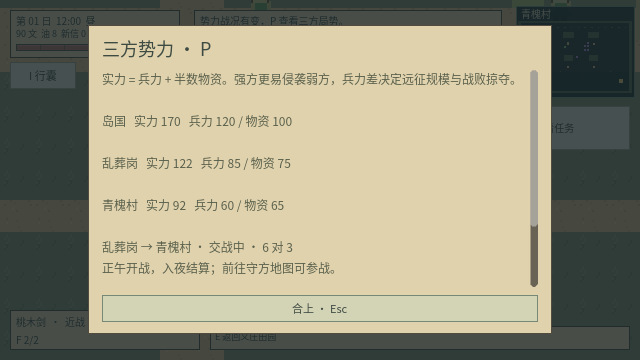
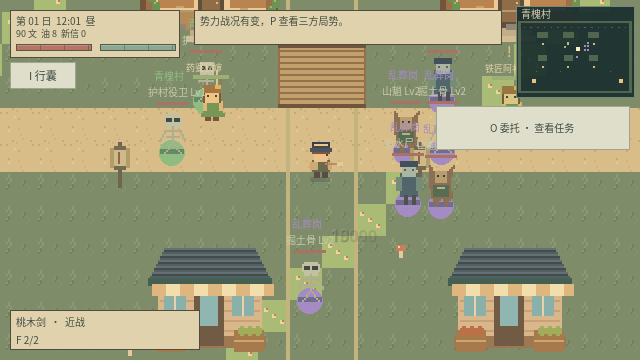

# v0.12 三方势力系统

岛国、乱葬岗、青槐村互为潜在进攻对象。按 P 打开局势；暂停菜单和村民互动也提供入口。NPC 离线交谈输入“势力”“进攻”“战况”会读取当前数据。

## 战争规则

- 实力 = 兵力 + 物资的一半。初始岛国 170、乱葬岗 122、青槐村 92。
- 每日各恢复 7 兵力、5 物资，上限分别为 180、140。每日最多一次远征。
- 每个进攻方向的候选概率为 `clamp(0.24 × 攻方实力 / 守方实力, 0.08, 0.82)`；候选按概率加少量确定性随机扰动排序。因此强方更倾向进攻弱方，弱方仍能反攻。
- 进攻队伍 4–9 人，实力差距越大投入越多；守军根据自身实力投入 3–7 人。日内结果使用固定种子，重读存档不能重抽出兵计划。
- 清晨预告，正午在守方地图部署双方军队。任一方全灭立即结算；晚上 20:00 按剩余军队生命结算，守方享有 15% 防守优势。跳日也会结算未完成战争。
- 实地图交战使用双方独立生命、预警近战、墙体阻挡与绕路。部队优先攻击敌军，敌军消失后非村庄势力会攻击玩家或村民。护村役卫不会攻击玩家，也不会被玩家选为敌人。
- 地面色环、名称和地图色点区分势力。NPC 之间击杀不生成玩家战利品；玩家亲手击杀仍按原战斗规则计算。
- 失败损失 8–26 兵力及相应物资，强方获胜掠夺更重；胜方也损失 5 兵力。兵力最低恢复底线 25，物资不会为负。
- 青槐村被攻破还会损失完好度、村民生命。村民最低保留 1 点生命。可每日花 30 文增加村庄 12 兵力、15 物资，影响后续行动。
- 原有每三日救村事件保留。自动势力计划会避开这一天对村庄发起额外进攻。

这是地区势力消长与远征系统；地区暂不永久易主。离开战场后按已有军队剩余生命进行夜间结算，离图期间不逐帧模拟战斗。

## 存档与验证

存档版本 9 自动迁移旧版存档；保留兵力、物资、当前战事、部队生命、资助日期和最近 12 条战报。读档验证势力、数值范围、战事与存活队伍所属关系。已结算战争不会重复结算，重复进入地图不会重复部署。

`python3 scripts/test_game.py` 执行全套回归。新增 `test_factions.gd` 覆盖进攻方向、强弱概率、警告与部署、结算幂等、JSON 往返、旧存档迁移、资助上限、60 日演变、NPC 查询、实际双方攻击、友军保护、P 键入口和暂停。

本次完整回归的 13 个游戏测试套件及主场景启动全部通过，势力专项 38 项；图形环境专项 40 项通过。

