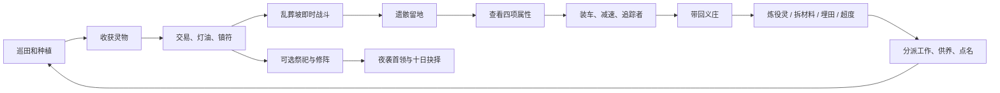

# 《阴田录》第一章落地范围

用户提供的完整设定作为长期方向，本版实现十日核心垂直切片。以下区分已接入的规则与后续目标。

## 十日手札

| 日 | 本版线索与活动 |
| --- | --- |
| 1 | 读师父遗书，空田开荒，烛穗与铜钱藤作为启动经济 |
| 2 | 古井担水声，役灵工作应匹配生前残念 |
| 3 | 棺盖里的阵图，调查遗骸完整度，开始炼骸与修阵 |
| 4 | 雨天与作物朝向祠堂的异常，发展寄灵作物 |
| 5 | 祭帖上出现玩家姓名，返魂稻模仿声音 |
| 6 | 虚构祭祀开放；地脉灵、无名客、旧山神三选一，或不祭祀 |
| 7 | 声音越来越像师父，封声规则是可观察、可应对的机制 |
| 8 | 村民承认，灵田既是封印也是食盆 |
| 9 | 不祭祀的路线也会遭遇夜袭首领棺中客 |
| 10 | 首领倒下后，与阿婆对话，选择封镇或共处；可以继续经营 |

剧情逐日进入可滚动手札，不要求每一日严格完成对应事项。祭祀可提前引来首领；未完成首领仍可在后续夜晚应战。第一章完成需要第十日及以后、首领击败和章末选择。未验证固定 1–2 小时游玩时长。

## 完整核心循环

## 作物

| 作物 | 成熟日数 | 种子单价 | 交易价格 | 额外用途 |
| --- | --- | --- | --- | --- |
| 烛穗 | 2 | 6 | 22 | 1 份炼 4 灯油，地脉灵供品 |
| 铜钱藤 | 3 | 10 | 38 | 无名客供品 |
| 童影葫芦 | 4 | 18 | 65 | 收割材料或破壳役灵；食秽 / 提灯 / 伏影分支 |
| 返魂稻 | 4 | 16 | 90 | 第 2 阶段开始模仿声音；贴符封声可规避污染 |

雨天固定在每第 4 日；浇水后的日结才推动生长，不采用随机枯死。埋骸会让田块阴性 +1、附带已知污染，葫芦童的初始怨气随该田阴性提高。

## 遗骸与战斗

完整度、残念、凶性、阴性为实际数据，不只描述文本。剑击保留完整度；镇符压制后击杀降低凶性；符火每次使完整度 -35。完整度不足 60 不能炼成完整役灵，仍可拆解、埋田或超度。

载骸最多 2 具；移速为基础速度的 62%；装满引出追踪者。遗骸不会在关闭区域后自动消失，也会写入存档。昏倒会把遗骸掉回场景。

玩家剑伤随修为提升，役灵伤害随契合提升。敌人有追击范围、接近攻击、半秒预兆；首领有更大攻击范围与更长预兆。闪避有短暂无敌。没有复杂连招、装备掉落或技能树。

## 役灵

三类：担水尸、掘土骨、葫芦童。安置位初始 2，花 80 文与 3 骨料扩建为 3；每日供养每位 1 灯油。契合、怨气、工作与名字均可保存。

食秽分支净化更强；提灯分支匹配守夜、提升镇守更多；伏影分支增加战斗伤害。役灵会在地图上移动并自动攻击近处鬼物；经营产出在日结时执行，避免挂机无限产出。

## 已知边界

- 义庄扩建是停尸棚外观和安置位升级，没有可进入的室内。
- 三种祭坛选择只允许执行一次，主持者为玩家；不含复杂祭坛编队。
- 棺中客留下首领遗骸，可拆解、埋田或超度，本版不开放棺将役灵。
- 指节笋、窥月花、缝衣婆、纸兵、其他探索区域、家具编辑、更多村民关系均为后续目标。
- 禁种异常采用明示规则、短文字事件与田块表现，没有语音演员或真实仪式。
