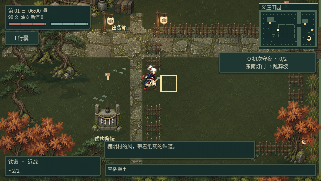
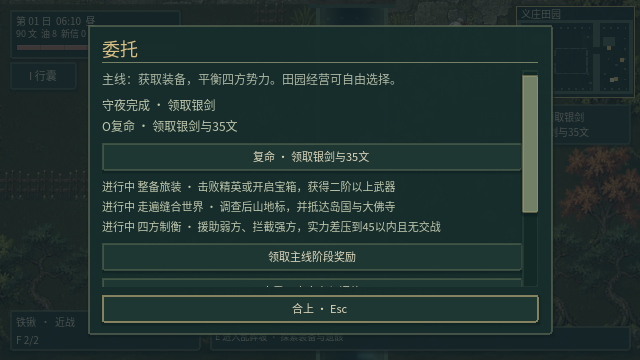
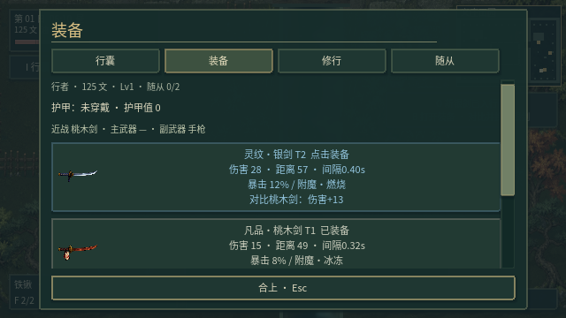
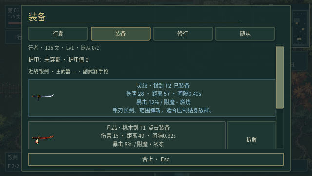

# v0.21 · 初次守夜：收拢开局体验

本轮按测评建议集中处理开局闭环、战斗辨识度和换装反馈，未扩充地图或追加武器系统。目标是形成可供短程试玩的内容切片；“十分钟”是设计目标，尚未通过普通玩家测试确认平均完成时间。

## 一条具体的开局目标

收起遗书或进入外观定制时自动接取“初次守夜”。任务栏提示东南灯门，小地图圈出当前目标，近处金色路点沿实际可通行路线引导。指引跟随未击败的守墓敌人更新，不强制移动玩家。

1. 从义庄东南灯门进入乱葬坡。
2. 击败两只异怪，观察红圈蓄力，使用闪避与镇符。
3. 击杀计数达到2/2后，沿西南灯门回义庄。
4. 按O复命，领取一把二阶银剑与35文。
5. 按B比较并装备银剑，结束开局引导，转入原有装备探索与四方制衡主线。

旧存档不会强制接取，可在O委托页自行开启。主动追踪其他委托会隐藏开局路点；首次换装完成状态会保存，之后自由换武器不会重新触发新手引导。

## 减少选择负担，展示换装收益

装备卡增大图标，展示伤害、距离或弹匣、攻击间隔；同类武器之间比较伤害，不再把手枪和近战伤害直接当成换装差异。新领取的银剑在第一次换装时置顶，并隐藏该奖励的拆解按钮，避免主操作被拆解干扰。外观定制移到装备列表之后。

无随从时收起“全员随行 / 智能驻村 / 全部休整”，改为明确解释击败异怪、遗骸旁按V免费炼化，并提供守夜委托入口。

## 小范围战斗调整

乱葬坡第一天保持五只敌人的数量，采用担水尸、掘土骨、吐骨弓手三类，远程敌人不再等到第三天才出现。地图增加守夜路、骨冢和弹道遮挡提示。

附近敌人增加淡色脚底轮廓，降低环境对其颜色的混合强度；蓄力时标注状态、增强地面危险范围对比，并让关节随蓄力逐渐后收。现有击退、命中停顿、取消和重击机制保留。本轮未重画整套角色动作，不将这些调整描述为完整的手绘动作重制。

## 验证与边界

- 23组回归共1,308项检查通过，主场景正常启动。
- 新增开局套件27项：鼠标收起遗书、键盘实际挥剑击杀两名完整生命的守卫、计数、战场不可远程复命、存档恢复、UI领奖、奖励防重复、满装备时保留奖励、实际点击换装、后续换武器不重启引导、旧玩家自选接取。
- 图形模式开局31项、重击与随从输入及渲染46项通过。检查新奖励首屏可见、任务说明不产生横向滚动，并保存运行画面。
- 修正原玩家流程用例：初始武器的暴击可能使一次伤害为25而非15；现在接受对应两种血量，并继续验证随后不会再次扣血，保留单次命中行为断言。

开局套件为快速回归而直接切图、定位到敌人附近，并暂时压制敌人攻击以隔离任务与奖励逻辑；它不是自然通关或战斗难度证明。原玩家流程另覆盖从出生点实际行走到出口及战斗输入。测试使用隔离存档，未修改玩家存档。

后续重点仍是主角与怪物更连贯的整套动作、区域空间差异和普通玩家对首战的理解程度，不继续用增加系统数量代替体验打磨。
