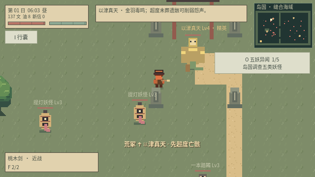
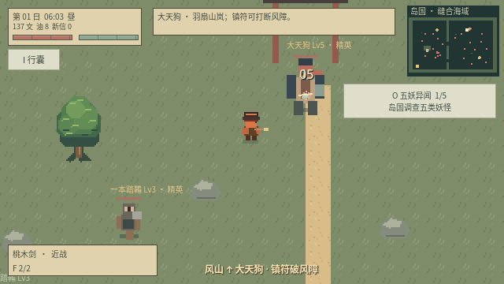
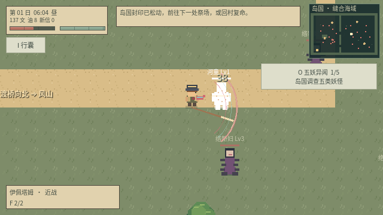
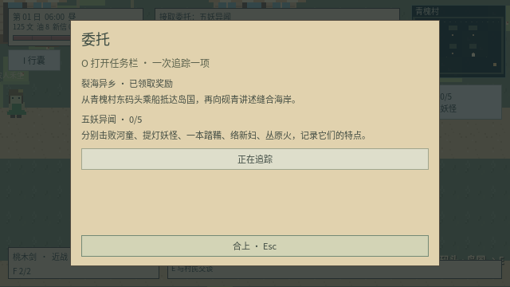

# v0.11：诡异缝合世界与岛国异闻

## 世界与路线

本作的“裂海”将不同地域民俗及其地貌拼接在同一世界。原有十日祭帖、义庄经营与村庄救援继续存在；岛国是可以自由往返的异闻区域。伊佩塔姆的阿伊努传说意象与日本妖怪并置，属于缝合世界的来源差异。

从青槐村东码头（1180,820）按 E 乘船，抵达岛国西南；从岛国渡口返回同一码头。地图为 2240×1600：

| 区域 | 内容 | 路线 |
| --- | --- | --- |
| 苇岸 | 河童、水塘、纸灯与渡口 | 主路向北抵荒冢，向东经下桥 |
| 荒冢 | 未葬亡骸、以津真天 | 平息后解开风山封印 |
| 风山 | 修验鸟居、大天狗 | 上桥过河，沿山道北行 |
| 双面社 | 武人祭场、两面宿傩 | 下桥过河向东，风山平息后解封 |

普通妖怪每类四只，合计二十只（含两只精英），按日刷新；三名首领只击败一次，跨日、换图和读档不会复活。后续首领在封印解除前不生成战斗实体，不能越序击杀。首领离祭场过远会回位。

## 民俗意象与实际战斗特点

下列为本作采用的民俗形象和原创战斗转译，数值、克制与委托均属游戏设计。

| 妖怪 | 形象背景 | 游戏机制与应对 |
| --- | --- | --- |
| 河童 | 水边生灵，头皿蓄水 | 水岸每秒恢复 3 生命并加速；镇符令蓄水失效；水击短暂减速 |
| 提灯妖怪 | 旧纸灯付丧神，独眼长舌 | 长舌弹射消耗玩家气力；纸躯受到火伤 ×1.6；没有可断的实体四肢 |
| 一本踏鞴 | 本作采用独眼独足山中锻匠形象 | 独足跳进，锁定落点后重锤；范围提示出现后离开即可躲避；断腿后行动受限 |
| 络新妇 | 蛛女，结网牵制猎物 | 扇形蛛网命中减速 2.5 秒，利用障碍或闪避脱离 |
| 丛原火 | 僧人面目的浮游妖火 | 火弹附加灼烧，自身耐火（火伤 ×0.25）；无实体肢体，不生成断臂断腿 |

| 首领 | 形象背景 | 战斗特点 |
| --- | --- | --- |
| 以津真天 | 人面金羽、蛇尾与对未葬者的哀鸣 | 金羽扇射和毒鸣；300 范围内每具未处理遗骸增加攻击与羽数，最多计三具；超度、拆解或移走遗骸可削弱 |
| 大天狗 | 长鼻、羽翼、山林修验者与羽扇 | 山岚弹幕带推力；蓄势风障使子弹伤害降为 45%；镇符可打断风障 |
| 两面宿傩 | 双面四臂、剑弓并用的武人形象 | 剑式同时威胁正面与背面；下一式向相反方向射出两组弓箭；绕侧面避剑、沿空隙避箭 |

新增妖怪可按既有完整度、容量规则炼为随从，使用对应的受限战斗数值与技能。新怪物使用独立像素图形。断头后的实体敌人仍遵循乱窜且不能发起攻击的规则；妖火没有实体肢体。

## 六环委托

O 查看、HUD 追踪。前置环节必须向正确 NPC 复命，才能接取下一环；已经达成的世界事实会计入，避免先击败首领后无法接续。

| 环节 | 委托人 | 目标 | 报酬与后续 |
| --- | --- | --- | --- |
| 裂海异乡 | 砚青 | 从村东码头抵达岛国并回报 | 35 文，开启五妖调查 |
| 五妖异闻 | 砚青 | 各击败一种岛国小怪 | 80 文，转向秋婶 |
| 何时安葬 | 秋婶 | 平息以津真天 | 100 文，转向砚青 |
| 风山修验 | 砚青 | 平息大天狗 | 120 文，转向柳伯 |
| 双面四臂 | 柳伯 | 完成两面宿傩试炼 | 150 文，转向阿祁 |
| 饥刃缔约 | 阿祁 | 三处祭场已平息，缔结契约 | 60 文及唯一神器伊佩塔姆 |

对话只能说明线索，不能替玩家直接接单、发钱或完成目标。装备位满时神器报酬保留，重复复命不重复发奖。

## 伊佩塔姆

近战栏装备，基础攻击 28、范围 76、间隔 0.38 秒，奖励为 T2 异宝；具有独立血色与青色三重刀弧。没有随机附魔，成长是其专属属性。

- 0 杀为 Lv1，每 5 次自身剑击最终击杀升一级，45 杀达到 Lv10。
- 每级在基础攻击上增加 2 点，之后再计算原有阶数、品质与角色加成。
- 吸血比例为 8% + 神器等级 × 1.2%，从 9.2% 增至 20%。
- 以目标实际损失生命计算吸血，最少 1 点；护盾完全吸收时不回血，不能超过 100 生命。
- 过量伤害不按面板数值吸血；枪械、符术、随从及无归属持续伤害的击杀不提供成长。
- 击杀归属随延迟剑击保留，同一目标不能重复提供成长；不允许生成第二把或拆解神器。
- 成长、岛国调查、封印、委托与首领状态存入第 8 版存档，可迁移第 3–7 版。

## 验证

python3 scripts/test_game.py 运行十二组自动化套件。test_island.gd 覆盖渡船与路线可达、实际 NPC 接续、三首领顺序与跨日记录、背景机制的真实伤害和控制、神器延迟命中与归属、吸血边界、存档迁移及致命攻击后的场景安全切换。

图形窗口测试截图使用受控测试场景，不代表人工完整通关时长。

