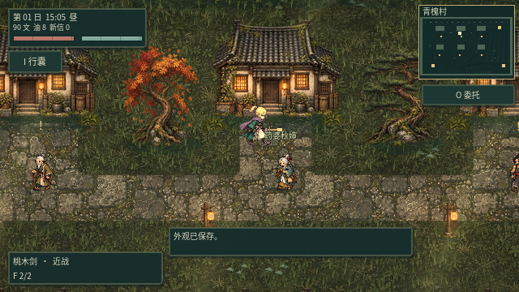
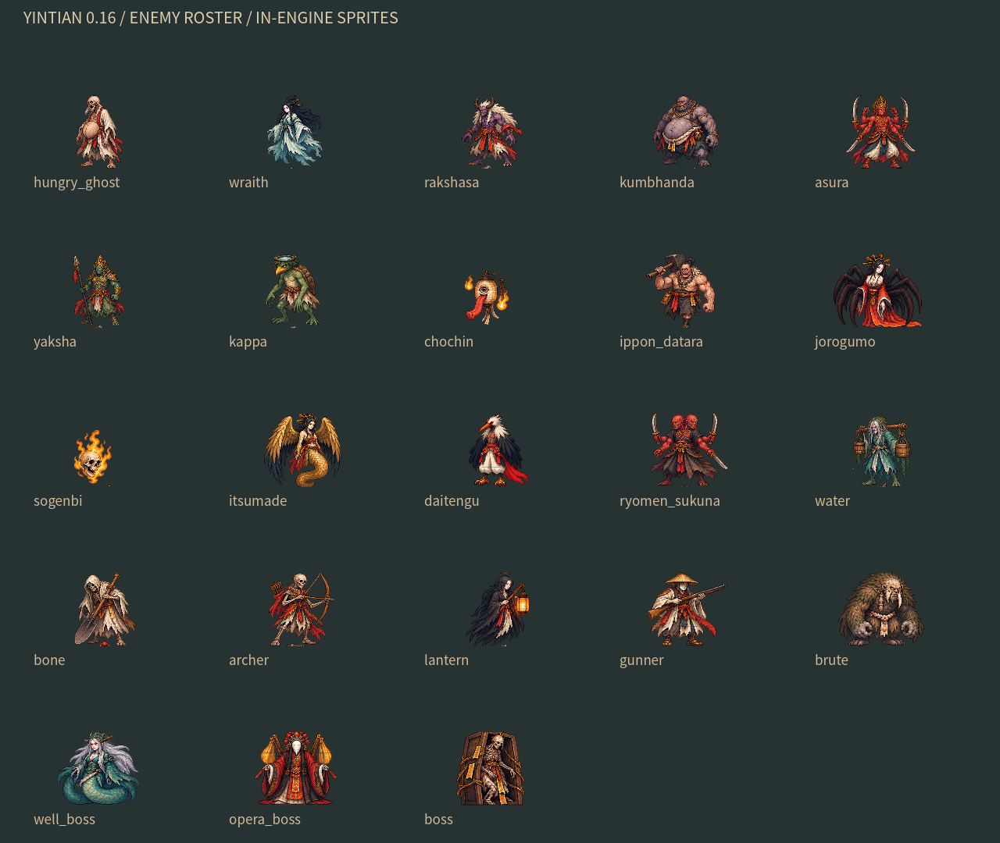
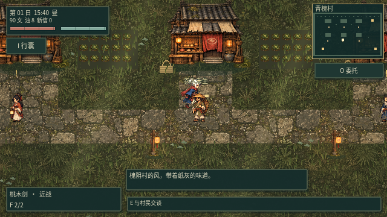
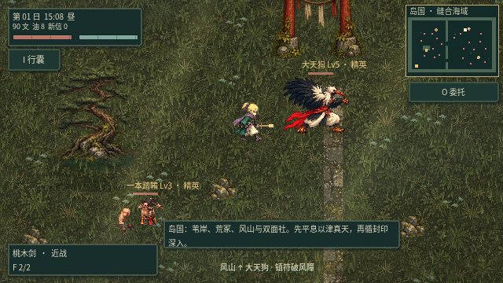
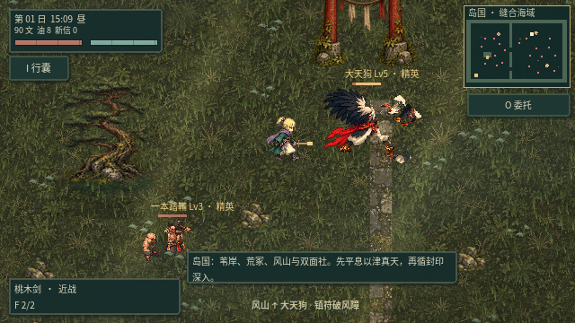
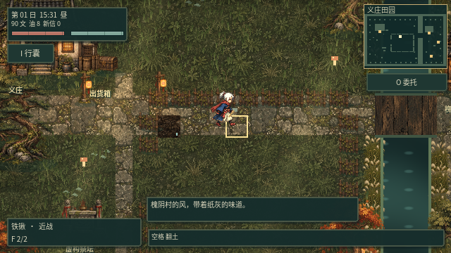
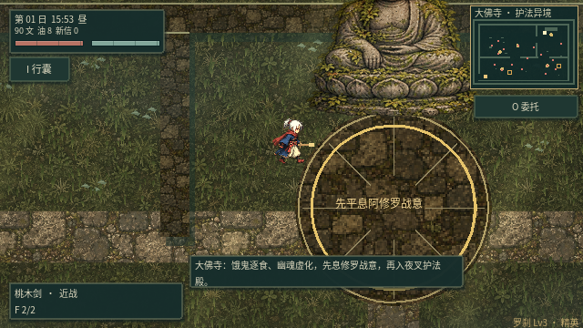
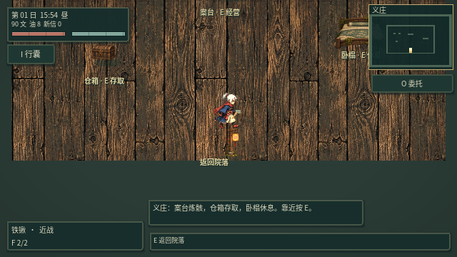
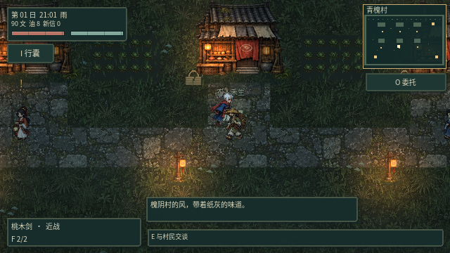

# v0.17 · 日系像素旅人与活草地

按本轮确认的方向，主角、怪物与村民改为更紧凑的日系 RPG 像素比例，保留服装、面部与妖怪轮廓的细节。环境采用低对比草土、苔石、旧木与瓦顶，让角色从场景中读得清，也能融入同一套材质与光照。

## 造型与外观自定义

从新游戏的遗书页选择「先定制旅人外观」，或在 **装备 → 外观定制** 中进入。可更改姓名、两套基础造型，以及发色、衣装、围巾、下装、鞋靴、肤色、饰件七组颜色。左右箭头可切换预览朝向；预览期间不会改动当前角色，点击「保存外观」才应用和存档，也可随机搭配、恢复默认外观。外观与装备数值分开，旧版存档会自动补齐默认外观。




两套造型各有四向八帧行走、六帧攻击选择，部分左右动作通过镜像复用。行走以 16 帧/秒播放，攻击随实际动作时长推进；衣摆在分段网格上连续摆动，握点随攻击阶段变化，装备仍由游戏绘制。怪物中的大天狗有独立四向姿态；普通怪物使用新的立绘部位层和关节步态，目前没有为每一类怪物单独画齐四向完整动作组。

## 全怪物与村民

23 类怪物重新统一像素轮廓、色阶与比例。河童的皿与甲壳、提灯妖的眼与舌、一本踏鞴的独腿、络新妇的蛛肢，以及佛寺各类妖物仍保留各自特点和战斗能力。六位村民按村长、药婆、铁匠、灯匠、农人、书生重新设计，并加入行走和交谈姿态；桥边阿婆和对话立绘也同步更换。





## 动作与断肢共用数据

怪物源图按头、左右臂、左右腿与躯干拆成透明部位层，沿颈部和关节收窄分区，保留原图像素。绘制与断肢共用同一套姿态、关节轴、翻转、位移和缩放数据；碎片直接从正在显示的部位层生成。移动、攻击、镜像和受击错位都会计入位置，断口也会从身体上扣除，加入小范围伤口标记。

断臂削弱攻击，断腿减速并放缓步态，断头取消攻击与蓄力后慌乱移动。幽魂和丛原火没有肢体，提灯妖按整体头部处理，一本踏鞴只拆其唯一腿部。当前仍是 2D 图层与关节动画；身体遮挡处没有在源图中出现的背面内容，不会凭空补画。





## 地图、材质与草地

房屋、商店、三类树、岩石、墓碑、灯笼、围栏、宝箱、祭坛、石塔、佛像和室内家具改用同方向的材质。地面按实际地图格子区分草、路、水和室内木地板，石路连接关系保留；乱葬坡的装饰道路也并入地表数据，使草地避开道路。耕地单独接入翻土和湿土材质，地块坐标与交互保持兼容。

活草按地图位置与自然疏密生成，根部固定、草梢随风；人物、附近村民和怪物可压弯草叶，走过后留下约 1.2 秒渐消的回弹轨迹。道路、水面、田块和室内不生成活草，暂停会冻结风和回弹。草采用分块实例化与视野剔除，近脚部还会有少量草叶遮挡鞋靴。


动图来自游戏运行画面，以每两个物理帧采集一帧、30 帧/秒播放；不是概念效果图。









## 验证与开发

- `python3 scripts/test_game.py`：导入、19 组规则与游戏流程回归、主场景启动。
- `python3 scripts/verify_actor_parts.py`：39 个源姿态逐像素验证；部位层无重叠，合并后与源图可见像素完全一致。
- `test_jrpg.gd`：外观草稿、实际按钮点击、空姓名反馈、配色传入材质、保存读档、跨地图；河童、一本踏鞴和大天狗在三种朝向下验证移动／攻击中碎片的位置、角度、比例和源层。
- `test_living_style.gd`：真实步行压草、回弹、暂停、视野剔除、耕地与河面排除、土壤状态；图形运行还导出 48 帧步行画面和各区域截图。

在当前云端图形环境、不进行 PNG 回读时，青槐村短测约 18–22 毫秒/渲染帧；这是该场景的观测，不是所有设备和战斗规模的帧率保证。截图与 PNG 编码本身的耗时不计作游戏帧率。

源图在 `godot/assets/jrpg/` 与 `godot/assets/world17/`，通过当前图像工具依据用户参考与本轮方向制作；并非直接调用 Midjourney，也未使用其他商业游戏的角色素材。运行时按既有建筑与交互尺寸归一化环境素材，源 PNG 保留。

角色源图改动后，需重新测量索引并生成配套部位层：

```bash
python3 scripts/index_jrpg_atlas.py
sh scripts/godot.sh --headless --script res://tools/bake_enemy_parts.gd
python3 scripts/verify_actor_parts.py
sh scripts/godot.sh --headless --editor --import --quit
```

索引和像素校验脚本需要 Pillow；切分工具用于开发阶段，游戏使用已生成的透明层。旧地形生成器不会覆盖本轮 JRPG 源图。存档格式升至 11，继续迁移旧存档。
