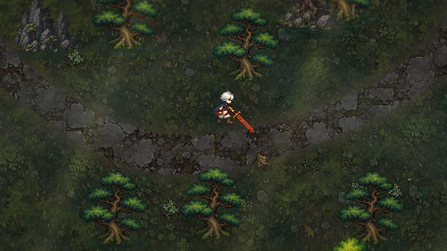
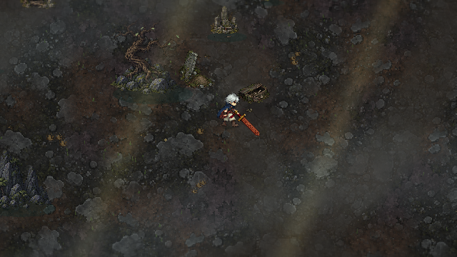
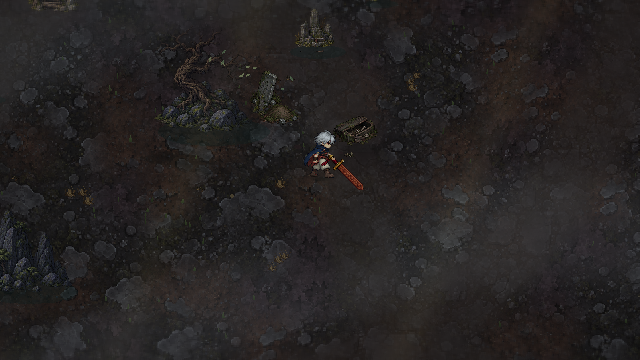
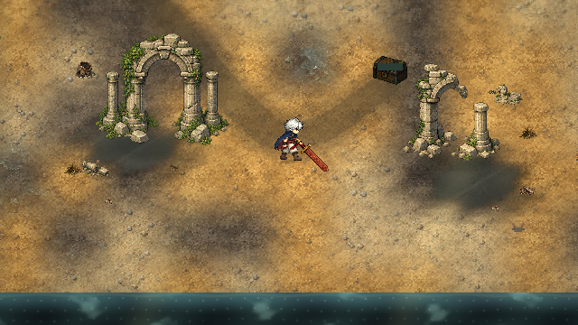
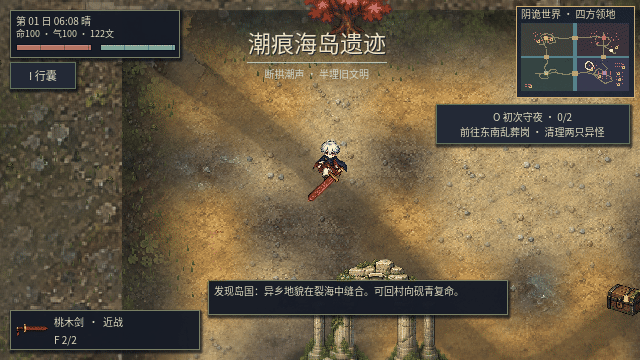
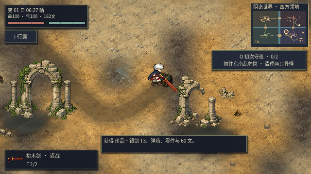

# v0.29：后山、孤坟与潮痕海岛遗迹

新主角与村民接入手绘像素风第一批素材，具体完成范围与尚未替换项见 [美术规范](PIXEL_ART_DIRECTION.md)。

本版处理重复石板、成片同种植被、格子路边和扁平场景。新生成的素材有 **四种石板、四种森林地表、四种坟地碎土、四种海岸材质，以及 24 个独立透明构件**；原始素材和测量后的单元边界保存在 `godot/assets/landscape29/source/`，可用 `godot/tools/bake_landscape29.gd` 重建运行素材。

以下分区总览为游戏实时渲染，检查时隐藏 HUD，保留原有天气与光照；领取宝箱图保留正常界面。

## 道路与后山



无缝地图的可见道路沿实际路线平滑弯曲，不再取方格瓦片的外轮廓。主路约 46–58 像素宽，新增支路约 23–35 像素宽；边缘加入少量侵蚀变化。石板、带泥碎石、土质路肩和草地连续过渡，四套石板在世界坐标中混合采样。逻辑 TileMap 继续承载水域和地形类型；道路加速与寻路偏好使用同一个可见道路场，不会只在看不见的旧格子上加速。

地面以低饱和深绿苔土为主，少量裸土、枯草与落叶打断重复。中层蕨类、三叶草、蘑菇、短枝采用疏密小群落，每群一至三株，留出空地。灌木和粗草进入角色所在的 Y 排序层，角色走到后面时半透明遮挡；植物顶端随风和经过的玩家偏摆。树林使用绿色树种，避免把后山全部当作荒岭生成岩壁和枯木。

新支路连接猎人的旧箱与守墓人的箱子，奖励仍是实际可领取且只能开启一次的装备。没有用仅能阅读的告示代替探索奖励。

## 荒岭孤坟与血月





原先随机散放的共用石坟堆改为 **三处重点墓葬组**：隆起土坟、风化墓碑，以及旁边的凹坑、半埋棺木或坍塌石墓。骨片、旧花环、铁链和断枝靠墓边、坑沿摆放；暗红污迹只作小点缀，不铺满地面。其他地方保留山石、枯木与大片空地。

灰色碎石、暗灰碎土、褐红泥土和少量苔石混合；高度场使坟丘顶面稍亮、凹坑变暗，局部坡面有明暗变化。这是俯视像素的视觉起伏，没有新增可攀爬的 Z 轴地形。

血月改为冷灰基底上的微弱暗红阴影与稀疏月光，降低原先整屏红色染色。原有天气触发与血月规则保留。

## 潮痕海岛遗迹



岛国海岸新增独立的遗迹区域，原有江户荒街保留。左侧拱门较完整、植被较多；右侧缺失拱门上部、只剩残柱，使用不同的素材与轮廓。倒柱、碎石、半埋雕像、残碑、破桶、船板、贝壳和海草集中在墙脚与浅洼旁。

暖黄干土、细砾沙土、湿泥和浅水材质混合。低洼处采用不规则轮廓，湿泥向浅水渐变，有克制的环境反光；中间路面略高。建筑底部有接触阴影，水边有淡海雾。拱门中央可通行，碰撞只放在柱脚；站在门后时建筑软化为半透明。

一只潮蟹在倒柱附近，另两只在开阔滩涂活动，靠近时会退避。**它们是环境生物，尚未作为新增战斗敌人。** 右侧遗迹后有真正的「潮痕遗匣」，提供三阶银剑与既有宝箱补给，保留附近敌人、容量限制、单次领取和存档规则。

## 实机与验证范围

`test_landscape29.gd` 覆盖独立素材、三处坟丘与凹坑、三条奖励支路的实际碰撞通行、宝箱交互与存档、两座拱门的门洞和遮挡恢复。分区截图使用受控时间与天气，并隔离战斗，以检查地图本身；不是战役通关记录。

`play_landscape29.gd` 从海岸入口的固定测试起点出发，随后使用正常移动输入，绕过废墟、穿过左拱门、再按 E 领取遗匣。敌人 AI、生命、伤害与物品奖励保持正常；初始位置是测试安排，并未从义庄一路走到海岛。





道路与起伏场在载入时烘焙；植被按世界固定种子分布，存读档不会因为当前站在不同领地而重新洗牌。静态装饰按可见分块绘制，远处构件不做细节更新。固定时步截图不作为 60 FPS 性能证据。实机海岸路线完成四个目标，穿过门洞后正常按 E 领取遗匣，生命保持 100，未关闭敌人 AI 或修改生命。

导入、**39 套 Godot 回归与主场景启动通过**；新增地图专项 **46 项**、GPU 地表接缝检查 **8 项**通过。新素材专项 GPU 检查 **75 项**通过；图形版 JRPG 外观与断肢检查 **42 项**、脚步与缺肢姿态检查 **130 项**通过。全量回归先完成前 23 套，更新绑定旧主角图集的断言后，从该套接续跑完剩余 16 套；未移除战斗、断肢或存档检查。

旧地域测试将“存在旧共用石坟堆”改为“保留山石且存在三处独立墓葬组”，其余天气、环境互动和物理检查保留。

新增地表着色器使用无三角函数的哈希，低矮装饰共用图集。全部新角色接入后，云端 llvmpipe 软件渲染、无固定帧率单次实测：

| 场景 | 中位帧耗时 | P95 |
| --- | ---: | ---: |
| 营地 | 17.551 ms | 22.435 ms |
| 雨战 | 25.387 ms | 37.554 ms |
| 后山 | 22.014 ms | 27.969 ms |
| 海岸 | 19.056 ms | 23.631 ms |

相较本次新增场景但尚未优化的测量，四处中位帧耗时约减少 1.8–3.2 ms。仍有新场景的额外开销，且**未稳定达到 60 FPS**，不能据此承诺任意设备最低帧率。性能场景会给玩家临时免伤以保护测量；前述正常输入游玩没有开启免伤。

## 复验与工程包

```sh
sh scripts/godot.sh --headless --script res://tools/bake_landscape29.gd
sh scripts/godot.sh --headless --editor --import --quit
python3 scripts/test_game.py
python3 scripts/package_game.py
```

图形检查需要可用 DISPLAY：使用 `--rendering-method gl_compatibility --audio-driver Dummy --fixed-fps 60 --script res://tests/test_landscape29.gd`。性能检查运行 `benchmark_performance.gd`，不要加 `--fixed-fps` 或 `--headless`。

下载工程包保留运行素材、生成源素材、代码、测试和当前实机图；不再重复收录 `docs/images/` 中约 26 MB 的早期展示图片。它们仍完整保存在 GitHub 仓库，并未删除。
