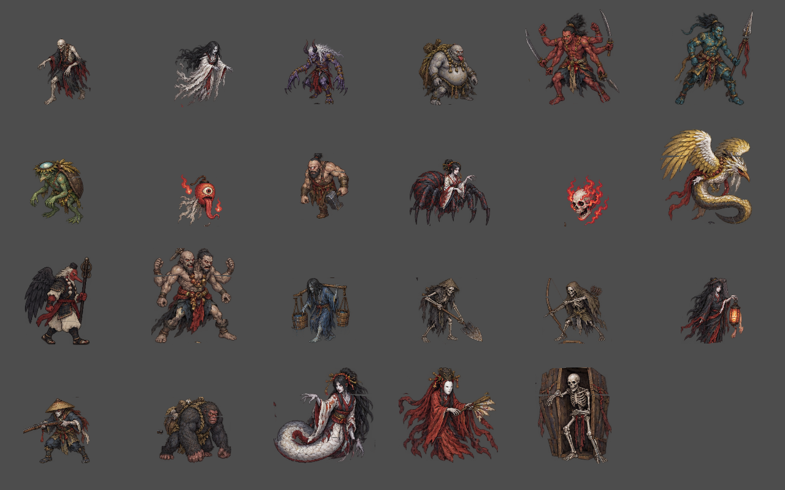
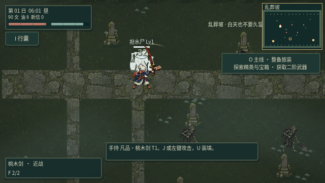
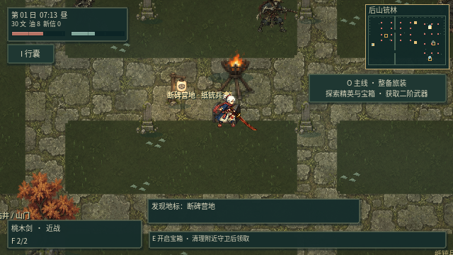
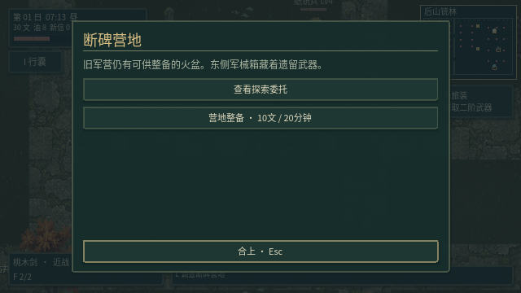

# v0.20 · 怪物实体与地图交互重建

本轮重绘23类怪物及大天狗四向动作，更新24种场景物件与四种地面素材。画面仍采用俯视角2D：怪物由独立头、躯干、肢体节点组成，按部位驱动关节变换，并非3D模型。大天狗另有四方向、待机/左右步/攻击的16个源姿态；其他怪物使用新原画分层和程序关节动画，并未逐类手绘完整四向逐帧动画。



## 体积、动作与受击

- 全怪物具有脚底胶囊碰撞体，按体型区分宽、高和质量；幽魂也参与角色体积碰撞。玩家闪避时仍能穿过角色，静态墙体继续阻挡。
- 移动步相由实际位移驱动；攻击区分蓄力、发力、收招，接触停顿与冻结会停止动作时钟。保留单足跳、蜘蛛低重心、浮游和大天狗源姿态。
- 身体与关节使用同一套源区域、镜像和枢轴数据，断肢碎片从当前部位位置脱离，断腿减速、断头失去攻击并乱窜。一次断腿保留另一侧支撑腿。
- 接触阴影随步相变化，重体型击退减小；保留右键重击、命中停顿、击退、伤害拖尾及技能特效。
- 新增怪物间避让；寻路按体积缓存通行区域，直线路径先检测整个身体的扫掠体积，避免视线通畅但肩部卡墙。障碍变化会使缓存失效，无法连通的目的地不再返回伪装成功的部分路径。通行图按障碍局部栅格化，减少首次寻路的逐格全障碍扫描。
- 出生位置按实际体积避开静态障碍。



## 地图与实际用途

出口位置、目的地、落点、小地图和大地图标记共用同一份数据。十张地图逐点检查可接近性与出口完整通路。E优先选择最近的可用交互目标，墙体阻止隔墙使用，目标自身灯柱或箱体不会误挡操作。

后山三处地标增加实体物件、近处交互标识、说明和委托入口：

| 地点 | 实际用途 | 消耗 |
| --- | --- | --- |
| 断碑营地 | 生命+20、气力+10 | 10文、20分钟 |
| 枯井 | 清除中毒、灼烧、束缚 | 5气力、10分钟 |
| 山门遗址 | 存活的受伤役灵恢复20%最大生命 | 20文、20分钟 |

附近有敌人时不能整备；资源不足不生效，无异常状态时净身不扣费，无受伤役灵时祈安不扣费。疗养不复活已倒下的役灵。地标探索继续连接原有调查委托，宝箱仍有独立奖励和守卫判定。




## 验证

22组回归共1,281项检查通过，主场景正常启动；图形模式实体与地标检查390项、重击及随从输入渲染检查46项通过。

`python3 scripts/test_game.py` 运行22组套件及主场景启动；其中新增 `test_models_map.gd` 的395项检查涵盖23类怪物的墙体、玩家、怪物碰撞、关节实际变化、镜像断肢位置、动作状态和十张地图交互。原河道用例将夹在建筑碰撞边缘的敌人移至可容纳新体积的位置，仍验证河墙两侧攻击无法穿透；持续射击固定随机散射种子，保留实际弹丸命中与弹药守恒断言。

`python3 scripts/verify_actor_parts.py` 检查39组源姿态的分层透明像素无重复、无遗漏。图形模式在固定30帧游戏时间下运行真实实体关节渲染和地标菜单，另用实际鼠标、菜单输入回归重击与随从系统。测试使用隔离存档目录。PCM音效已验证数据，图形环境使用Dummy音频，不代表实际聆听验证。

```sh
python3 scripts/test_game.py
python3 scripts/verify_actor_parts.py
DISPLAY=:1 YINTIAN_CAPTURE_DIR=/tmp/models20-captures \
  MOSSFIELD_RUNTIME_DIR=/tmp/models20-profile \
  sh scripts/godot.sh --audio-driver Dummy --rendering-method gl_compatibility \
  --fixed-fps 30 --script res://tests/test_models_map.gd
```

截图来自Godot运行画面。长期刷怪平衡、大规模同时出战性能和各类怪物更丰富的手绘方向动作，仍可继续调校。
