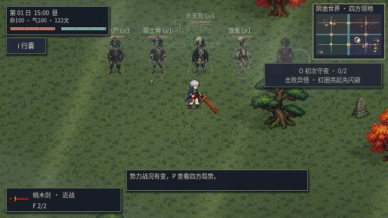
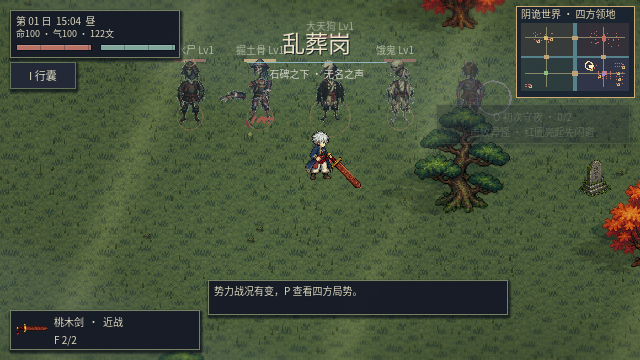
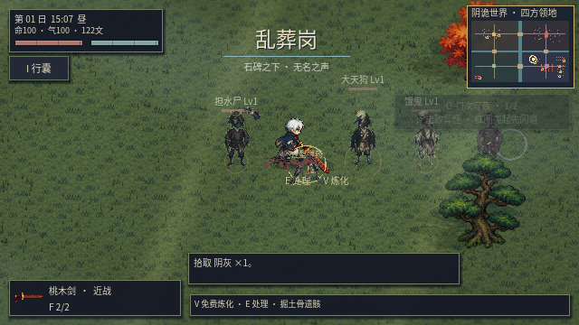

# v0.25 · 五套模块化敌人与物理断肢

本版在正式无缝世界中替换敌人身体的绘制方式，使用五套独立素材包。怪物的技能、装备掉落、委托和势力身份继续由原记录决定；同类体型共用素材模板，并非新增 23 套独有角色原画。青槐村民兵继续使用村民外观。

## 五套独立下载

| 素材包 | 主要外形 | ZIP |
|---|---|---|
| drowned | 靛青甲衣水尸 | [水尸](../artifacts/enemy-packs/drowned.zip) |
| skeleton | 斗笠骸兵 | [骸兵](../artifacts/enemy-packs/skeleton.zip) |
| tengu | 白首、黑羽、赤带天狗 | [天狗](../artifacts/enemy-packs/tengu.zip) |
| hungry | 破衣、瘦骨饿鬼 | [饿鬼](../artifacts/enemy-packs/hungry.zip) |
| rakshasa | 犄角、暗肤罗刹 | [罗刹](../artifacts/enemy-packs/rakshasa.zip) |

每包含 21 个文件：19 张 PNG、`manifest.json` 和说明。所有帧格为 **64×64 RGBA**，相同的 **24 色板**、3/4 俯视视角、最近邻采样，基准脚点 `(32,61)`。原画由图像生成工具制作，随后使用 Godot 工具按独立组件归一化、索引色板，并烘焙动画；不是从一张完整人物贴图中按矩形裁出碎块。

- `idle.png`：4 帧呼吸循环；`walk.png`：8 帧步态；`hit.png`：3 帧受击。
- `parts/`：独立躯干、头部、左臂、右臂、左腿、右腿。手臂从肩至手、腿从髋至脚，不是碎片。
- `residual.png`：无四肢的躯干与头部，可另行拆下头部。
- `stumps/`：左右肩、左右大腿根、颈部断口；每张都是可开关的独立叠加层。
- `blood/`：血滴、地面血渍和短暂飞溅，各自独立小图案，使用同样的透明帧格。
- `atlas.png` / `manifest.json`：合批图集、帧索引与关节锚点。

左右以未镜像角色的素材命名为准。现阶段为统一的 3/4 视角加左右镜像，不包含独立绘制的四方向背面。生成原稿保留在 `godot/assets/enemy_packs/source/components.png`，实际游戏只加载五张低分辨率图集。



## 实际运行方式

`YinMonsterRig` 在正式无缝世界中选择 `YinModularRig`。每个关节拥有独立 `Sprite2D`，肩与髋使用明确的旋转锚点；行走相位跟随实际移动距离。导出的完整帧与实时关节共用 `YinEnemyPack.transform_for()`，避免美术序列和断肢坐标采用两套标准。历史分图测试保留旧图集回归路径。

近战或子弹造成伤害后，按剩余生命阈值分别切断左臂、右臂、左腿、右腿和头部，阈值为 65% / 48% / 32% / 22% / 12%。断腿降低移动速度，断臂降低攻击伤害，断头后取消攻击并慌乱移动。幽魂、丛原火不生成四肢；一本踏鞴保留单腿。

一次切断同时执行三件事：移除对应肢体的子 Sprite，开启对应断口，向世界中生成独立 `YinSeveredLimb : RigidBody2D`。飞出时复制关节的当前位姿、镜像和完整部位素材。身体起始高度转换为抛物线高度，初始画面位置仍与关节一致；刚体在平面上旋转移动，与地形、尸体和其他断肢碰撞，落地后休眠。模型的视觉飞行高度独立于刚体旋转，避免转动时血肉部件绕着空气打圈。

受击包括闪色、局部帧位移、实际击退与停顿。`AnimationPlayer` 驱动三帧受击关节姿态。短暂全局时间缩放在真实时间 45 ms 后恢复；远处战斗不会触发玩家的慢动作。

命中飞溅为一次性 `CPUParticles2D`，约 0.32 秒消失；断口每 0.55 秒发射少量独立血滴，落到身体下方地面后生成血渍。尸体新鲜断口继续渗血 8 秒。渗血只在视野附近生成；同时限制飞溅发射器 16 个、下落血滴 48 个、血渍 96 个。血渍使用地面绘制层，避免盖到人物前面。



## 尸体与保留设置

死亡时记录当前剩余关节位姿与缺肢清单，销毁原来的 `Enemy CharacterBody2D`。`YinCorpse : StaticBody2D` 保留躯干、尚未被切断的部位、断口层与胶囊碰撞形状，播放约 0.45 秒倒地投影。独立断肢属于世界节点，不会跟随敌人销毁。

StaticBody2D 本身不接受物理力；玩家脚部范围通过碰撞查询找到尸体，再用移动扫掠进行脚本推挤。玩家可以踏过低矮残躯，踩踏时轻微压低躯体。推后的位置写回尸体记录；地形与其他尸体阻挡推移。静置尸体停止自己的逐帧回调，没有敌人 AI、伤害接收器或移动逻辑。

游戏设置可以选择 **永久保留 / 60 秒后淡出 / 180 秒后淡出**。该选择作用于新生成的尸体和离体部位。永久保留时刚体在落地后休眠，不持续运行自定义更新。定时尸体淡出后同时移除碰撞与存档记录；旧尸体仍可按 E / V 就地处理。

存档保留残躯的精确关节、四肢缺失、断口、位置与保留时长，兼容旧 `arm/leg/head` 缺肢标记。读档后静置的旧尸体不会重新渗血；定时保留从重新加载场景起计时。离体刚体的现场运动不写入存档，重新进入场景不会重放飞散过程。



## 复现与验证

```sh
sh scripts/godot.sh --headless --editor --import --quit
sh scripts/godot.sh --headless --script res://tools/bake_enemy_packs.gd
python3 scripts/package_enemy_packs.py
python3 scripts/test_game.py
```

全量回归 **27 套、1477 项检查，0 失败**，包含历史玩法、无缝世界、性能与尸体，以及新增的模块化敌人检查。[完整输出](enemies25/validation.txt) 新增套件 61 项；另在图形模式验证并保存三张实机画面。新增测试实际验证单侧切断、镜像动作对齐、子 Sprite 移除、刚体撞墙与落地、玩家真实移动推动、受击 AnimationPlayer、时间恢复、渗血、死亡后断肢存活、保存回读和淡出清理。图形模式另保存三张实机画面。

本次云端 Mesa llvmpipe 软件渲染、解除帧率上限实测：营地中位帧耗时 **16.135 ms**、P95 **19.876 ms**；雨战中位 **18.004 ms**、P95 **26.986 ms**。该环境雨战仍有低于 60 FPS 的情况。截图测试使用固定步长，只验证画面与交互，不作为帧率证据。[原始基准输出](enemies25/benchmark.txt)
