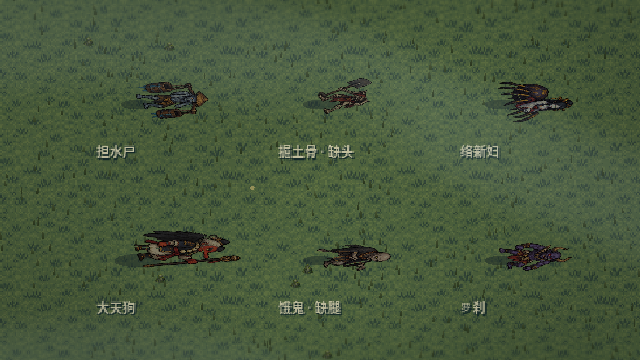
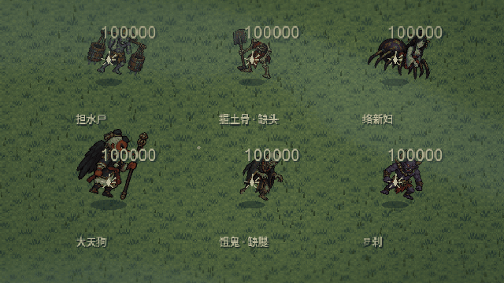

# v0.24 帧耗时优化与尸体重构

本版以 60 FPS、每帧 16.67 ms 为优化目标，战斗物理保持 60 Hz。设置帧率上限不能强制硬件达到最低帧率；本版没有将“全设备不低于 60 帧”标记为已经实现。

## 实测结果

环境：Godot 4.6.3，OpenGL Compatibility，Mesa llvmpipe 软件渲染，640×360 逻辑画布、1280×720 窗口，Dummy 音频。比较两个独立新档的营地晴天与乱葬岗雨天战斗场景。基准解除 60 FPS 上限，按真实墙钟记录帧间隔；没有使用固定帧率模拟值作为实测 FPS。

| 场景 | 优化前帧时间中位数 | 优化后帧时间中位数 | 优化前 P95 | 优化后 P95 | 优化后中位帧率约值 |
|---|---:|---:|---:|---:|---:|
| 营地 | 136.98 ms | 15.68 ms | 146.81 ms | 18.98 ms | 64 FPS |
| 雨天战斗 | 153.24 ms | 20.06 ms | 191.52 ms | 48.94 ms | 50 FPS |

最终测量时没有并行 Godot 测试进程。优化前使用 60 帧预热，在原始帧率下约 8 秒；最终版本使用 8 秒墙钟预热。各场景采样 180 帧。AI 行为和自适应画质会随运行时间变化，因此这是一组场景性能抽样，不是完整设备基准。雨战最终为轻量画质，营地为流畅画质。原始输出见 [优化后记录](performance24/benchmark.txt) 与 [优化前记录](performance24/baseline.txt)。

软件渲染环境的雨战中位帧率仍低于 60，P95 也超过 16.67 ms。真实显卡和 CPU 的效果需在目标设备上实测，不能将本结果声称为稳 60 或最低 60 已通过。

## 具体优化

- 视野外怪物停止关节重算、材质更新与重绘；战争的寻路、碰撞、攻击、伤亡继续按原逻辑运行。
- 128 像素空间索引缩小邻近敌人和避让查询范围，每 0.1 秒更新位置快照，并为跨格移动留余量。
- 连续世界导航从 400×300 缩为 200×150 格；保留按怪物实际体积扩展障碍，桥梁与四方主城仍可达。历史小地图维持原网格。
- 环境细节按视野查询分块；草地可见性只在视野明显移动后刷新，步行压草仍实时更新。
- 全境树木共享风材质，远处树木不反复更新独立参数。
- 将 225 个关节 PNG 无损打包为共享图集。打包工具逐块比较像素，原始分层文件保留，断肢仍使用同一部位与锚点。
- 小地图与界面文字按 10 Hz 刷新，重要操作仍即时刷新。
- 连续战斗存档合并为至多每 0.75 秒一次请求处理，手动保存、返回标题等保留立即保存。

持续超预算时自动降低到流畅或轻量档，减少景深、光晕、草叶密度与衣物几何细分；保留角色行走源帧、攻击时序、怪物碰撞、物品掉落和实体战争。负载恢复后带延迟地恢复画质，避免频繁切换。按 F3 查看实际帧率、帧时间和档位。

## 尸体表现



上图为 Godot 实机验证布置，展示不同怪物的遗体，以及缺头、缺腿状态。展示位置和敌人由验证脚本集中布置，并非自然遭遇截图。



击杀时保存当前源姿态、步相、关节动作、朝向与断肢状态；部件先旋转倒下，再投影到地面，避免宽体和翼类怪物倒下后仍呈站立轮廓。尸体使用静态阴影和低饱和颜色，不再全部替换成同一张骨堆。

落地约 0.45 秒后停止处理，无 AI、碰撞体或受击框。尸体按 ID 增量维护，再次击杀不销毁重建场上已有遗体；就地炼化或处理只删除对应尸体。NPC 与军队互相击杀也留下遗体，但不直接给予玩家击杀奖励。

旧存档缺少死亡姿态时，根据怪物类型重建静态遗体；新姿态经过 JSON 存取与有限数值、部位、资源索引校验。保留源部件 PNG 作为烘焙与验证依据。

## 验证与复现

- 26 组、1416 项检查通过：24 组历史规则与兼容检查 1360 项，连续世界专项 34 项，性能与尸体专项 22 项。详见 [验证记录](performance24/validation.txt)。
- 新专项检查真实击杀、倒地结束、缺肢保留、增量节点稳定、旧档重建、JSON 往返、损坏数据拒绝、炼化删除和合并后的实际磁盘存档。
- 图形模式专项 24 项通过，检查并保存倒地与落地画面；固定步长仅用于功能截图，不用于上面的性能测量。
- 打包工具验证 225 个部件逐像素一致；角色原有 39 个分层姿态验证继续保留。

完整回归：`python3 scripts/test_game.py`。

实测前使用独立存档目录，运行：

```sh
MOSSFIELD_RUNTIME_DIR=$(mktemp -d /tmp/yingui-bench.XXXXXX) sh scripts/godot.sh --audio-driver Dummy --rendering-method gl_compatibility --script res://tests/benchmark_performance.gd
```

需要图形环境。不要添加 `--headless` 或 `--fixed-fps`，基准会拒绝这些参数。修改人物分层后，先运行原部件烘焙，再运行 `res://tools/pack_actor_parts.gd` 更新共享图集，最后导入资源。
