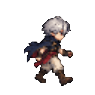
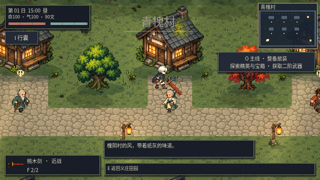

# 《阴诡世界》手绘像素风与逐帧动作规范

用户指定参考：[Children of Morta / 莫塔之子](https://store.steampowered.com/app/330020/Children_of_Morta/)。本环境访问 Steam API 被代理返回 403，因此未完成官方截图的现场对照。以下是本项目依据用户指定方向制定的原创美术规范，不是对参考作品素材或制作流程的复刻。

## 统一画面

- 采用有明确像素簇、彩色暗轮廓和有限色阶的手绘像素**风格**。新素材由图像生成工具制作，不标注为人工逐像素绘制。
- 人物基准约 48–50 像素高，同一俯视角；世界保持原有可读的 Q 版比例。低饱和场景衬托角色和危险提示，避免背景满铺高亮碎点。
- 森林用冷绿、墓地用灰紫与克制暗红、海岸用土黄与青灰、残寺用褐沙。局部火光和月光不能把全屏染成单色。
- 道路、湿泥与植被通过世界空间材质过渡；装饰按叙事小组摆放，保留可走通的空地。
- 美术检查包括实际镜头下的辨识度、透明边缘、材质接缝、前景遮挡和雨雪表现；大尺寸源图不能替代实机图。

## 动作与断肢

行走应能辨认左右脚接触、下压、经过与抬升；帧相位跟随实际移动距离，停止和撞墙不能继续踏步。攻击必须有蓄力、命中、随挥、收势；重击延长蓄力，不靠重复快速转动武器制造动作。

新默认主角拥有四方向各八帧行走、六帧攻击、独立待机和受击，共 64 个源姿态。运行图集使用统一比例和脚底基准，握持点按各帧手部定位；不使用原有腿部网格变形来生成新行走。第二套符术旅人仍保留旧素材与变形，这是待替换项。

怪物后续逐项替换时必须保持本体、四肢、断口和离体实体的同帧配套。现有 23 类怪物仍是独立解剖部件加关节动画，不能称为已经完成新的逐帧重绘。任何替换必须通过缺肢行走、受击中截肢、死亡姿态保存与重载检查，再退出旧素材。不能为换画风丢掉现有断肢和实体战争。

## 本批实机与剩余工作

上图是 Godot 实际渲染的独立角色检查视口，用于查看源帧，不是地图游玩录像。地图中的实际行走录像见地图说明。

村民图取自保留的区域地图回归场景，用于检查角色接入，不代表该区域的建筑与地面都已换新。

新素材专项检查默认主角四方向的八帧下肢轮廓变化、六个攻击阶段、独立待机/受击、随帧握持点，以及六位居民各四个不同姿态。

已接入：默认主角新的行走/攻击/受击源帧，后山/坟地/海岸的材质、道路、地形叙事构件与实际探索奖励。六位 NPC 的新图集保留村长、药婆、铁匠、灯匠、农人、书生身份，各有独立待机、左右步和交谈源帧。

尚未完成全量替换：23 类怪物的逐帧解剖素材、第二套主角、所有武器和技能特效、全部建筑树木。旧版本的演示图保留为历史记录，不作为新风格的验收图。此批是统一美术的第一批实现，不能当作全游戏美术重置完成。

验证：39 套回归分段完成；新素材专项图形版 75 项、实际外观/断肢交互 42 项、地图 46 项及地表接缝 8 项通过。正常输入海岸路线四个目标与单次奖励通过，生命 100→100，未冻结敌人。云端性能尚未稳定 60 FPS。

源图与技术烘焙保存在 `godot/assets/pixel30/source/`、`godot/tools/bake_pixel30.gd`；地图构建与实机范围见 [v0.29 地图说明](LANDSCAPES_V029.md)。
