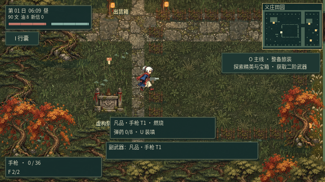
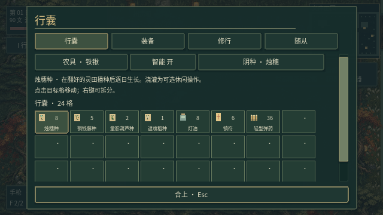
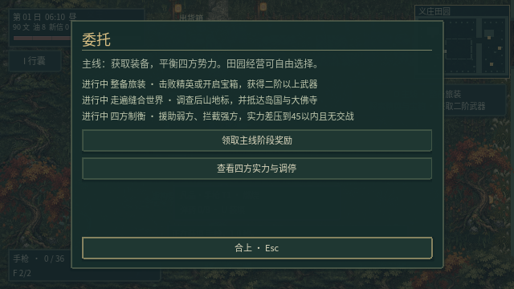
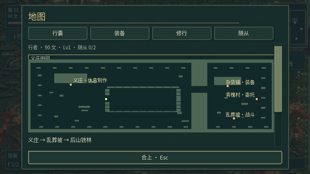
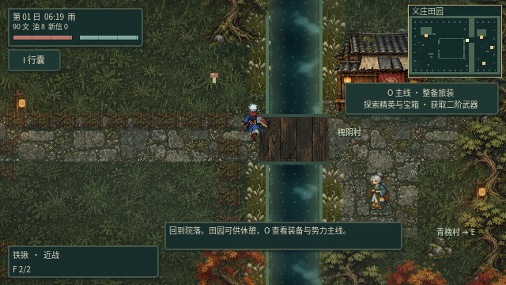
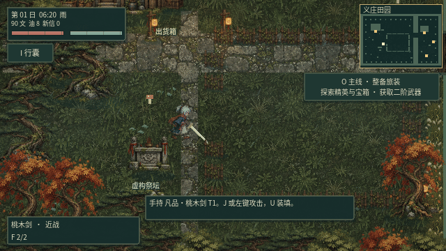

# v0.18 · 操作、战斗与探索主线

这一版以实际操控为中心调整，不增加新的菜单层级。`O` 直接查看装备、探索和四方制衡目标；`P` 查看实力与战争，援助当前最弱的一方。

## 操作与战斗

- 基础步速由92调整到112，加入短促加减速，松键停下不再强制取整坐标。行走帧由实际位移推进，撞墙时不再原地滑步。
- 攻击中保留52%的移动速度，施法保留65%。闪避可以取消攻击和装填，冷却从1.2秒缩短到0.65秒。取消前摇不会残留伤害，取消装填不会增加弹药。
- 连击缓冲180毫秒，按游戏时间计时；先检查出招资格再扣除缓冲，避免恢复完成的边界帧丢输入。
- 剑、妖刀、般若剑、鞭子使用手部锚点和连续插值的挥击轨迹；枪械分别显示枪管、握把、左轮转轮、加特林多管、后坐和枪口火光。法器保留图标纹理并增加施术环。
- 近战在动作46%的位置判定命中，神器特效同时出现；命中加入45毫秒的主角停顿，与怪物闪白、硬直和火花配合。
- 滚轮切换显示2.4秒的小状态条，包含当前武器、附魔、弹匣或施术信息；换地图及改持其他物品后不残留旧提示。

## 内容与导航

尸体装车、运输减速与运输追踪者已移除。遗骸可就地炼化、拆解和超度。旧存档车内的遗骸迁回义庄院落，内容保留。

种田成为休闲支线：未浇水的已播种作物也会逐日生长，未封声返魂稻不再自动累积每日污染；封声收获、葫芦养成等可选玩法仍保留。役灵的供养系统和旧章节剧情继续存在，装备与四方主目标不要求收成或祭祀。

主目标是取得二阶以上武器、调查后山与两个异境、让四方实力差不超过45且没有正在进行的战争。各阶段提供一次性铜钱与修为奖励，领取状态随存档保存，存档版本升至12并兼容旧版。

点击背包物品后直接显示简介；装备列表补充每种武器的用途说明。大地图标注出口目的地、义庄休息制作、商店、村庄委托、异境地域和村民位置。

## 美术与环境

怪物增加抬腿、摆臂、身体起伏、呼吸，一本踏鞴单足跳跃、络新妇低伏移动。关节动画仍与断肢共用变换数据；阴影随同一动作时钟改变宽窄与位置。怪物色彩适度压低饱和度并融入环境色，不重新生成会破坏断肢对齐的素材。

水面加入流向叠波、破碎高光、岸边浅水和暗色深水、轻微岸沫及雨圈，保留已有精灵倒影、雨水与地图碰撞。这是配合像素世界的风格化水面，并非写实三维水体。

## 玩家视角验证

使用实际键盘和鼠标输入，检查走停、攻击中位移、闪避取消、连击、滚轮换武器、装填取消、背包点击、任务面板和六张地图的出口信息；战斗场景验证前摇无伤害、命中帧掉血和停顿。另检查旧运输存档迁移、主线奖励只发一次、弱方援助及交战时不能完成和平目标。

试玩和收尾检查修复三处问题：换地图残留旧武器提示、连击缓冲在恢复边界帧提前过期、数字键换武器残留旧挥击状态。

验证结果：20组回归共847项检查通过；带画面的键鼠试玩39项检查通过（含7张截图），48帧录屏用于动图复查。数字键修复后补跑操作场景33项及枪械61项检查，均通过。39组原始怪物姿态的部位层仍可无重叠地重建源像素。

运行方式：

```sh
python3 scripts/test_game.py
DISPLAY=:1 YINTIAN_CAPTURE_DIR=/tmp/polish-captures \
  MOSSFIELD_RUNTIME_DIR=/tmp/polish-profile \
  sh scripts/godot.sh --audio-driver Dummy --rendering-method gl_compatibility \
  --script res://tests/test_player_polish.gd
```

测试在隔离存档中进行。地图与战斗目标使用固定测试场景，操作由真实输入事件驱动；这能验证可操作性与时序，长时间难度、装备掉落节奏仍需要后续游玩调校。







