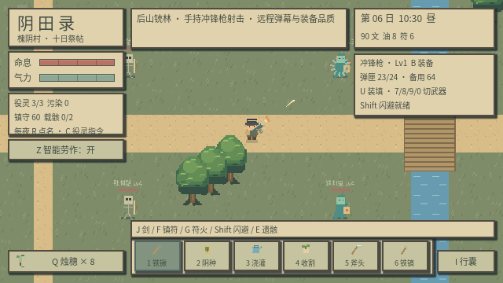
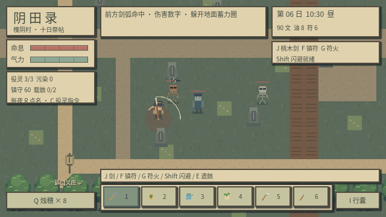

# v0.6：枪械与后山追加验证

本次保留原有种田、遗骸搬运、炼化和十日剧情检查，新增 61 项装备、弹药、弹幕与地图验证；玩家旅程为 35 项。总计 230 项，验证采用真实键盘、GUI 鼠标事件、实际物理更新与独立存档。

新增验证覆盖：智能空格连续翻土 / 播种 / 浇水、手动工具覆盖、手持斧头攻击、种子不能偷偷变成剑、三种枪的实际子弹命中、持续连射与每发弹药守恒、弹匣与备用弹种分离、换枪取消装填、暂停装填与弹丸、拆解返还未用弹药、护甲减伤、高速子弹无法穿墙、闪避避开真实弹丸、三种怪物蓄力后射击、弹丸数量上限、装备品质与等级、精英保底掉落、地面装备拾取与满容量保留、鼠标穿戴、后山入口 / 返回入口、扩展边界与镜头、旧存档升级。

图形模式复核玩家旅程与新增战斗检查，并检查完整名称、物品图标、装备菜单、手持枪械、枪口闪光和弹丸轨迹。开枪截图使用预设战斗时刻，以便显示动画与轨迹；运行中的动画由后坐与枪口闪光计时驱动。

数值、获取方式和参考来源见 [战斗与掉落说明](COMBAT_AND_LOOT.md)。以下保留 v0.5 的问题与操作路线记录。

# v0.5 玩家流程与画面检查

本次以新玩家的操作顺序设计键鼠驱动试玩，使用 Godot 的 GUI 鼠标事件分发、键盘事件和持续移动输入。它是自动模拟试玩与截图审查，不代表真人长时间游玩的主观评价。

## 实际操作路线

标题中新建义庄 → 鼠标收起遗书 → 从田边走到义庄 → E 进入 → 仓箱存取界面 → 门口退出 → 穿过农田左侧入口 → 1/2/3 配合空格翻土、播种、浇水 → I 打开行囊 → 关闭后绕田、过桥 → E 进入乱葬坡 → F 压制活敌 → J 击杀 → E 查看遗骸并点击装车 → 减速载骸返回 → 跨桥回义庄 → 案台处理运输车 → 滚动界面并点击炼为役灵。

这条流程使用实际移动与互动，没有用场景跳转、直接修改生命或直接调用炼化方法代替操作。后面的墙体、背后攻击、接触帧与闪避检查使用明确摆放的测试场景。

## 发现并处理

| 问题 | 修改 |
| --- | --- |
| 义庄门边纸灯挡住横向通行 | 将纸灯移出门口路线，保留建筑和河道实体碰撞 |
| 命息、资源混在一行小字中 | 独立命息与气力条，资源和时辰集中在右上角 |
| 默认进度条的最小高度挤住第二条 | 用固定尺寸像素状态条替换 |
| 近战判定能扫到视觉剑弧之外 | 统一 49 像素范围与前方扇区，背后敌人不受伤 |
| 符术与敌人攻击可跨墙命中 | 结算前检查实体墙遮挡，遮挡符术不消耗符箓 |
| 按键瞬间扣血，缺少接触过程 | 0.06 秒起手后结算；一次挥剑不重复命中，菜单暂停待结算攻击 |
| 敌人、玩家可随意穿过彼此 | 增加身体碰撞；闪避期间允许穿过敌人，墙体保持阻挡 |
| 夜战反馈不明确 | 增加伤害数字、像素碎屑、符术轨迹、闪避残影和蓄力圈进度 |

## 可重复验证

运行 `python scripts/test_game.py`。每组检查使用独立临时存档，避免其他测试产生的存档改变标题状态。

- 种田与剧情规则：65 项。
- 场景、物理与完整章节：26 项。
- 模块架构、仓储与旧存档迁移：43 项。
- 玩家旅程与战斗边界：34 项。
- 总计 168 项；另外检查资源导入与标题启动。

图形检查使用实际 Godot OpenGL 渲染，在 640×360 逻辑分辨率、1280×720 整数放大的窗口下检查标题、日间农场、仓箱、义庄、夜色和战斗截图。`combat.png` 用预设战斗时刻保留命中数字和敌方蓄力圈；其他场景截图展示成熟作物及役灵，新游戏仍从空田开始。

尚未验证一至两小时的游戏节奏、真人对难度的偏好或不同硬件上的操作体验；自动检查关闭音频播放。保留十日剧情的原有回归检查。
