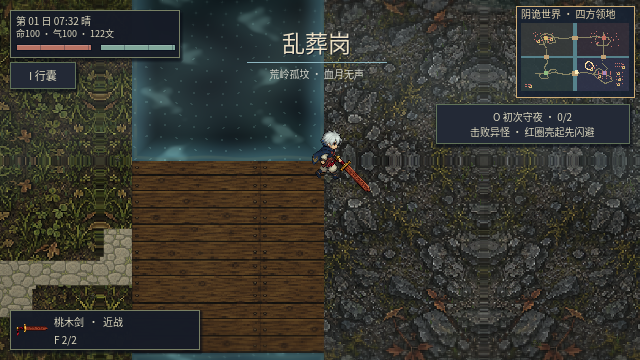
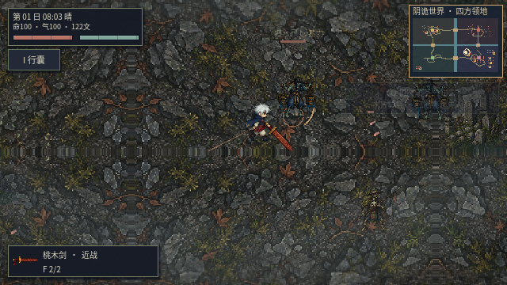
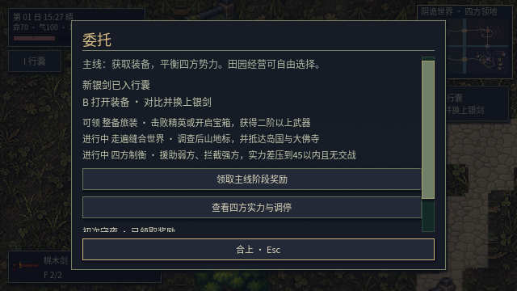

# v0.27 玩家视角试玩

## 先说体验判断

**开局战斗和装备获取已经能形成闭环，但还不能称为成熟、沉浸的ARPG。** 新怪物的物种辨识优于旧共用躯体，打击停顿和实际断肢有反馈；目前最拖累体验的是动作过渡不足、长距离赶路的回报偏少，以及战争发生后缺少明确的领地变化。

## 怎么玩的

在实际图形客户端、640×360窗口、Godot 4.6.3 Compatibility模式运行。通过程序发送正常键鼠事件控制角色，并查看客户端截图评价画面；不是人工鼠标长时间操作，也不是从头通关。固定时间步仅用于重放和截图，不作为帧率证据。

使用隔离的新存档：初始桃木剑、100生命，没有修改伤害、生命、装备，没有额外生成敌人，也没有关闭野外AI。移动使用按住WASD；自动化测试读取导航路线辅助选方向，攻击和闪避通过J/Shift事件，奖励通过实际任务栏按钮点击。

1. 从义庄(800,3648)出发。
2. 第1383个物理步越过东侧界河桥，连续移动抵达乱葬岗，期间没有场景切换或传送。
3. 寻找并攻击自然生成的两只异怪，第一次击杀后生命91，第二次完成后生命70。
4. 正常步行返程。此时发现村内细灯柱卡住导航，修正后从**同一存档**的卡点(1451,3501)继续，未改位置或血量。
5. 步行回到义庄附近(863,3558)，按O打开委托，实际点击复命，确认银剑奖励已经领取，最终生命70。

另外对16处新地点做了分段图形走查：这部分在各地点附近定位测试E交互、调查存档和离开路线，**不能算一次步行走遍四地**。新地点的首都通路另逐段做了真实身体扫掠检查。

## 试玩发现并修复

| 问题 | 实际表现 | 处理与复测 |
| --- | --- | --- |
| 斜向过桥时士兵反复折返 | 32秒仅前进约14像素 | 清除安全情况下多余的起始网格中心；四座桥双向实际单位通过 |
| 窄灯柱被网格漏判 | 两端网格可走，但连线穿过细灯柱，返程导航持续撞柱 | 无缝地图按网格单元覆盖范围保留障碍余量，逐段验证实际通行；同档返程成功 |
| 地点出口被布景挤占 | 锈剑风口的绳索影响向东离开 | 调整绳索位置，16处地点键鼠走查166项通过 |
| 地表镜像形成对称接缝 | 山地出现明显十字纹样 | 取消镜像采样，保留材质方向，重新检查地域画面 |

军队额外验证：四座桥、两个方向、斜向接近；六人队伍保持实体碰撞通过；过桥后发生真实伤害。再从正式宣战入口部署岛国与大佛寺军队，军队从自己的主城出发，无桥边定位，实际越河并交战。未使用传送或离屏扣血。

## 玩家仍会感受到的不足

**动作仍是第一优先级。** 现在是四张独立源姿态，已经摆脱同一张图旋转关节的主要表现，但迈步到攻击缺中间帧，上下方向没有独立完整动作。怪物转向、起手和收招依然显得突然。非人形断肢采用左右组，可见部位分层需要继续按物种校准，不能把自动分层视作全部解剖完成。

**探索有地点，但回报不够。** 钟庭、空伞市场、归冢和公井终于有可读内容，见闻能关联调查委托。可调查文字仍占多数，缺少能改变路线的机关、可靠的支路装备奖励和区域事件。首轮往返也明显暴露了大地图的赶路时间，任务密度应继续提高。

**战争能打起来，领地反馈还弱。** 修复后军队确实过桥，双方会主动接敌；但守方也会出城迎击，战斗容易集中在桥头。当前主要反馈是伤亡、兵力和物资结算，缺少据点占领、守备变化和战后驻军等玩家可直接看见的结果。

**美术方向更统一，场景构图还需精修。** 新怪物有清楚的物种形态，地区地表和布景有所区分；建筑基座和地面融合、高差、遮挡层次仍不足。局部地表细节过密时会抢角色轮廓，光照与雾效也不足以替代空间设计。继续添加更多散件无法解决这些问题。

**装备奖励有后续提示，界面仍有负担。** 返回领取银剑后能看到换装指引；任务页同时放入主线、调查、势力调停等内容，第一轮玩家仍要阅读较多文字。下一步应把当前目标和本次奖励放得更突出。

## 验证范围

- 完整回归运行：31套、1874项，全部通过，包含素材、战斗、尸体、存档、NPC、势力及地图。
- 后续细障碍导航修正：另运行36项地点路线/异常存档检查，并重跑18项过桥、34项无缝世界与正式主城部署行军。
- 图形走查：16地点、轻击/右键重击、调查保存，共166项通过；地域光照、天气和白边渲染另做图形验证。
- 默认工程测试列表已纳入新增路线与自然行军，共33套。探索性新玩家游玩不算进上述自动断言数量。
- 性能单独使用真实耗时基准，不用固定帧率重放冒充最低60帧。数据见本页后续性能记录。

当前建议：先继续精修动作衔接、探索回报和战争的场景反馈，再扩怪物种类或继续铺设大地图面积。

### 真实耗时性能记录

Mesa llvmpipe软件渲染、取消帧率上限、未使用`--fixed-fps`，每场景预热8秒、采样180帧：

| 场景 | 中位帧耗时 | P95帧耗时 | 对应中位帧率 |
| --- | ---: | ---: | ---: |
| 义庄晴天 | 16.396ms | 22.724ms | 约61FPS |
| 雨天战斗 | 22.072ms | 32.445ms | 约45FPS |

该环境下雨战仍未达到稳定60帧，画质自适应保留。不能承诺“最低不低于60帧”；有独立显卡的机器仍需另测。
