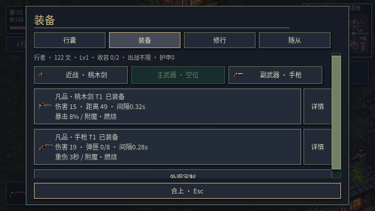
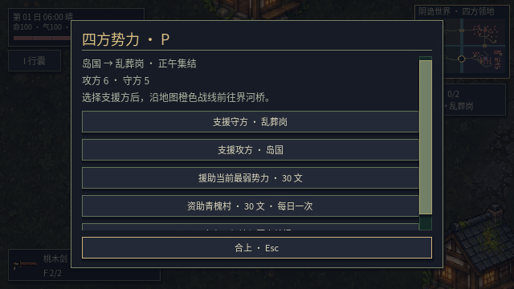
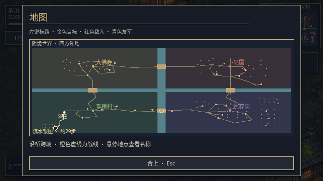
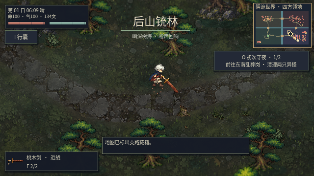

# v0.30 玩家反馈修正与验证

## 可见变化

- 两套主角分别具备 64 个源姿态，共 128 个；23 类怪物解剖部件与 12 种武器重绘，保持断口、独立四肢和握持定位。怪物仍是中立源姿态加关节动画，不是完整的逐帧重绘。
- 背景降低碎点反差，敌人增加克制的轮廓提示、醒目血条与危险动作提示。近战预警半径与实际判定共用数值，避免预警范围误导。
- 删除任务页种田承诺；随从统一显示“收容 n/容量 · 出战不限”，保留收容限制和不限出战人数的实际规则。
- 任务首屏突出当前目标，阶段奖励和历史委托可展开；势力页首先显示战争与支援操作，实力、领地和历史战报另开详情；装备卡直接显示伤害、暴击、重伤和附魔，长简介在详情中查看。
- 离线 NPC 查询实际归属队伍的击杀物种，旧档没有物种记录时明确说明，战争自行造成的死亡不算玩家击杀。当前回答是留存记录的汇总，尚不提供逐次击杀时间线。
- 宝箱问答给出具体名称、方向、约略步数，并在地图生成可走路线；地图区分当前目标、敌人、友方和探索点，可点击设置目标。手动目标目前只保留在本次运行。
- 开局加入三处可交互路边事件：补给中选择护具或精力、供碗中选择治疗或钱、足迹指向实际支路遗匣。奖励有持久化的一次性限制；不扩大无互动的赶路距离。

## 性能实现及边界

现代连续地图把静态地表烘焙成 256 像素分块，含边缘保护像素，最多缓存 64 块；原始颜色加地表/积水/河流掩码由 GPU 保存，运行时不读取回 CPU。主纹理约 16.3 MiB，另有视口、节点及驱动开销。分块异步预取，未完成时保留原地表绘制，避免缺块；冷缓存和快速跨区仍可能出现构建峰值。

动态水纹、雨滴、积雪、沙尘和血月继续叠加。镜头附近的静态装饰按空间索引绘制，屏外碰撞、寻路与战争模拟继续运行。缓存屏幕范围与怪物基础数值，目标感知按 100ms 更新；移动、攻击、命中和战斗物理仍保持原有 60Hz 逻辑。低预算时减少装饰雨线、落叶和光照分辨率，不暂停敌人。

性能基准使用实际图形窗口、llvmpipe 软件渲染、关闭限帧和垂直同步，每处预热 8 秒后采样 180 帧。基准为安全保持同一场景而给玩家临时无敌，敌人照常活动；正常输入通关路线没有无敌。固定帧步进的功能测试不作为 FPS 证据。独立显卡尚未测试，不能由云端结果推断。

同机 v0.29 基线与本次 v0.30 实测如下（FPS 为中位帧耗时换算，并非最低帧率）：

| 场景 | 原中位帧耗时 / FPS | 当前中位帧耗时 / FPS | 当前 P95 帧耗时 |
| --- | --- | --- | --- |
| 营地 | 17.254ms / 58.0 | 15.954ms / 62.7 | 21.050ms |
| 雨战 | 24.972ms / 40.0 | 16.869ms / 59.3 | 23.437ms |
| 后山 | 22.071ms / 45.3 | 15.522ms / 64.4 | 20.709ms |
| 海岸 | 18.394ms / 54.4 | 12.646ms / 79.1 | 15.747ms |

雨战中位帧耗时下降约 32%，后山下降约 30%。**稳定 60 FPS 尚未达成**：雨战中位值仍超出 16.67ms，营地、雨战与后山的 P95 也超预算。测试窗口各处仅采样 180 帧，不代表长时间最低帧率；独显和多战场压力还需另测。未启用实验性独立渲染线程，也未修改 FPS 计数。

## 实机与回归

正常输入自动游玩新档：走过界河桥、完成两只敌人的守夜目标，生命 100→21，返回领取银剑；途中通过 E 和鼠标完成路边护具选择，随后实际领取支路护具并快速返回。未关闭敌人、未修改生命或传送完成此路线。它是自动输入加画面检查，不等同于人工完整游玩全部内容。

图形专项：两套主角 119 项、解剖与尸体 90 项、步态与交互 130 项通过；最终界面/问答/互动/地表缓存专项另有 56 项通过。覆盖四方向源帧、受击截肢、缺肢尸体重载、真实按钮输入、单次奖励、碰撞寻路、缓存掩码和稳定镜头不重复构建。

最终完整运行通过资源导入、40 套 Godot 回归与主场景启动，未出现脚本错误；四处地表图形检查另有 8 项通过。跨桥行军、真实占领、村民自卫、尸体处理与存档兼容均在回归范围内。

仍需继续处理：怪物全套逐帧动作、技能和全部建筑植被的画风统一，更长时间、多场战争并发的玩家体验，以及真实独立显卡性能。工程包保留游戏素材和可再生源图；为控制单文件大小，不附旧版 docs/images 与 docs/landscape29 历史截图，这些仍保存在 GitHub 仓库。
