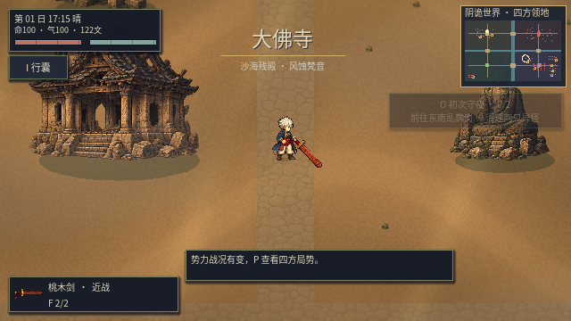
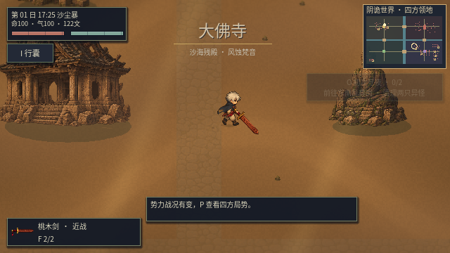

# v0.26 · 地域重构、白边修复与环境互动

## 三个阵营的新场景

| 阵营 | 场景构造 | 地域天气 |
|---|---|---|
| 大佛寺 | 沙海、风蚀佛殿、残佛、断塔、倒柱；寺外石路改为被沙覆盖的行迹 | 每日每三小时天气段约 35% 概率沙尘暴 |
| 岛国 | 两排破败町屋、木结构商铺、破鸟居与残灯旗幡；铺装街道留出战斗空间 | 全局雨天气段转为大雪；晴天气段另有约 45% 概率落雪 |
| 乱葬岗 | 岩坡、枯松、散落墓冢、山中破屋；整齐石路改为不规则土径 | 18:00 后约 45% 天气段出现血月 |
| 青槐村 | 保留村舍、树影与人间烟火，加入实际屋檐避雨 | 普通晴雨、暮色与雨后潮湿 |

天气由地域坐标、游戏日期和三小时天气段共同决定。相同存档的天气段可复现，跨界渐变切换；不会每帧重新抽签。保存数据仍使用原来的晴 / 雨字段，兼容旧档。

12 张新的建筑、岩石和植被素材由图像生成工具制作后归一化为游戏像素尺寸；原稿与烘焙工具均保留。河流、四座桥梁、领地主城坐标、委托点与军队通行走廊保留，未用背景图片代替实际地图碰撞。






## 白边与打击反馈

旧角色着色器沿透明边界添加亮色，半透明轮廓像素也会直接参与绘制，容易形成贴纸感。本版取消边缘加亮，对亮色外沿收敛明度，并剔除低透明度杂边；内部白发、肤色、衣物亮部与受击闪白保留。

怪物、村民、主角及随从共享地域环境色和潮湿反馈。静态新建筑另使用共享天气材质；树木沿用同一风场与雪色。接地阴影、带遮挡的局部灯光、冷暖环境光与日落综合色继续叠加。

正式无缝世界中的 **23 类怪物** 均验证了打击闪色、受击 AnimationPlayer 与命中反馈，包含幽魂、丛原火与各首领。原有肢体、断口、物理断肢和尸体逻辑保留。

渲染测试另用透明像素与白色内部的受控样本验证：外沿不会额外发白，内部亮部不被整体涂暗，透明区保持透明，强烈打击闪白仍可出现。

## 环境互动

- 沙地：可见沙印和轻微扬尘；沙尘暴增强风、沙幕与衣摆摆动。
- 雪地：屋顶、树冠、衣物与地面同步变冷并积雪；步行留下压暗的雪印，寒天出现少量呼气。
- 雨天：地表变暗、街道积水反光、涟漪、屋檐滴水和湿衣；停雨后地面逐渐干燥。
- 血月：以暗红月光、低雾和稀疏尘埃改变整个场景，不额外加入天空盒或单张背景图。
- 玩家、NPC、实体怪物和随从都参与近景脚步与草地反应。漂浮幽魂和火灵不留下实体人脚印。
- 村民按自己所在位置的天气寻找实际建筑屋檐，沿可通行路线移动；遇敌仍优先自卫。战斗寻路加入缓存，避免追敌时逐帧重复完整 A*。


效果按视野生成：脚印上限 120，呼气上限 24；雪粒子 160 个分层样本，沙尘 65 条风迹。远处战争继续运行，视觉天气不改变 60 Hz 物理设定，也不施加强制扣血或大幅移速惩罚。

雪与沙尘反馈是像素材质和粒子表现，并未模拟三维积雪体积或可变形沙丘。血月不额外修改怪物数值；地图仍使用现有 2D 俯视结构。

## 验证与复现

```sh
python3 scripts/test_game.py
```

全量回归：**28 套、1538 项检查，0 失败**。[完整输出](regions26/validation.txt)

新地域套件包含 61 项检查；[图形模式共 70 项](regions26/render-validation.txt)，额外验证四项真实着色器像素结果并保存五张实机画面。覆盖地域概率、地图布景、通行地面、23 类怪物受击、脚印、NPC实际避雨、天气暂停与视觉对象数量上限。截图使用固定步长，用于画面与功能验收，不作为帧率证据。

可以独立重新生成布景素材：

```sh
sh scripts/godot.sh --headless --script res://tools/bake_biome_art.gd
```

本次 Mesa llvmpipe 云端软件渲染、解除帧率上限实测：营地中位帧耗时 **15.985 ms**，P95 **23.336 ms**；雨战中位 **22.452 ms**，P95 **32.962 ms**。雨战约 45 FPS，仍未稳定达到最低 60 帧。[原始输出](regions26/benchmark.txt) 不把固定步长截图测试当作性能数据。
