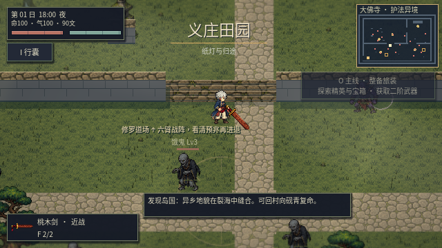
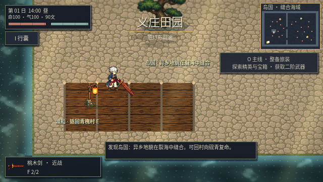
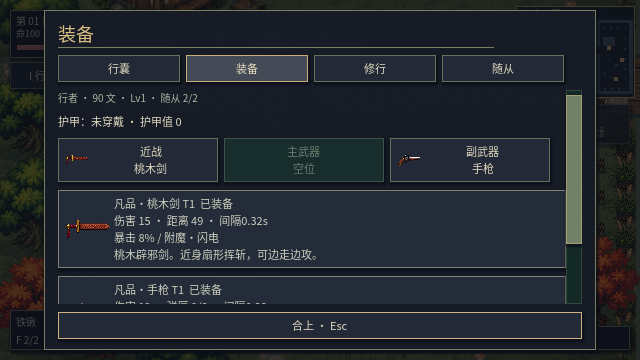

# v0.22 像素美术与战斗表现重构

本版统一人物、怪物、武器、NPC 与环境的像素比例和配色，保留装备成长、委托、势力、断肢与存档系统。表现方向参考《八方旅人》，采用 2D 布景分层、区域光色和轻景深实现，尚不是完整 3D 场景。

## 实机画面

以下来自本版 Godot 实际运行，非概念图。

男女主角使用四向八帧行走；攻击分蓄力、伸展、命中、随势与收招阶段。武器层沿手部锚点运动，鼠标瞄准通过实际摄像机变换计算。打击接入 CC0 音效，保留停顿、击退和受击闪光。

佛寺墙体参与脚底深度排序，台阶对齐真实通道。不同区域分别配置地面、石材、树种与雾色；森林、岛国、佛寺、沉村与剧场采用不同的场景层次。

新环境图集采用最近邻显示、保持长宽比例与底部落点，减少角色与物件的画风割裂。现有风、草地互动、雨水与水面系统保留并适配新配色。

界面统一深色底、象牙白文字与铜色边线。装备页显示三个可切换武器槽，滚轮武器状态栏保留；战斗附近任务提示变淡并让鼠标事件穿透。区域标题短暂显示，避免长期堆积信息。

## 验证

- 完整自动回归：24 组、1359 项检查通过，包含导入与主场景启动。
- 图形模式：新呈现 60 项、怪物与地图 402 项、初次旅程 31 项、动作与随从 46 项，均无失败。
- 怪物素材：39 个分层姿态重建原像素一致。
- 动图记录同一局中的连续 60 帧，展示真实角色运动与战斗；图形测试使用固定步长和独立存档，未改动玩家个人存档。

这些验证覆盖功能、素材完整性和短程实机表现，不能代替长时间平衡测试或不同显卡的性能测试。音频运行使用 Dummy 驱动，音效接线通过验证，未宣称完成听感评测。

## 当前边界

怪物采用独立关节和程序化步态、蓄力、受击与断肢联动；大天狗另有四向源姿态。并非所有怪物都已绘制完整四向逐帧动画。地形规则与地图布局在原系统上增强，没有将整个项目迁移到 3D 引擎。

[开源研究与素材授权](ARPG_RESEARCH_V022.md)。下载根目录 `yintian-godot.zip`，用 Godot 4.6 打开其中 `godot/project.godot`；这是源码工程包。
