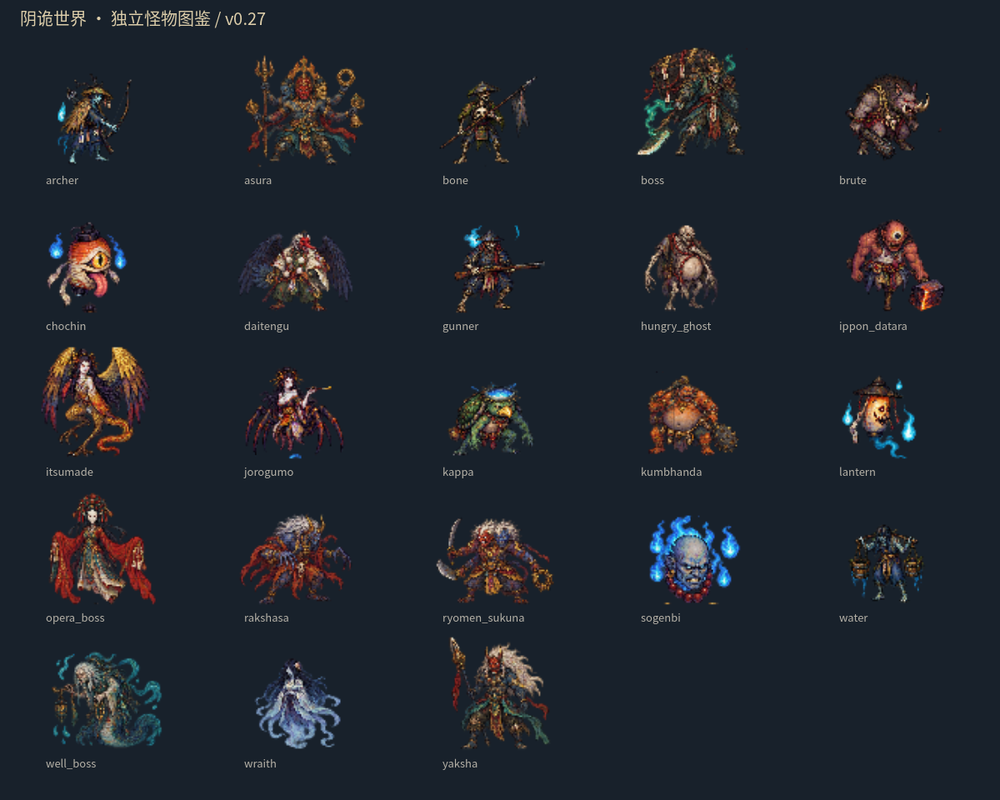
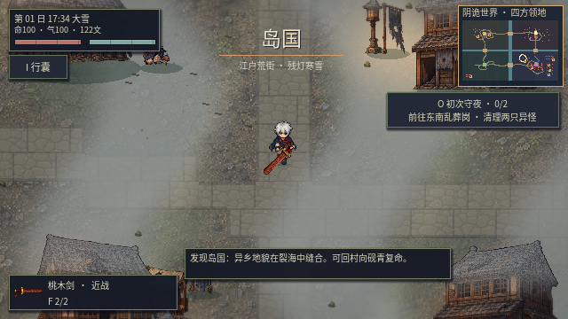
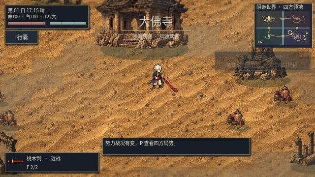
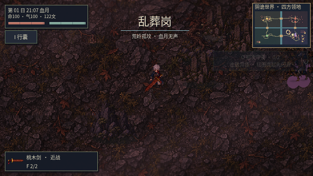
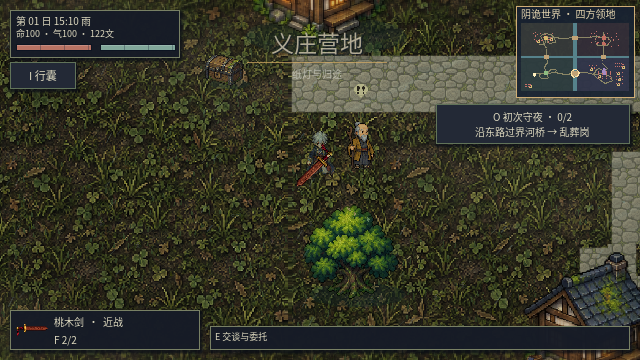

# v0.27：怪物重建、地点叙事与过桥入侵修复

本版移除旧五类共用躯体、旧怪物整图及旧部件图集，以23类独立怪物素材替换。美术方向参考《八方旅人》的细密像素、材质分色与暗部轮廓，使用为本项目生成的原创设计，未提取商业游戏素材。

## 当前实际交付

- 每类怪物使用独立768×576透明图集，96×96格，四张独立源动作：待机、迈步A、迈步B、攻击。行走播放0、1、0、2，并随实际位移推进；左右镜像，不宣称已有完整四方向或八张独立行走帧。
- 河童保留龟壳，提灯妖怪保留灯体，络新妇保留蛛身，一本踏鞴只有一条腿，丛原火为火首，幽魂为浮游灵体；多臂、鸟翼和蛛腿按左右组记录损伤。
- 继续使用独立Sprite子节点、断口叠层、RigidBody2D断肢、StaticBody2D残躯、真实碰撞与推动，保留闪色、击退、命中停顿、三阶段AnimationPlayer受击回弹和独立血粒子。尸体记录新动作帧，读档冻结该帧；旧尸体身份兼容。
- 分层是对源动作中**可见像素**的分配，不等于补绘了遮挡处的完整解剖。非人形怪物需要逐种进一步精修接缝，不能据此称为全部手工完成的动画素材。
- 重新生成沙地、街土、村落草地和山岩四类地域地表，保持同一材质方向，取消容易形成十字接缝的镜像采样。
- 四地重新绘制九条探索与交通路线，增加16处具名调查地点与24类新细节素材。残寺有钟庭、埋经回廊、净池、朝圣石阶；岛国有空伞市集、雪渡旧栈、铳铺与小社；乱葬岗有吊魂径、归冢、剑口和守冢空居；青槐村有公井、茶棚、洗衣埠与灯岗。
- 调查使用实际E键交互，见闻记录存档，并计入遗迹调查委托。大地图绘制实际弯曲道路，已调查地点显示名称。岛国增加有水体碰撞的局部运河和可通行桥隙。道路附近不再随机塞入阻路植被。



## 实际过桥问题与修复

修复前，将有碰撞的骸兵放在北桥斜向入口(3024,880)，目标位于(3472,1232)。真实AI运行32秒，士兵仅到(3034,890)，无法过桥。原寻路每0.5秒刷新时重新返回脚下网格中心，使慢速单位反复折返。

现在只在身体扫掠确认安全时移除路径的起始网格中心；直线追击也同时检查身体体积，避免射线能通过而肩宽撞河岸。没有使用传送、忽略河岸碰撞或离屏扣血。

验证覆盖四座桥的两个方向、斜向进桥、六人队伍拥挤通行、过桥后实际造成伤害，以及使用正式宣战/部署入口从岛国与大佛寺主城出发的自然行军。具体运行结果见[玩家视角试玩记录](PLAYTEST_V027.md)。

## 画面与开发






23个独立素材包位于 `artifacts/monsters27/`，每包提供图集、该怪物的动作锚点和格式说明。旧五套共用躯体与旧烘焙工具已退役，历史版本仍可从Git历史获取。

源素材位于 `godot/assets/monsters27/source/`；重建命令：

```sh
sh scripts/godot.sh --headless --script res://tools/bake_monsters27.gd
sh scripts/godot.sh --headless --editor --import --quit
python3 scripts/package_enemy_packs.py
python3 scripts/test_game.py
```

旧测试中的“所有敌人共享一张图集”“五个64px模板”和“旋转关节即行走”等断言已改为验证新格式；保留碰撞、断肢对齐、尸体、存档、交互与旧玩法兼容检查。另增新素材逐像素分层、实际桥梁行军与图形键鼠游玩检查。没有把旧数量直接算作新版本通过数量。

源码工程ZIP保留运行资源、源美术、代码和当前截图；历史GIF演示留在GitHub仓库网页，不重复打进工程包，以免超过GitHub单文件限制。
