# v0.28：完整肢体、探索奖励与实际占领

这次移除了 v0.27 的整张怪物坐标切块方案。23 类怪物重新采用接近主角比例的 Q 版造型；每类由完整躯干、头、左右整臂、左右整腿六个独立素材组成，共 138 个部件。躯干不包含离体四肢，不再靠挖空整幅贴图表现断肢。

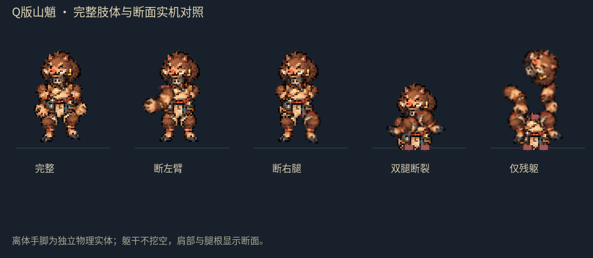

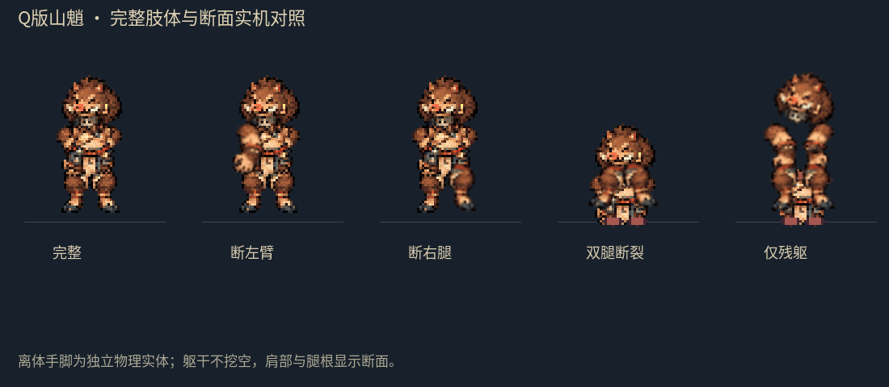

上面是受控节点对照场景：完整、断左臂、断右腿、双腿断裂、残躯。断肢时从当前关节位置与旋转生成完整的 RigidBody2D 肢体，开启肩部或腿根断面；原躯干保留。手持武器随对应手臂掉落。尸体保留倒地姿态、缺肢状态、碰撞与推动反馈。幽魂、独足妖、翼妖依各自结构使用适用部件；蜘蛛和多臂怪仍按左右侧组合处理。

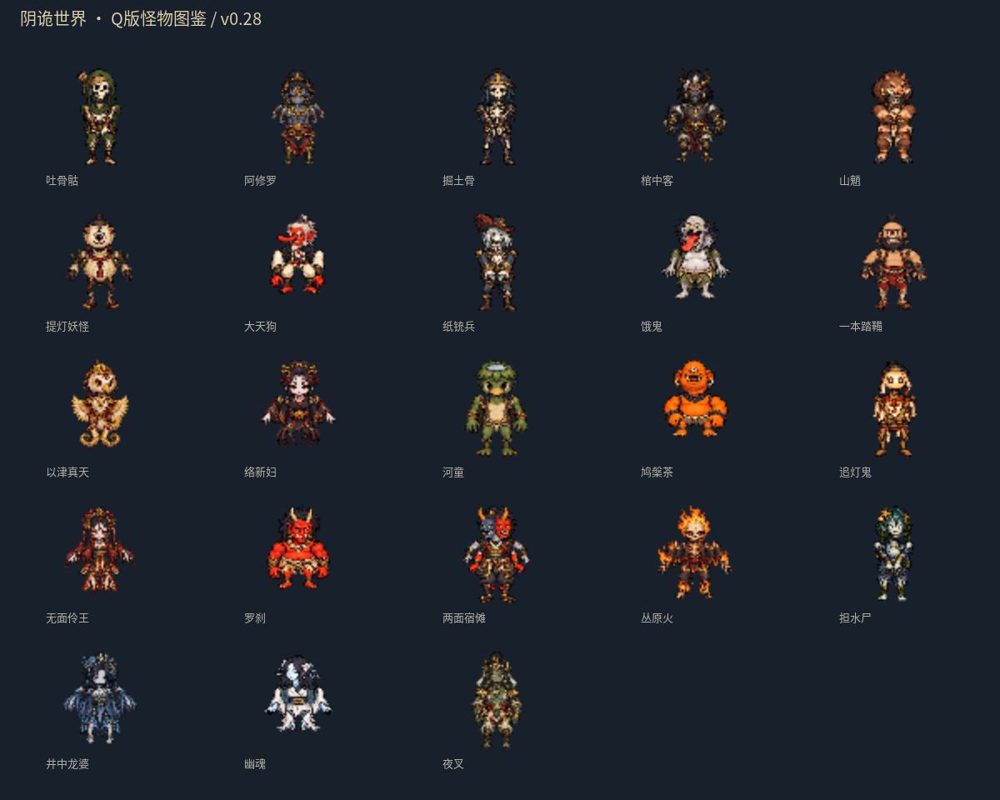

## 动作衔接

每类是 **一套独立中立源部件，加连续关节动画**，并非八张新绘全身动作图。八个行走关键姿势按实际移动距离插值，六个攻击关键姿势衔接蓄力、挥击与收招；手持武器绑定手臂。转向加入短暂压缩与平滑恢复。修复同帧多次刷新造成转向和关节重复推进的问题，受击停顿与冻结不再继续推进关节。

断一腿减速，双腿断裂后躯干下沉并爬行；断头后无法攻击，短时间乱走并持续失血。旧存档的单侧断肢标记仍可迁移。主角保留原有行走帧，渲染转向与武器层级同步过渡，操作朝向即时响应。目前仍没有完整四方向独立绘制的怪物动作。

## 地图与探索

地面改为世界坐标连续混合四块内部纹理，取消镜像四分块与边界循环采样；道路覆盖与区域土壤一起渐变。保留四地的沙尘、积雪、血月和雨水反馈。图形读取检查比较四个区域交界与附近地面的亮度梯度，8 项通过。

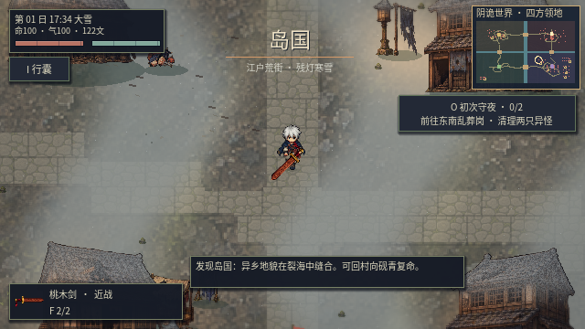

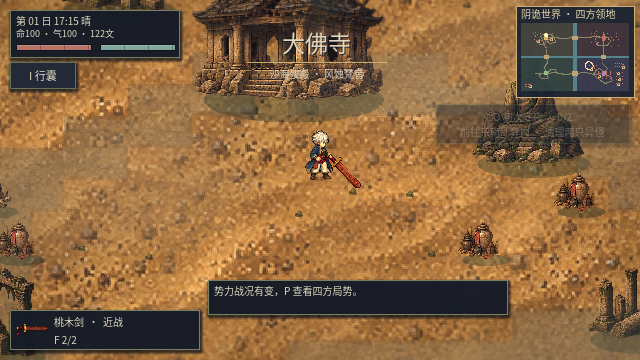

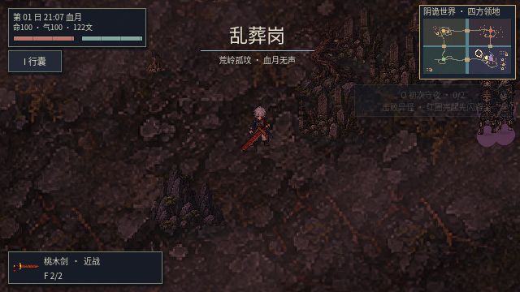

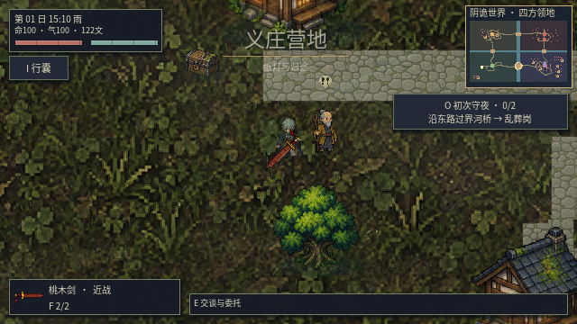

16 个调查点都可领取一次实际奖励，存档后不会重复领取。藏经处给二阶闪电魔法书，岛国工坊给二阶燃烧左轮，乱葬岗剑冢给二阶冰冻鞭，村外瞭望点给二阶护甲；其余地点给钱与修为，村井另有治疗。未领取的遗物用金色标识，领取后变绿。

道路在附近无敌人时提供 1.5 倍赶路速度；军队寻路也优先道路。已发现据点提供游戏内驿路移动，附近有敌人或目的地不安全时禁止使用，不会重置场景中的战争。

## 占领与驻军

击败一支军队后，胜军必须实际走到目标旗点、在没有敌方驻军阻挡时驻留 6 秒，才能改变领地主人。最多三名实际存活且未断头的士兵转为驻军，保留原单位身份；剩余士兵步行返乡。没有凭空生成守军或将士兵传送到旗点。

驻军会自主攻击入侵者；旗帜、据点界面、势力报告和政治地图显示实际领主，以及已到岗、仍在途的人数。支持过的盟军保留友好关系。清除威胁后可调停归还原势力，盟军驻军会步行撤回。领地归属跨日与存读档保留。

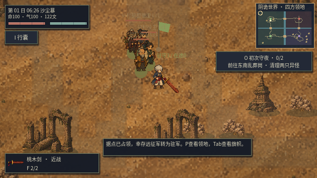

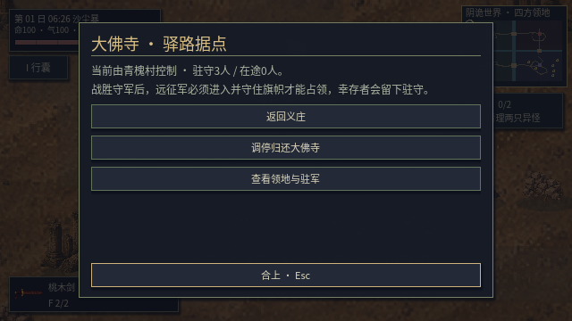

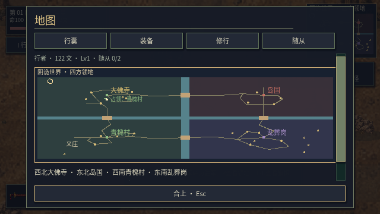

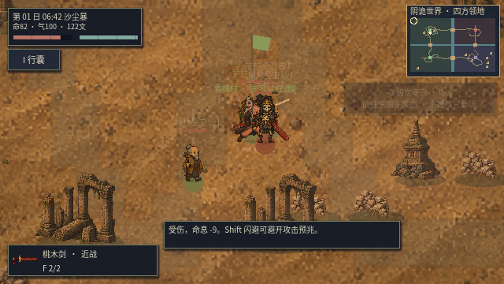

目前领地粒度是四个主据点，尚未实现逐村分封、完整外交或攻城器械。

## 实际游玩与验证

用新存档和实际图形窗口，通过正常移动、攻击、交互输入完成：从义庄出发、步行过桥、击杀两敌、返回领取银剑、探索支路领取二阶护甲、使用游戏内驿路返程。未修改生命、伤害、装备，未用调试传送；生命由 100 降到 46。这是自动输入驱动的实机流程，并非人工通关整个战役。第二次战斗耗时仍较长，后续应继续调整战斗节奏。

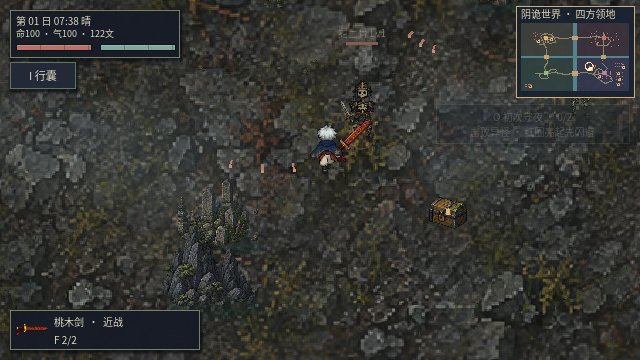

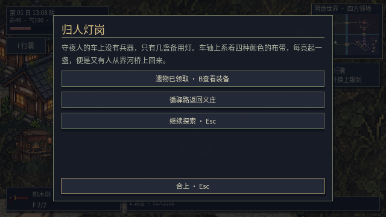

完整回归：导入、36 套 Godot 测试与主场景启动通过。随后对最终部件、冻结与持械细节补测：模块化敌人 87 项、新断肢 148 项、武器 61 项、探索 41 项、领地 10 项通过。最终图形检查包含地域天气 70 项、领地 10 项、地表连续性 8 项；另有真实肢体实体和 23 类图鉴截图检查。素材检查通过 23 套、138 个完整独立部件。

占领验证使用受控战争局面检查抵达、驻留、同单位转驻军、守军自主防御、归还与步行返乡；自然行军过桥仍由单独的真实单位回归覆盖，不能把据点截图当作整场战争通关证明。

云端 Mesa llvmpipe 软件渲染实测（非固定帧率）：营地中位 15.630 ms、P95 19.961 ms，约 64 FPS；雨战中位 22.327 ms、P95 28.563 ms，约 45 FPS。逻辑物理步进保持 60 Hz，**此环境雨战仍达不到稳定 60 FPS**。

## 复验

```sh
sh scripts/godot.sh --headless --script res://tools/bake_monsters28.gd
sh scripts/godot.sh --headless --editor --import --quit
python3 scripts/verify_actor_parts.py
python3 scripts/test_game.py
python3 scripts/package_enemy_packs.py
python3 scripts/package_game.py
```

实机脚本为 `play_new_game28.gd`；部件动图为 `capture_parts28.gd`，领地验证为 `test_territory28.gd`。图形运行需可用 DISPLAY，使用 `--rendering-method gl_compatibility --audio-driver Dummy`。截图用固定时步，性能基准使用 `benchmark_performance.gd` 且不加 `--fixed-fps`。
