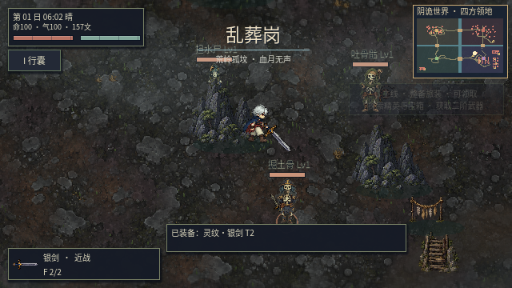
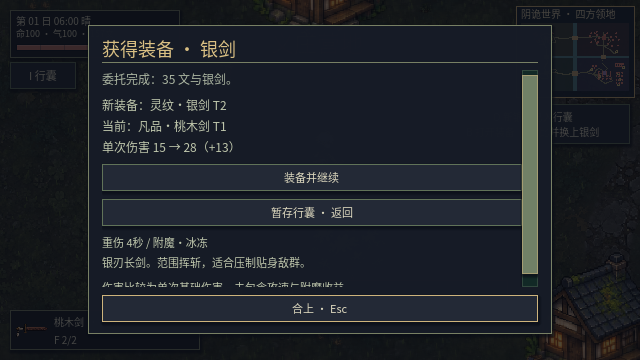
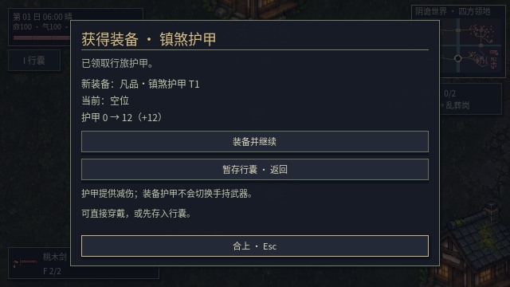

# v0.30.1：文字、敌人辨识与领奖换装

修正实机评测中优先提出的三项问题。

## 文字溢出

通用段落原先强制最小宽度 492px，超过普通弹窗内容区，导致横向滚动和裁切。改为跟随容器宽度自动换行，普通弹窗禁止横向滚动，长内容仍可纵向阅读。路边事件保留统一的底部关闭操作，去掉重复的“继续赶路”按钮。

## 敌人辨识

附近敌人轻微提高局部亮度与暖色边缘对比，名称增加暗色描边并略微放大，血条加宽、加厚并加深底色。脚下定位圈增强，友方守卫使用青色。修改作用于实时敌人渲染，不替换怪物形体或断肢素材；幽魂等原本的透明设定保留。

## 领奖后直接换装

任务装备、宝箱、探索遗物及路边护甲领取后，展示与当前对应槽位的比较，并在首屏提供“装备并继续”和“暂存行囊 · 返回”。领取后已保存奖励；预览和返回不自动装备，也不重复发奖。

比较显示当前、新装备的单次基础伤害或护甲与差值，不把这个数字当成包含攻速和附魔的综合战力。完整词条和简介仍可向下阅读。装备武器同步切换手持和槽位，装备银剑同步完成新手换装目标；护甲不切换当前武器。

同时修正路边护甲领取的容量判断：使用真实的 20 件装备上限，失败时不消耗一次性奖励。

## 验证

新增图形交互专项 19 项通过：长说明和段落实际换行、没有横向滚动、满行囊不消耗奖励、首屏直接装备、暂存不强制换装、重复打开不重复发奖、槽位/手持/新手目标同步，以及 JSON 保存恢复。使用真实鼠标按钮事件验证；战斗画面检查使用实际存活怪物。

新档真实输入路线通过：路边领取并穿戴护甲→过桥→击败两只异怪→返回领银剑并直接换装→领取支路护甲→快速返回。最终手持银剑、护甲槽为路边奖励，生命 100→58。路线由脚本辅助，未关闭敌人或修改生命；不把自动输入的掉血结果当作难度平衡结论。

完整运行通过资源导入、41 套 Godot 回归及主场景启动。断肢与尸体图形专项另有 90 项通过，未发现脚本或着色器错误。

本轮只修上述三项。未重新测量 FPS，v0.30 的性能限制仍有效；不宣称因此实现稳定 60 FPS。怪物完整逐帧重绘也不在本轮范围内。
