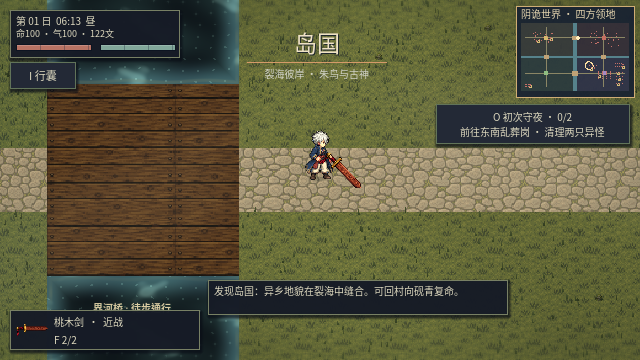
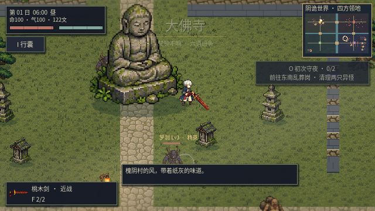
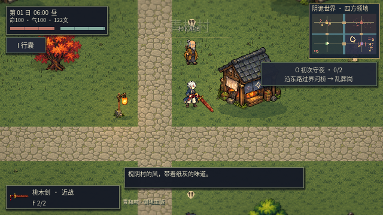

# 阴诡世界 v0.23

本版以探索装备和势力战争为核心，保留 v0.22 像素美术、角色动作、断肢、雨水、水面与植被表现。

## 连续地图

| 方位 | 势力与领地 | 场景 |
|---|---|---|
| 西北 | 大佛寺 | 佛像、浮屠、带开口的寺墙与护法异怪 |
| 东北 | 岛国 | 鸟居、林地与异乡妖怪 |
| 西南 | 青槐村 | 村民主城、义庄营地、商队、沉水村 |
| 东南 | 乱葬岗 | 荒冢、后山、废戏台与探索地标 |

采用 6400×4800 世界坐标和同一个物理世界，中央十字河网与四座桥梁连接领地。河水有碰撞，桥上可行走，敌军与随从使用相同的桥梁路径。参考《骑马与砍杀》的空间领地、主城集结和行军可见性，并未复制其素材或代码。

跨境只更新区域名称、任务语境和氛围，保留世界、玩家、军队、投射物的实例；不再通过出口传送切换户外地图。义庄、仓库与交易通过就地服务交互打开。首次载入、死亡返回营地和休整可重建世界，军队位置由持久化记录恢复。

## 实体战争与村民

每日按实力差产生远征意图，正午在双方本土主城集结具体军队。每个士兵都有保存的 ID、生命、伤害、阵营、世界位置和物理体积；军队实际寻路、过桥、蓄力和攻击。玩家不在战场附近时，军队仍在同一场景运行。

移除连续世界中的离屏抽象伤害和入夜按剩余血量判胜；一方军队实际覆灭后结算兵力、物资、战报和参战贡献。胜方余部结算后撤编。当前同时维护一场远征，领地归属边界固定；本版不包含城池占领、领土易主或多线外交。

六名青槐村村民可自动识别附近敌人，按角色使用近战挥击或有视线判定的远程术击，自行接近射程内目标、攻击并承受伤害。保留受伤、倒地、救治和委托交互；青槐民兵军队使用现有 NPC 像素风格，避免以怪物外形代表村民。驻村随从在玩家离开领地后仍保留实体，普通异怪在附近有村民或随从时继续运行攻击。

## 移除种田与旧档兼容

- 新游戏持装备武器，左键与空格用于攻击。
- 无田块、农具入口、播种浇水、种子交易、种田产出或农业日结。
- 删除背包的农具、阴种与智能劳作操作；役灵通过战斗、跟随、驻守和休整管理。
- 旧档中的种子和作物每件折算 2 文，田块清空，装备、随从、任务、宝箱和主要进度保留。坐标和 Boss 归位点一起迁移；已有掉落和遗骸转为世界坐标。
- 保存格式升至 14。更名后优先读新目录；没有新档时读取同级旧《阴田录》目录，首次保存写入新目录，保留原档。

底层保留旧存档字段和历史测试所需的兼容代码，正式游戏不再开放种田或旧户外分图。历史地图测试通过显式开发测试环境变量运行，不是新游戏的入口。

## 验证范围

24 组历史回归与连续世界专项合计 25 组、1392 项检查通过；历史组检查存档、装备、战斗和任务兼容，连续世界专项覆盖新游戏实际入口。专项验证包括：

- 原版本存档导入、世界坐标往返、重复迁移不重复退款、Boss 归位点一致。
- Esc 关闭遗书也接取第一项任务；背包与商店没有农业操作。
- 使用实际移动输入完整走过桥梁，跨境前后世界与角色实例不变。
- 四方主城均存在跨河可达路径；军队从本土集结后实际移动。
- 玩家远离战场时，实体军队攻击产生伤亡并最终结算；离屏时间跳转和夜晚不能直接扣血或判胜。
- 村民自主攻击附近敌人；活动战争与部队位置可保存、恢复。

图形检查另保存本页实机画面。战斗验证使用隔离的交战布置，让实际 AI 在桥头接战；不将该测试声称为多小时自然战争与经济平衡评测。软件渲染器和 Dummy 音频驱动也不用于评判真实显卡性能或听感。

测试命令：`python3 scripts/test_game.py`。直接检查新世界：隔离存档后运行 `sh scripts/godot.sh --headless --script res://tests/test_continent.gd`。
