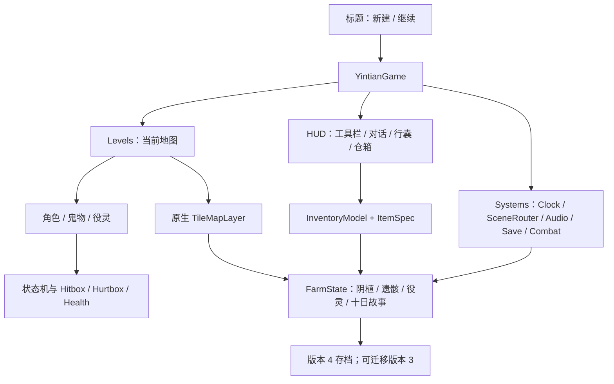

# JevonLee/Stardew 全程序参考与《阴田录》模块对应

指定参考仓库：[JevonLee/Stardew](https://github.com/JevonLee/Stardew)。实际检查版本：`f238436b44c1a433f4d9e27c5d073637607c9107`，引擎 Godot 4.6。

已下载完整工程并检查项目配置、角色 / 状态机、背包 / 工具栏 / 箱子、四类地图、场景管理、时钟、作物、放置、掉落、对话、主菜单和存档模块。参考仓库未附 LICENSE；本项目以其系统分工为参考，独立实现对应逻辑，继续使用《阴田录》的设定、原创美术和声音。没有将参考仓库源码、地图、角色、美术或音乐纳入下载包。

## 程序对应关系

| 参考仓库模块 | 《阴田录》实现 | 实际作用 |
| --- | --- | --- |
| Player/States | `scripts/player_states/` | 闲置、移动、工具、剑击、符术、闪避、暂停；互斥动作与统一恢复 |
| Player/player | `scenes/actors/player.tscn` + `scripts/player.gd` | 可编辑身体碰撞、摄像机，接入状态机与攻击组件 |
| Bag/Item、InventorySystem | `resources/items/` + `scripts/inventory/` | 不共享可变数量的物品定义、24 格行囊和仓箱、99 堆叠上限 |
| Bag/slot、bag_ui、box_ui | `scripts/ui/inventory_slot.gd`、`inventory_panel.gd` | 交换、拆半、堆叠、拖拽、跨容器移动、整理、物品提示 |
| Bag/tool_bar | `main.gd` 工具栏 | 六种工具、1–6 选择、鼠标滚轮切换，Q 换阴种 |
| Global/SceneManager、SpawnPosition | `scripts/core/scene_router.gd` + `scenes/maps/` | PackedScene 注册、命名出生点、切换时停用和释放旧地图 |
| Farm/MyHouse/Town/Store | farm / hall / shop / graveyard 四场景 | 院落、可进入义庄、可进入杂货铺、战斗区域；村民仍在院落东侧 |
| TimeSystem | `scripts/core/game_clock.gd` | 分钟 / 日结信号、菜单暂停；保留《阴田录》十日与夜袭规则 |
| CropsComponent、HoeComponent | `scripts/components/tile_farm.gd` | 原生 TileMapLayer 地表、耕土 / 湿土、作物阶段；坐标转换 |
| HitComponent / HurtComponent | hitbox / hurtbox / health_receiver / combat_controller | 物理形状查询、朝向、墙体遮挡、伤害接收与资料化武器 |
| Terrain/Trees/Rocks | `terrain_resource.gd` | 指定农具采集、血量 / 耐久、永久移除、掉落与场景恢复 |
| FallObjects | `item_pickup.gd` | 物品留地、延迟拾取、容量检查、跨区域与存档保存 |
| PlaceComponent / Footprint | `placement_controller.gd` | 网格吸附、绿色 / 红色占地预览、距离 / 碰撞 / 灵田限制、纸灯和阵桩 |
| NPC/Dialogue | `dialogue_data.gd`、`dialogue_panel.gd` | 头像、逐字显示、整句跳过、多段对话，章末选择在对话结束后出现 |
| UI/GameStartMenu | `scenes/ui/title_screen.tscn` | 新建、继续、退出；新建前确认并备份已有进度 |
| SaveComponent / SaveManager | `components/save_component.gd` + `save_store.gd` | 身体位置采集、版本化 JSON、多个区域和容器一起保存 |
| Global/AudioManager | `core/audio_manager.gd` | 环境音播放、昼夜音量、静音与释放 |

## 结构

`main.gd` 编排游戏与经营菜单；规则仍集中在独立的 `FarmState`，不绑死在某个区域的节点上。服务以游戏会话内的 Systems 节点管理，避免依赖固定绝对场景路径。

地图图层与装饰由程序在运行时生成；区域入口和角色碰撞可在 `.tscn` 中编辑，物品、作物和武器参数可在 `.tres` 中编辑。没有声称参考仓库的地图布局已被直接移植。

## 保留《阴田录》特色

阴植、童影葫芦、返魂稻封声、遗骸四种用途、供养与点名、三类役灵、祭祀预览、棺中客和十日抉择沿用本作规则。参考项目中的专有角色、超级武器、彩虹猫、原作场景和完整物品表属于不同题材，未纳入本作。

## 验证与边界

- 校验旧存档迁移后作物、经济、载骸、役灵和敌人状态保留。
- 行囊 / 仓箱移动、拆分和交换保持总量；满堆叠与非法目标不丢失物品。
- 实际模拟角色行动、物理命中、地形移除、掉落拾取、放置、室内切换和日结。
- 场景转换后已砍树、已采石、已放置物和地图上的遗骸 / 物品会恢复。
- 仍是《阴田录》第一章原型；没有将参考项目所有内容视作已完成的玩法，也没有宣称完整复刻《星露谷物语》。
