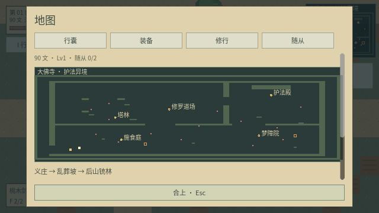
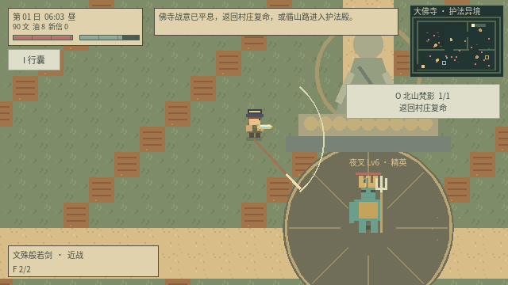
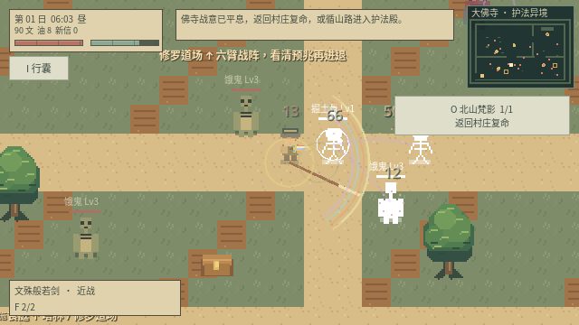
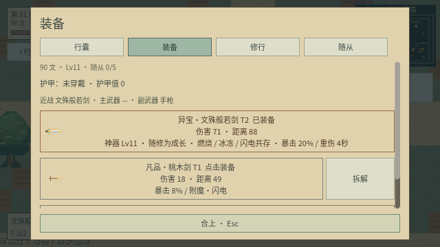
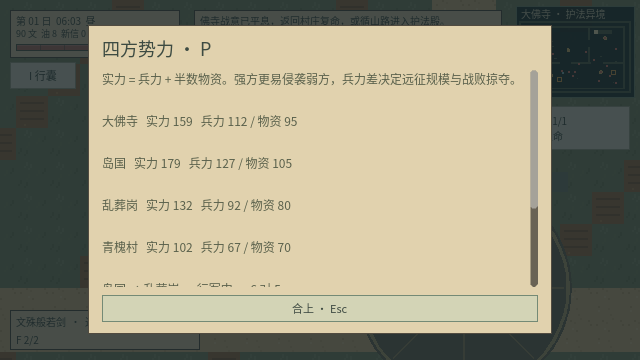

# v0.13 大佛寺与般若开锋

从青槐村北侧山道（1120,160）按 E 进入大佛寺；寺院西南山道按 E 返回村庄。按 Tab 看区域地图，按 P 看四方势力。新内容沿用离线 NPC 对话、免费炼化与装备自带词条。

## 地图与势力

1600×1280 地图由施食庭、塔林、梦障院、修罗道场、护法殿连接而成。庭院间有可绕行的塔林支路与山门通道，墙体、塔基和佛像基座有真实碰撞。地图有两个独立宝箱，需要清除附近守卫后开启。

大佛寺初始兵力 105、物资 90，按现有实力公式参与四方战争，既能进攻岛国、乱葬岗、青槐村，也会受到它们进攻。寺方远征使用饿鬼、罗刹、鸠槃茶；不把剧情首领投入普通远征。战争沿用每日恢复、强攻弱倾向、正午部署、入夜结算与有限掠夺规则。

## 敌人与应对

这片缝合异境采用以下传说意象设计战斗；夜叉在此承担守藏护法角色，战胜代表平息其异常战意。

| 敌人 | 背景意象与实际机制 | 应对 |
| --- | --- | --- |
| 饿鬼 | 细喉大腹、饥渴难填；受伤时每 6 秒可吞食 100 范围内一具本地图遗骸，恢复 18 生命。咬中玩家夺 8 气力并回血 | 先超度遗骸；燃烧与镇符阻止吞食；闪避也会阻止夺气 |
| 幽魂 | 无形魂躯，刀枪与农具伤害减至约 30%；没有可斩落的实体肢体 | 镇符显形解除虚化减伤；符火、诅咒和附魔伤害绕过魂躯抗性 |
| 罗刹 | 幻化欺敌、持毒刃；每 6 秒有 1.2 秒紫色幻身，绕侧接近并削弱刀枪伤害；命中附带短时中毒 | 镇符破幻；避开近身毒刃预警 |
| 鸠槃茶 | 亦写作鸠槃荼，取大腹梦鬼、梦压意象；三发慢速梦珠命中会减速并夺取气力 | 保持走位，利用墙体或闪避，镇符打断蓄势 |
| 阿修罗 | 三面六臂、争斗嗔怒；交替释放六向剑阵与十二发战火；半血后移速及攻击节奏加快 | 剑阵六道锋线之间留有安全空隙；战火有蓄势预警 |
| 夜叉 | 守藏护法、迅捷巡守；每 6 秒恢复护障，交替预警直线疾刺与三叉投锋 | 镇符破护障；横向避开疾刺线路。须先击败阿修罗才会解封 |

双方近战与弹幕受地形阻挡；首领会在过远时回到道场附近。除幽魂外的新敌人沿用断肢系统：断腿减速、断头乱窜且无法攻击。首领平息记录跨天保留，普通寺院敌人每日刷新。

佛寺遗骸可按 V 免费炼为对应役灵。新役灵使用独立佛寺外观，继承重击、扇射、冲锋或环射；阿修罗、夜叉按首领役灵计算部署消耗。

## 五段委托

先到青槐村找砚青，依次完成并向各自委托人复命：

| 委托 | 委托人 | 目标 |
| --- | --- | --- |
| 北山梵影 | 砚青 | 从村北山道抵达大佛寺 |
| 四障异闻 | 秋婶 | 分别击败四类佛寺异怪 |
| 止息修罗 | 柳伯 | 平息阿修罗 |
| 守藏之问 | 砚青 | 挑战解封后的夜叉 |
| 般若开锋 | 阿祁 | 完成寺院见闻，领取文殊般若剑 |

每段委托以前一段复命为前提，支持 O 任务追踪；已有探索和原生怪物击败记录可用于后来接取的委托。势力远征部队不计入佛寺原生异怪档案。NPC 输入怪物名、“大佛寺”“文殊”“般若”可获得对应机制与路线提示。

## 神器文殊般若剑

- 近战神器，装备在近战栏；委托发放异宝品质、T2，唯一持有，不能拆解。
- 随角色修为等级成长，不消耗材料，也不靠单独的击杀计数。基础伤害为 `25 + 2 × (角色等级 − 1)`，再计算现有品阶、品质和角色等级倍率；角色等级上限 20。
- 每次有效命中都触发燃烧、冰冻、闪电，元素强度为 `3 + floor(角色等级 / 3)`。燃烧与冰冻在这把神器上共存，闪电向附近最多两名可见敌人传导；普通武器仍保留火冰消解规则。
- 先天带 20% 暴击词条和重伤词条，按现有概率触发；三种元素附魔则每次命中保证触发。击杀目标后不再对其追加状态。
- 独立金色智慧剑光、火冰雷三色轨迹及光轮，与伊佩塔姆的吸血剑光区分。装备页显示当前角色等级、实际伤害及三相共存说明。

## 存档与验证

存档版本升级到 10，兼容旧版，包括 v0.12 的在途战事。迁移保留已有势力兵力、物资、战事、任务和装备，仅加入大佛寺初始势力及寺院档案。寺院敌人、遗骸、掉落、每日刷新标记、首领顺序和神器属性均参与校验与 JSON 往返恢复。

运行 `python3 scripts/test_game.py` 可执行全套检查。专项 `res://tests/test_temple.gd` 覆盖真实 NPC 接取、地图往返、路径与出生点、五段委托、剧情首领顺序、旧战事迁移、怪物机制、神器接触伤害及三相共存。

本次验证：14 套游戏回归及主场景启动全部通过；最新图形专项 82 项通过，包含 5 张截图校验。

