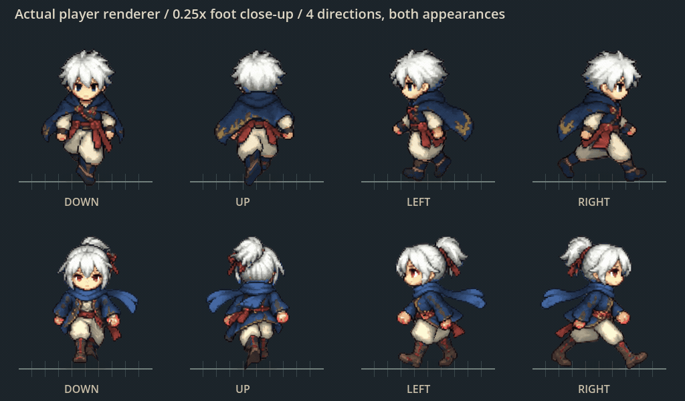
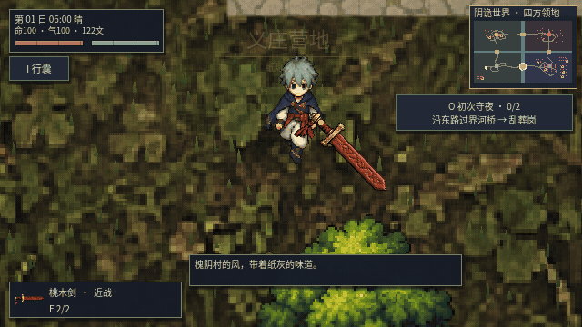

# v0.28.1：左右脚交替抬起

此前主角的八张行走帧仍在切换，但脚部补偿被设成零；源图正面姿势中两只鞋又有遮挡和重叠，游戏尺度下抬脚幅度不足，主要看见全身位移与上下晃动。

本版继续使用当前角色与八张源行走图，在髋部以下增加连续网格变形：左右脚相隔半个周期，交替摆腿、抬起约 4.5 像素并落地。上身不参与脚部位移，脚底抵消上身小幅上下起伏。中线采用互补权重，避免重叠鞋底的中央像素被固定在地面。一张连续网格、一次三角形绘制，保持裤装连接，不拆成两个滑动半身。

这张是 **0.25 倍速**的受控近景：使用游戏实际 FarmPlayer 节点和同一个绘制函数，展示四方向、两套外观，隐藏持械层以便看清双脚。测试固定推进步态，没有在地图中实际位移；下图才是正常按键移动的地图画面。

正常图形窗口分别按住右、左、下、上，每段实际移动约 112.6 个世界单位；武器与地图照常运行。没有更换人物造型，也没有声称增加新的手绘行走帧。

怪物的整腿改为绕固定髋关节更明显地摆动并短暂收腿，完整脚部离地；不再把整条腿向上平移，髋部保持连接。备用绘制与断肢素材的姿态计算同步保留腿部伸缩，原有物理断肢仍使用当前关节变换。尸体记录新增可选的腿部伸缩数据，读档后保持死亡瞬间的弯腿姿态，旧存档缺少该数据时使用原尺寸。

步态继续由实际位移推进；停步后收住步态，撞墙不会原地踏步。受击停顿冻结步态；攻击与闪避使用原动作，不叠加走路变形。保留步态相位，避免每次停走都机械地从同一只脚重新开始。

## 验证

- `test_footsteps.gd`：无窗口 127 项，图形模式 130 项。覆盖四方向交替抬脚、上身固定、23 类怪物髋部连接与脚部离地，以及真实输入、停步、撞墙、受击、攻击和闪避；另验证抬腿死亡姿态存读档与旧尸体兼容。
- 图形检查使用同一张侧面源姿势，读取真实 GPU 输出：左右鞋底分别离地约 9 个截图像素（2 倍展示），头与上身像素一致。侧面两只鞋可分辨，正面中立姿势有遮挡，不能将图像左右半区直接当作两只脚。
- `capture_walk.gd`：四方向、两套外观实际渲染与正常地图移动录制。
- 导入、37 套 Godot 回归与主场景启动通过；最终受击关节细节另做专项复测。断肢与尸体回归 87 项通过。测试入口为 `python3 scripts/test_game.py`。

当前是原有绘制帧与程序步态结合，尚未制作独立膝关节素材或新四向手绘帧。正面重叠与侧面遮挡仍遵循源图，近景不能等同于完整骨骼角色。
