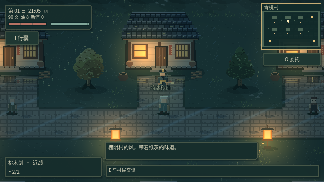
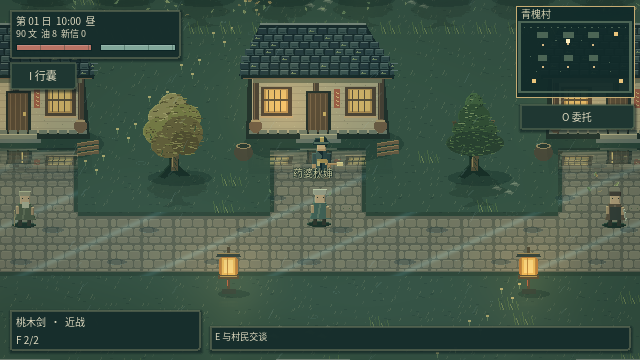
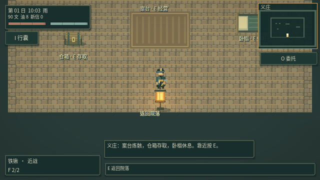
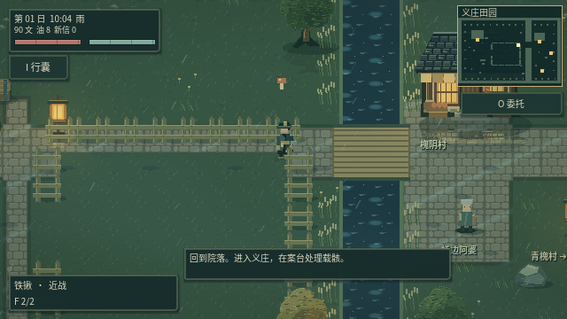
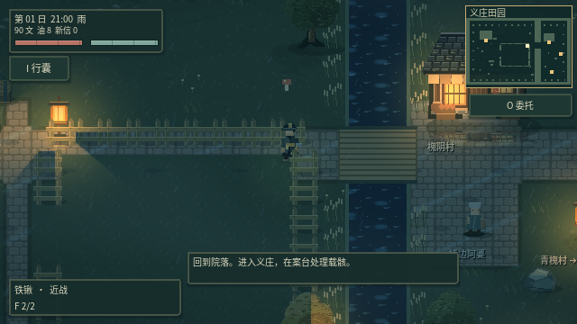

# v0.15：HD-2D 方向的风雨、光照与场景细化

参考《八方旅人》的像素人物、光影层次、前后景分离与气氛表达，继续细化现有可游玩的俯视场景。本轮采用原创像素素材、2D 几何遮挡光场与分层后处理；没有引入原作素材，也没有把概念图替代成静态地图。

## 先看实机动图

下图是 Godot 运行时连续截取的 36 帧，展示风摆、雨线、落叶与水花。点击图片可单独打开。

## 前后对比

| v0.14 晴夜 | v0.15 雨夜 |
| --- | --- |
|  |  |

同一青槐村庭院，分别展示旧版晴夜和本轮雨夜；拍摄时角色位置有小幅差异。

## 光照与空间层次

- **遮挡光场**：灯与窗光按地图碰撞轮廓生成可见区域，墙体、树干、围栏会截断光线；水体阻挡行走，但不会被误当成不透光墙。光源自身灯柱也不会错误地遮住整片地面。
- **暖窗与冷雨**：夜间冷色环境与暖色灯火分开计算，加入克制光晕、昼夜色温和雨天环境压暗。建筑附近保留亮暗分区，角色周围略微保留可读亮度。
- **景深气氛**：晴天有轻微斜向光束，户外雾层缓慢移动；画面极边缘使用很弱的离焦处理，角色附近和 HUD 保持清楚。这里的离焦是 2D 屏幕层次处理，未转换为原作的三维摄像机场景。
- **投影**：树冠投影与树身共享风的时钟，建筑增加浅层方向投影，方向随日间时段变化；砍伐后移除对应阴影。

## 雨水与湿地

- 远近雨线有不同速度与长度，方向随风改变；屋檐产生短滴水线。
- 雨滴落在可行走露天地面上形成水花与涟漪；走过湿地时产生脚步涟漪。室内没有户外雨线、落叶与水花。
- 石路随降雨变湿，出现浅积水、高光与反射。房屋、纸灯和树木使用对应精灵的镜像，并按实际地块遮罩裁切，加入衰减与波纹扰动；不是绘制固定倒影图案。
- 河流持续产生细小波纹与水面闪光。雨停时雨线逐渐减弱，湿地缓慢干燥；从其他地图进入正在下雨的区域时，会保留合理的湿润外观。

## 风、树木与落叶

- 重新细化树皮、分叉枝干、树冠叶簇与顶侧明暗，加入阔叶、秋色与针叶三种树冠。
- 树冠使用顶端强、根部弱的风摆，树根和碰撞位置保持固定。草簇、芦苇与落叶共享环境风，雨天风势更强。
- 落叶从视野附近的真实树木生成，有高度、漂移、翻转、下落和落地停留过程；不是贴在屏幕上的循环图案。
- 角色走进树冠下方时，树冠逐渐半透明，避免遮住战斗和交互。青槐村补充了四处树木，并验证村民与原有路线可以正常通行。

## 人物与建筑细化

- 主角源帧改为 32×48，细化衣袍与步行比例，保持脚底和操作碰撞坐标。
- 主角、村民与 23 类敌人补充边缘明暗和颜色层次，受击闪白继续生效；潮湿时材质略有变化。
- 屋顶增加瓦沟、苔痕和破损变化，墙面增加旧化纹理，屋檐下增加压暗层。仍保留现有门口、交易、委托和地图出入口。

## 性能与兼容

静态遮挡轮廓缓存，砍树或新增摆件才重建；倒影按视野显示，光场通过独立小尺寸视口合成。落叶上限 54、水花上限 90，避免持续积累。环境动态随游戏暂停冻结。

保留 Godot GL Compatibility 渲染与 640×360 逻辑画布。存档格式继续为版本 10；风、波纹、落叶等是临时视觉状态，不修改角色成长、战斗数值或旧存档结构。

## 验证

- 16 套完整游戏回归共 **721 项检查通过**，主场景正常启动。
- 最新图形专项 **65 项通过**，包含 5 张截图、36 帧连续实机动画和动态时钟验证。
- 验证光线遮挡、光场与游戏物理隔离、湿地遮罩、真实反射来源、树干固定、落叶上限、暂停冻结、砍树缓存失效、室内干燥与存档恢复。
- `python3 scripts/generate_art16.py` 可重复生成 30 张原创素材图集；`python3 scripts/test_game.py` 运行全部回归。

## 更多实机画面

